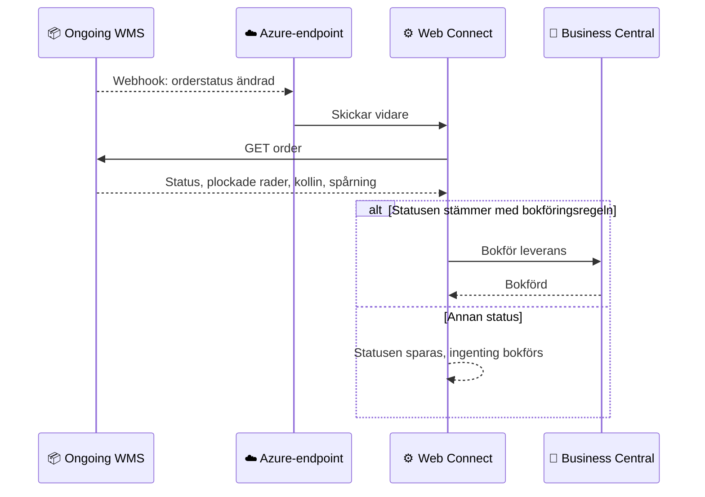

# Från Ongoing WMS till Business Central: leveranser

När lagret skickar en order skickar Ongoing WMS en webhook. Web Connect hämtar ordern från Ongoing med plockade antal, kollin och spårning, och bokför leveransen i Business Central när ordern har den status du har valt.

| | |
|---|---|
| **Riktning** | Ongoing WMS → Business Central |
| **Startas av** | En webhook från Ongoing när orderstatusen ändras. Statusen kan också hämtas enligt schema från jobbkön |
| **Resultat** | En bokförd försäljningsleverans (eller flyttleverans) i Business Central med de plockade antalen |
| **Del av** | [Business Central och Ongoing WMS: integration](../overview.md) |

## Steg för steg

1. Orderstatusen ändras i Ongoing, till exempel när ordern skickas (Ongoing).
2. Ongoing anropar webhooken. Azure-endpointen skickar anropet vidare till Web Connect (Ongoing, Azure).
3. Web Connect hämtar ordern från `orders/?goodsOwnerId=…&orderNumber=…` (Web Connect).
4. Status, plockade antal per rad, kollinummer och spårningslänkar skrivs till lagerdokumentet (Web Connect).
5. Stämmer statusen med den status som är inställd i logistikinställningarna bokförs leveransen. Rader utan lagersaldo, till exempel frakt, bokförs tillsammans med den (Business Central).

## Mappning av data

| Fält i Ongoing | Fält i Business Central | Kommentar |
|---|---|---|
| `orderInfo.orderStatus.text` | Status på lagerdokumentet | Jämförs med bokföringsregeln |
| `orderLines.pickedNumberOfItems` | Antal att leverera | Per rad |
| `orderLines.externalId` | Radnummer | Matchar raden som skickades med ordern |
| `parcels.parcelNumber` | Kollinummer på lagerdokumentet | Kan också skrivas till Package Tracking No. på försäljningsordern |
| `parcels.tracking.trackingUrl` | Spårningslänk på lagerdokumentet | |
| `orderInfo.orderId` | Ongoings order-id | |

## Objekt i Web Connect

| Objekt | Roll |
|---|---|
| `ONGOING-OUTSTATUSCHANGE` | Tar emot webhooken och startar hämtningen |
| `ONGOING-OUTSTATUS` | Hämtar ordern och dess status från Ongoing |
| `ONGOING-STATUS-ORDERLINES` | Plockade antal per rad |
| `ONGOING-PARCELS` | Kollin och spårning |

## Felhantering

| Situation | Vad som händer | Gör så här |
|---|---|---|
| Leveransen kan inte bokföras, till exempel på grund av en spärrad artikel eller en inställning som saknas | Felet loggas på lagerdokumentet, och Web Connect försöker igen upp till maxantalet i logistikinställningarna | Rätta orsaken och bearbeta dokumentet igen |
| Inga webhooks kommer in | Leveranser bokförs inte | Leta efter inkommande meddelanden i Entries. Be 3PL:en kontrollera webhooken på varuägaren i Ongoing |
| Statustexten i Ongoing stämmer inte med bokföringsregeln | Statusen sparas, men ingenting bokförs | Ändra statusen i bokföringsregeln |

## Vanliga frågor

### Vid vilken status i Ongoing bokförs leveransen?

Vid den status du har ställt in i logistikinställningarna, till exempel Sent. Statustexten kommer från 3PL:ens Ongoing-system och kan skilja sig mellan 3PL-lager, så den kontrolleras när integrationen sätts upp.

## Relaterat

- [Business Central och Ongoing WMS: integration](../overview.md)
- [Utleveransorder](order-outbound.md) · [Orderändringar och makuleringar](order-change-cancellation.md)
- [Webhooks](../../../general/webhooks.md) · [Logistics Setup](../../../general/logistics-setup.md)
