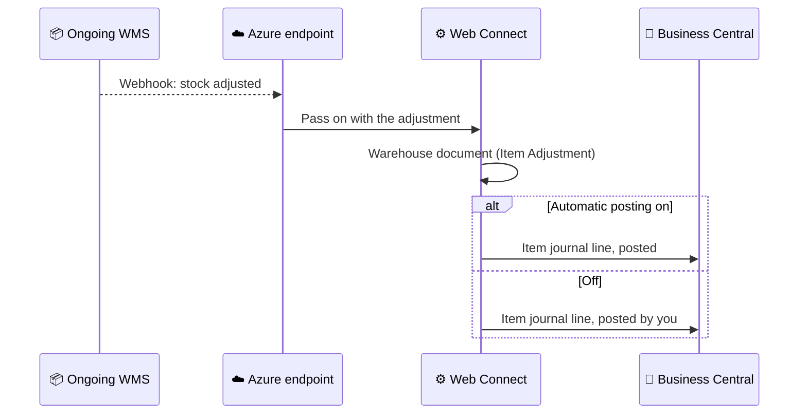

# Ongoing WMS to Business Central: stock adjustments

When the warehouse adjusts stock in Ongoing WMS, for example after a count or for damaged goods, Ongoing sends a webhook. Web Connect writes the change to an item journal in Business Central and posts it, or leaves it for you to review and post.

| | |
|---|---|
| **Direction** | Ongoing WMS → Business Central |
| **Trigger** | Webhook from Ongoing when stock is adjusted |
| **Result** | An item journal line in Business Central, posted if automatic posting is on |
| **Part of** | [Business Central and Ongoing WMS integration](../overview.md) |

## Step by step

1. Stock is adjusted in Ongoing (Ongoing).
2. Ongoing calls the webhook with the article, the change and the transaction. The Azure endpoint passes the call on to Web Connect (Ongoing, Azure).
3. Web Connect creates a warehouse document of type Item Adjustment from the message (Web Connect).
4. The change is written to the item journal template and batch set in the logistics setup, and posted if automatic posting is on (Business Central).

## Data mapping

| Ongoing field | Business Central field | Note |
|---|---|---|
| `webhookEventId` | Warehouse document reference | One document per webhook event |
| `system` | Logistics code | The Ongoing system name is translated to the logistics setup with a text mapping |
| `article` | Item No. | |
| `inventory` | Quantity on the journal line | The change in stock |
| `transaction` | Reason for the change | [ATT FYLLA I: vilka fält från transaktionen som hamnar på journalraden] |

## Web Connect objects

| Object | Role |
|---|---|
| `ONGOING-ITEMADJUSTMENT` | Receives the webhook and creates the adjustment |
| `ONGOING-ARTICLE3`, `ONGOING-INVENTORY`, `ONGOING-TRANSACTION` | Article, stock change and transaction in the message |

## Error handling

| Situation | What happens | What to do |
|---|---|---|
| The Ongoing system name is not in the text mapping | The adjustment cannot be linked to the logistics setup | Add the system name to the mapping `ONGOING-SYSTEM-TO-LOGISTICSCOD` |
| The journal line cannot be posted, for example for a blocked item | The line stays in the journal | Correct the cause and post the journal |

## Frequently asked questions

### Do we have to post stock adjustments from Ongoing ourselves?

Only if you want to. Automatic posting is a setting in the logistics setup. With it on, each adjustment is posted as soon as it arrives. With it off, adjustments wait in the item journal until you post them.

## Related

- [Business Central and Ongoing WMS integration](../overview.md)
- [Stock reconciliation](stock-reconciliation.md)
- [Webhooks](../../../general/webhooks.md) · [Text Mapping](../../../general/text-mapping.md)
