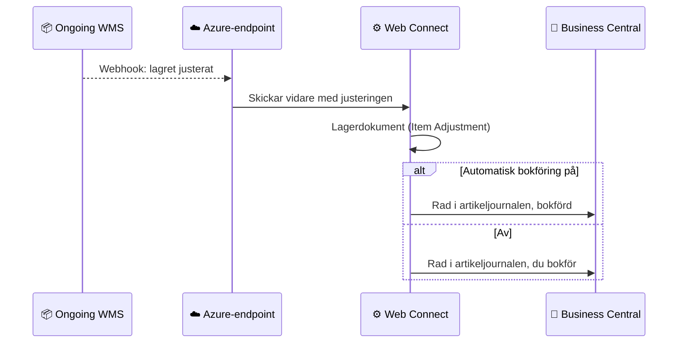

# Från Ongoing WMS till Business Central: lagerjusteringar

När lagret justerar lagersaldot i Ongoing WMS, till exempel efter en inventering eller för skadade varor, skickar Ongoing en webhook. Web Connect skriver ändringen till en artikeljournal i Business Central och bokför den, eller lämnar den åt dig att granska och bokföra.

| | |
|---|---|
| **Riktning** | Ongoing WMS → Business Central |
| **Startas av** | En webhook från Ongoing när lagret justeras |
| **Resultat** | En rad i artikeljournalen i Business Central, bokförd om automatisk bokföring är på |
| **Del av** | [Business Central och Ongoing WMS: integration](../overview.md) |

## Steg för steg

1. Lagersaldot justeras i Ongoing (Ongoing).
2. Ongoing anropar webhooken med artikeln, ändringen och transaktionen. Azure-endpointen skickar anropet vidare till Web Connect (Ongoing, Azure).
3. Web Connect skapar ett lagerdokument av typen Item Adjustment från meddelandet (Web Connect).
4. Ändringen skrivs till den journalmall och journal som är inställda i logistikinställningarna, och bokförs om automatisk bokföring är på (Business Central).

## Mappning av data

| Fält i Ongoing | Fält i Business Central | Kommentar |
|---|---|---|
| `webhookEventId` | Lagerdokumentets referens | Ett dokument per webhookhändelse |
| `system` | Logistikkod | Namnet på Ongoing-systemet översätts till logistikinställningarna med en textmappning |
| `article` | Item No. | |
| `inventory` | Antal på journalraden | Ändringen i lagersaldot |

## Objekt i Web Connect

| Objekt | Roll |
|---|---|
| `ONGOING-ITEMADJUSTMENT` | Tar emot webhooken och skapar justeringen |
| `ONGOING-ARTICLE3`, `ONGOING-INVENTORY`, `ONGOING-TRANSACTION` | Artikel, lagerändring och transaktion i meddelandet |

## Felhantering

| Situation | Vad som händer | Gör så här |
|---|---|---|
| Namnet på Ongoing-systemet finns inte i textmappningen | Justeringen kan inte kopplas till logistikinställningarna | Lägg till systemnamnet i mappningen `ONGOING-SYSTEM-TO-LOGISTICSCOD` |
| Journalraden kan inte bokföras, till exempel för en spärrad artikel | Raden ligger kvar i journalen | Rätta orsaken och bokför journalen |

## Vanliga frågor

### Måste vi själva bokföra lagerjusteringarna från Ongoing?

Bara om ni vill. Automatisk bokföring är en inställning i logistikinställningarna. När den är på bokförs varje justering så fort den kommer in. När den är av väntar justeringarna i artikeljournalen tills du bokför dem.

## Relaterat

- [Business Central och Ongoing WMS: integration](../overview.md)
- [Lageravstämning](stock-reconciliation.md)
- [Webhooks](../../../general/webhooks.md) · [Text Mapping](../../../general/text-mapping.md)
