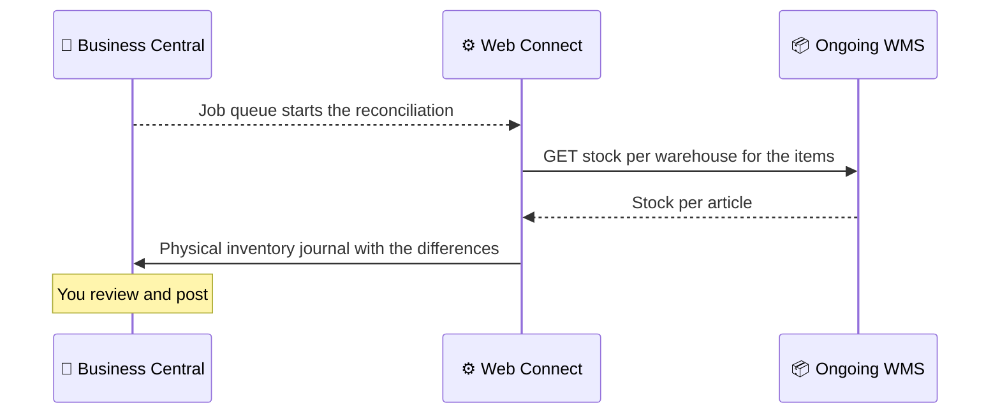

# Ongoing WMS to Business Central: stock reconciliation

On a schedule in the Business Central job queue, usually at night, Web Connect reads the stock per item and warehouse from Ongoing WMS. Differences against Business Central are put in a physical inventory journal, where you review them and post. It catches anything the other flows missed.

| | |
|---|---|
| **Direction** | Ongoing WMS → Business Central |
| **Trigger** | Schedule in the Business Central job queue |
| **Result** | A physical inventory journal in Business Central with the differences |
| **Part of** | [Business Central and Ongoing WMS integration](../overview.md) |

## Step by step

1. The job queue starts the reconciliation (Business Central).
2. Web Connect selects the inventory items and asks Ongoing for their stock, either per warehouse with `articles/inventoryPerWarehouse` or per article with `articles` (Web Connect).
3. Ongoing returns the stock per article (Ongoing).
4. The quantities are written to the physical inventory journal set in the logistics setup. Lines without a difference can be cleared (Business Central).
5. You review the journal and post it (you).

## Data mapping

| Ongoing field | Business Central field | Note |
|---|---|---|
| Article number | Item No. | Only inventory items are included |
| Stock per warehouse | Physical quantity on the journal line | |

## Web Connect objects

| Object | Role |
|---|---|
| `ONGOING-INVENTORY-PER-WAREHOUSE` | Reads stock per warehouse from Ongoing |
| `ONGOING-BALANCE` | Reads stock per article from Ongoing. Used instead of stock per warehouse in two of five configurations |
| `ONGOING-MOVEMENTCHANGE` | Receives a webhook when goods move in Ongoing and fetches the stock for that article. Used together with `ONGOING-BALANCE` |

## Error handling

| Situation | What happens | What to do |
|---|---|---|
| The job queue entry is not running | No reconciliation is made | See [Integrations not running](../../../../../how-to/web-connect/integration-not-running.md) |
| Large differences in the journal | Nothing is posted until you post | Check shipments, receipts and adjustments in Entries before you post |

## Frequently asked questions

### Is the stock in Business Central overwritten with the stock in Ongoing?

No. Differences are put in a physical inventory journal, and nothing changes until you post it. In the Ongoing configurations, the journal is never posted automatically.

## Related

- [Business Central and Ongoing WMS integration](../overview.md)
- [Stock adjustments](stock-adjustment.md)
- [Item Inventory](../../../general/item-inventory.md) · [Logistics Setup](../../../general/logistics-setup.md)
