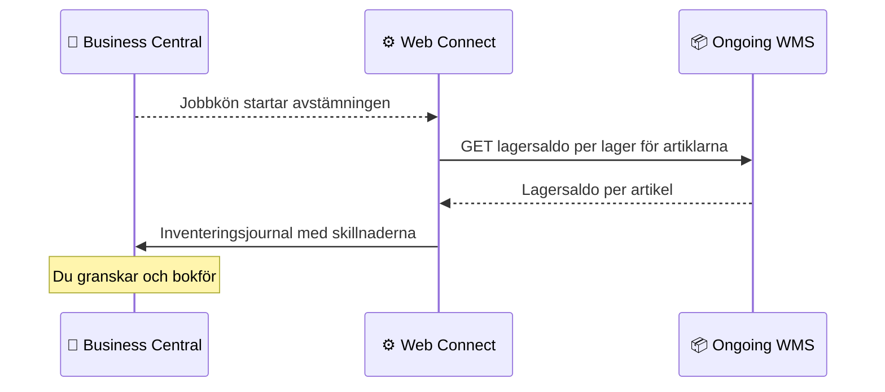

# Från Ongoing WMS till Business Central: lageravstämning

Enligt ett schema i jobbkön i Business Central, oftast på natten, läser Web Connect lagersaldot per artikel och lager från Ongoing WMS. Skillnader mot Business Central läggs i en inventeringsjournal, där du granskar dem och bokför. Avstämningen fångar det som de andra flödena har missat.

| | |
|---|---|
| **Riktning** | Ongoing WMS → Business Central |
| **Startas av** | Ett schema i jobbkön i Business Central |
| **Resultat** | En inventeringsjournal i Business Central med skillnaderna |
| **Del av** | [Business Central och Ongoing WMS: integration](../overview.md) |

## Steg för steg

1. Jobbkön startar avstämningen (Business Central).
2. Web Connect väljer ut lagerartiklarna och frågar Ongoing efter deras lagersaldo, antingen per lager med `articles/inventoryPerWarehouse` eller per artikel med `articles` (Web Connect).
3. Ongoing svarar med lagersaldot per artikel (Ongoing).
4. Antalen skrivs till den inventeringsjournal som är inställd i logistikinställningarna. Rader utan skillnad kan rensas bort (Business Central).
5. Du granskar journalen och bokför den (du).

## Mappning av data

| Fält i Ongoing | Fält i Business Central | Kommentar |
|---|---|---|
| Artikelnummer | Item No. | Bara lagerartiklar tas med |
| Lagersaldo per lager | Inventerat antal på journalraden | |

## Objekt i Web Connect

| Objekt | Roll |
|---|---|
| `ONGOING-INVENTORY-PER-WAREHOUSE` | Läser lagersaldot per lager från Ongoing |
| `ONGOING-BALANCE` | Läser lagersaldot per artikel från Ongoing. Används i stället för lagersaldo per lager i två av fem konfigurationer |
| `ONGOING-MOVEMENTCHANGE` | Tar emot en webhook när varor flyttas i Ongoing och hämtar lagersaldot för den artikeln. Används tillsammans med `ONGOING-BALANCE` |

## Felhantering

| Situation | Vad som händer | Gör så här |
|---|---|---|
| Posten i jobbkön körs inte | Ingen avstämning görs | Se [Integrationer körs inte](../../../../../how-to/web-connect/integration-not-running.md) |
| Stora skillnader i journalen | Ingenting bokförs förrän du bokför | Kontrollera leveranser, inleveranser och justeringar i Entries innan du bokför |

## Vanliga frågor

### Skrivs lagersaldot i Business Central över med lagersaldot i Ongoing?

Nej. Skillnaderna läggs i en inventeringsjournal, och ingenting ändras förrän du bokför den. I Ongoing-konfigurationerna bokförs journalen aldrig automatiskt.

## Relaterat

- [Business Central och Ongoing WMS: integration](../overview.md)
- [Lagerjusteringar](stock-adjustment.md)
- [Item Inventory](../../../general/item-inventory.md) · [Logistics Setup](../../../general/logistics-setup.md)
