# Business Central and Ongoing WMS integration

Web Connect by CombineIT connects Microsoft Dynamics 365 Business Central with Ongoing WMS, the warehouse management system many Nordic 3PL warehouses run. Items, sales orders, purchase orders and returns are sent from Business Central to Ongoing, and shipments, receipts and stock changes come back and are posted in Business Central. All mappings and rules live in your own Business Central, where you can see and change them yourself.

## At a glance

| | |
|---|---|
| **System** | Ongoing WMS (warehouse management system, usually run by a 3PL) |
| **Integration product** | Web Connect for Microsoft Dynamics 365 Business Central |
| **Runs in** | Your own Business Central environment, as an extension. Documents are sent to Ongoing when they are released in Business Central. Ongoing reports status changes and stock adjustments with webhooks: an Azure endpoint receives each call and passes it on to Web Connect, which fetches the details from Ongoing. A stock check runs from the Business Central job queue. All processing and configuration stays in Business Central. |
| **Configured by** | You, in Business Central: mappings, conditions, triggers and flows. You can do all of it yourself. If you want, CombineIT takes part in any step, as a sounding board or by doing the work. |
| **Connection** | Ongoing REST API and webhooks, with Basic authentication |
| **Ongoing API** | [Ongoing WMS REST API](https://developer.ongoingwarehouse.com/REST/v1/index.html) and [Ongoing webhooks](https://developer.ongoingwarehouse.com/webhooks) |
| **Data flows** | 9: items, outbound orders, order changes and cancellations, shipments, purchase orders, receipts, returns, stock adjustments and stock reconciliation |
| **Business Central editions** | All editions, Essentials and Premium, including the latest version |
| **Available from** | [Web Connect on Microsoft AppSource](https://marketplace.microsoft.com/sv-se/product/PUBID.martitab1633951001710%7CAID.webconnect%7CPAPPID.9f3a7223-19db-4ac7-832f-cf8e4699186f?tab=Overview). |

## What can be synchronized

Web Connect has nine data flows between Business Central and Ongoing WMS.

| Data | Direction | What happens |
|---|---|---|
| [Items](flows/items.md) | Business Central → Ongoing | Items are created or updated as articles in Ongoing |
| [Outbound orders](flows/order-outbound.md) | Business Central → Ongoing | A released sales order, or a transfer order, is sent to Ongoing as an outbound order |
| [Order changes and cancellations](flows/order-change-cancellation.md) | Business Central → Ongoing | The order status in Ongoing is updated when the order changes in Business Central, and a cancelled order is removed from Ongoing |
| [Shipments](flows/shipment.md) | Ongoing → Business Central | When the order is shipped in Ongoing, the shipment is posted in Business Central with picked quantities and tracking |
| [Purchase orders](flows/purchase-order.md) | Business Central → Ongoing | A released purchase order is sent to Ongoing as an inbound order |
| [Receipts](flows/receipt.md) | Ongoing → Business Central | Received quantities come back from Ongoing, and the receipt can be posted automatically |
| [Returns](flows/returns.md) | Business Central ↔ Ongoing | A sales return order is sent to Ongoing as a return order or inbound order, and the return receipt is posted when the goods arrive |
| [Stock adjustments](flows/stock-adjustment.md) | Ongoing → Business Central | Adjustments made in the warehouse are written to an item journal in Business Central |
| [Stock reconciliation](flows/stock-reconciliation.md) | Ongoing → Business Central | Stock per item is read from Ongoing and differences are put in a physical inventory journal |

Items, outbound orders, shipments, stock adjustments and stock reconciliation are part of every Ongoing integration. The other flows are chosen when the integration is set up. See [Choose your setup](#choose-your-setup).

## How it works

Ongoing is usually run by a 3PL, and your company is a goods owner in the 3PL's Ongoing system. Web Connect uses the [WMS documents](../../general/wms-documents.md) in Business Central: when a sales order, transfer order or purchase order is released for the integrated location, a warehouse document is created and sent to Ongoing. When something happens in the warehouse, Ongoing calls a webhook. An Azure endpoint receives the call and passes it on to Web Connect, which fetches the order or purchase order from Ongoing and posts the shipment or receipt in Business Central. Stock adjustments arrive the same way and are written to an item journal. Every message in both directions is logged in Web Connect [Entries](../../general/entries.md), where it can be inspected and resent.

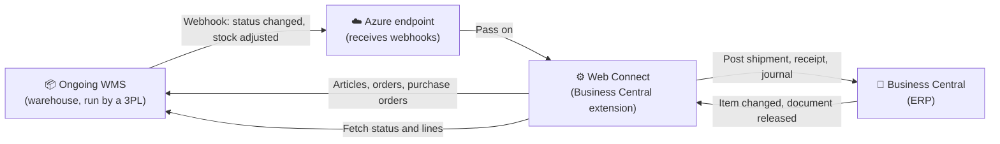

### Order status in Business Central

Each document sent to Ongoing has a warehouse document in Web Connect that follows the order through the warehouse. The status texts come from Ongoing and can differ between 3PLs, which is why the status that triggers posting is set in the [logistics setup](../../general/logistics-setup.md).

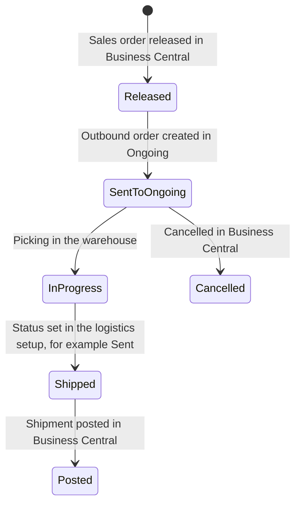

## Choose your setup

Each flow has to fit how your business works: which system owns the data, where people do their work, and what the accounting needs. That is why the flows are decided together when a new integration is set up. The options below are the ones found in the five Web Connect configurations for Ongoing today. **Common setup** marks the option at least three of them use. **Recommended** marks CombineIT's best practice, where there is one.

### Outbound orders

| Option | How it works | When it fits |
|---|---|---|
| **Sent when the sales order is released** (common setup) | Releasing the sales order in Business Central creates the outbound order in Ongoing. Lines without stock, such as freight, are not sent, but they are posted together with the shipment | Business Central is where orders are handled, for example from a web shop integration |
| **Sent with Send to Warehouse** | The sales order is released as usual, but nothing is sent until someone chooses the action Send to Warehouse on the order | You want to decide yourself when each order goes to the warehouse |
| **Sales orders and transfer orders** (common setup) | Transfer orders from the integrated location are also sent to Ongoing as outbound orders | You have more than one location in Business Central, and goods move between them |

#### Outbound orders sent when the sales order is released

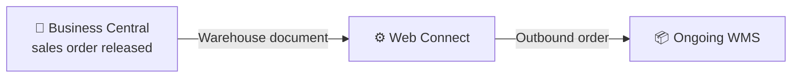

#### Outbound orders sent with Send to Warehouse

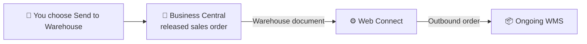

#### Outbound orders for sales orders and transfer orders

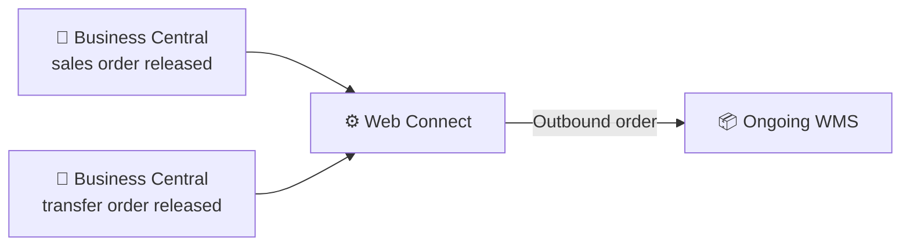

### Order changes and cancellations

| Option | How it works | When it fits |
|---|---|---|
| **Status follows the sales order** (common setup) | When the sales order is reopened or released again in Business Central, Web Connect updates the order status in Ongoing, so the warehouse knows whether the order may be picked. Cancelling the order in Business Central removes it from Ongoing | Customer service changes orders after they are released |
| **Whole order cancellation only** | A cancelled order is removed from Ongoing. Other changes are made by the warehouse | Orders are rarely changed after release |

Cancellation applies to the whole order in four of five configurations. One configuration allows selected lines to be cancelled.

#### Order status follows the sales order

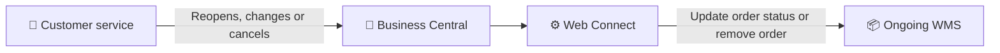

#### Whole order cancellation only

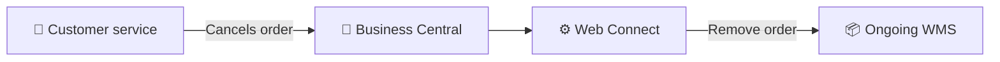

### Receipts

| Option | How it works | When it fits |
|---|---|---|
| **Posted automatically** (common setup) | When the purchase order gets a status set in the logistics setup, for example Lagerlagd or Avvikelse, the received quantities are posted as a receipt in Business Central | The warehouse's received quantities can be trusted without a manual check |
| **Registered, posted by you** | Received quantities are written to the purchase order, and you post the receipt yourself | You want to check deviations before anything is posted |

#### Receipts posted automatically

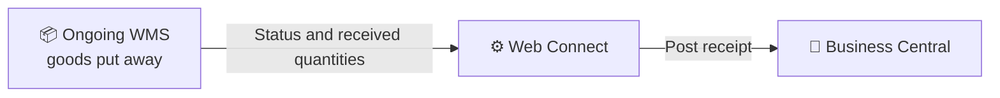

#### Receipts registered, posted by you

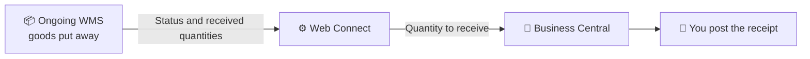

### Returns

| Option | How it works | When it fits |
|---|---|---|
| **Not integrated** | Returns are handled outside the integration | Few returns, or returns go to another location |
| **Return order in Ongoing, linked to the original order** | The sales return order is created in Business Central from the posted shipment or invoice and sent to Ongoing as a return order, with the Ongoing ID of the original order and its lines. When the goods are received, the return receipt is posted in Business Central | Every order ships from Ongoing, and you want the warehouse to see which order the return belongs to |
| **Inbound order in Ongoing** (recommended) | The sales return order is sent to Ongoing as an inbound order, the same way as a purchase order. When the goods are received, the return receipt is posted in Business Central | Some orders ship from another warehouse or are drop shipped, so Ongoing cannot link the return to an order |

CombineIT recommends inbound orders as the standard, because Ongoing does not accept return orders on orders that were not shipped from Ongoing. Two of five configurations send returns as inbound orders in production. Return orders linked to the original order are set up in a test environment so far.

#### Returns not integrated

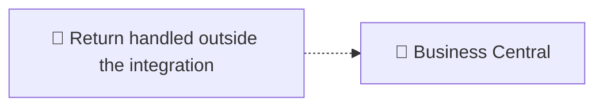

#### Returns as return orders in Ongoing

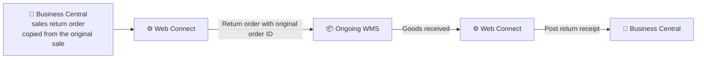

#### Returns as inbound orders in Ongoing

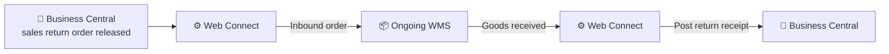

### Stock adjustments

| Option | How it works | When it fits |
|---|---|---|
| **Posted automatically** (common setup, recommended) | Each adjustment from Ongoing is written to the item journal and posted | You want Business Central stock to follow the warehouse without a manual step |
| **Written to the journal, posted by you** | Adjustments are collected in the item journal, and you post it | You want to review adjustments before they affect stock value |

#### Stock adjustments posted automatically

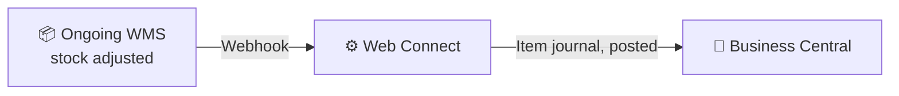

#### Stock adjustments posted by you

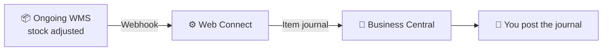

### Item data

| Option | How it works | When it fits |
|---|---|---|
| **All item data from Business Central** (common setup) | Item number, name, purchase price, country of origin, tariff number, dimensions, weights and barcodes are sent from Business Central | Business Central owns the item data |
| **Basic data from Business Central, the rest from a PIM** | Business Central sends item number, name and the trade data. Dimensions, weights, barcodes and translated names are left out, so Business Central does not overwrite what a PIM loads into Ongoing | You maintain logistics data in a PIM |

#### All item data from Business Central

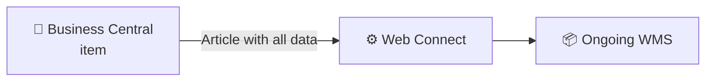

#### Basic item data from Business Central, the rest from a PIM

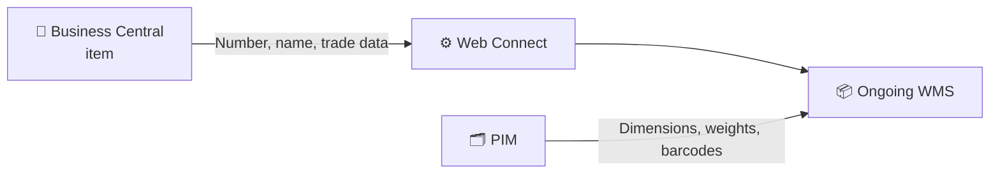

Warehouse locations, picking, packing, carrier booking and the 3PL's own article settings are always maintained in Ongoing.

## What you need

- Microsoft Dynamics 365 Business Central, any edition, including the latest version
- Web Connect installed from Microsoft AppSource, with an activated Web Connect license
- Your approval for Web Connect to be installed and to act in your Business Central environment
- Web Connect added as a Microsoft Entra application in Business Central, with consent granted by your Entra administrator. Webhooks from Ongoing cannot reach Business Central without it
- An API user in the 3PL's Ongoing system for your goods owner, and your goods owner ID. Both come from the 3PL
- A location in Business Central for the warehouse the 3PL runs, a number series for warehouse documents, and an item journal template with one batch for stock adjustments and one for the stock reconciliation
- Webhooks registered on your goods owner in Ongoing for order status, purchase order status and stock adjustments. CombineIT sets these up together with the 3PL

## Setting it up

1. Decide which flows to use and which option to choose for each, see [Choose your setup](#choose-your-setup).
2. Install Web Connect in Business Central, activate the license and give your approval. Add Web Connect as a Microsoft Entra application and have your administrator grant consent.
3. Import the Ongoing configuration with the integration turned off, then set your location, goods owner, Ongoing system and journal batches.
4. Enter the 3PL's API user for your goods owner in the Web Connect authentication setup.
5. Register the webhooks in Ongoing and set the status values that trigger posting in the [logistics setup](../../general/logistics-setup.md).
6. Test items, orders and purchase orders in a Business Central sandbox against the 3PL's Ongoing test environment before going live.

## Configure it yourself in Business Central

All configuration and logic in the integration is visible and editable in Business Central. There is no external integration platform where the logic is hidden. The Azure endpoint that receives webhooks only passes the call on to Web Connect.

| What you can change | Where in Web Connect | Example |
|---|---|---|
| Which documents are integrated | [Logistics Setup](../../general/logistics-setup.md) | Send sales orders and purchase orders, and add transfer orders or sales returns |
| When shipments and receipts are posted | [Logistics Setup](../../general/logistics-setup.md) | Post the shipment when the order status in Ongoing is Sent, and the receipt when the purchase order is Lagerlagd or Avvikelse |
| What is sent to Ongoing | [Outgoing Mapping](../../general/outgoing-mapping/outgoing-sync-triggers.md) | Remove weights and barcodes from the article if a PIM owns them |
| What triggers an item update | [Outgoing Sync Triggers](../../general/outgoing-mapping/outgoing-sync-triggers.md) | Resend the article when name, tariff number or country of origin changes |
| Fields on the order header | [WMS documents](../../general/wms-documents.md) | Send the shipment method as way of delivery |
| How Ongoing values are translated | [Text Mapping](../../general/text-mapping.md) | Translate the order status in Business Central to the status number in Ongoing |
| Monitoring and resending | [Entries](../../general/entries.md) | See every order and status message, and [resend a message](../../../../how-to/web-connect/resend-outgoing-message.md) |

## Configuration choices

- **Location:** which Business Central location the 3PL runs. Only documents for that location are sent to Ongoing.
- **Document types:** sales orders, purchase orders, transfer orders and sales returns are switched on one by one.
- **Posting rules:** whether shipments, receipts, returns and stock adjustments are posted automatically, and at which Ongoing status.
- **Lines without stock:** whether freight and other service lines are sent to Ongoing, and whether they are posted with the shipment.
- **Item data:** which item fields are sent, and in which currency the purchase price is shown in Ongoing.
- **Cancellation:** whether cancellation applies to the whole order or to selected lines.
- **Error handling:** how many times a failed message is retried, and who receives error emails.

## Limitations

- **Ongoing only accepts a return order when the original order was shipped from Ongoing.** If some orders ship from another warehouse or are drop shipped, returns are sent as inbound purchase orders instead.
- **The status texts that trigger posting differ between 3PLs.** They are set per integration, and a wrong value means nothing is posted.
- **Receipts and shipments depend on webhooks from Ongoing.** If a webhook stops, Business Central is not told about the change. Status can be fetched manually for a single document.
- **Orders the warehouse has started on cannot be cancelled.** When an order has come further than allocated in Ongoing, Ongoing returns an error when you choose Send Cancel to Warehouse, and the order stays in Ongoing. Contact the warehouse to stop it.
- **The stock reconciliation journal is not posted automatically.** Differences are put in a physical inventory journal for you to review and post.

## Frequently asked questions

### Can Business Central be integrated with Ongoing WMS?

Yes. Web Connect connects Business Central with Ongoing WMS through the Ongoing REST API. Items, sales orders, transfer orders, purchase orders and returns are sent to Ongoing, and shipments, receipts, stock adjustments and a nightly stock check come back to Business Central.

### Our 3PL runs Ongoing. Does the integration work with any 3PL on Ongoing?

Yes. Each 3PL has its own Ongoing system, and your company is a goods owner in it. Web Connect connects to the 3PL's Ongoing system with an API user for your goods owner, which the 3PL creates.

### Why is a purchase order not received in Business Central although the warehouse has put the goods away?

Web Connect only posts the receipt when the purchase order gets one of the statuses set in the logistics setup, for example Lagerlagd or Avvikelse. Ongoing tells Web Connect about the status change with a webhook. If the webhook from Ongoing has stopped, nothing is received. Check Web Connect Entries for incoming status messages, and ask the 3PL to check the webhook in Ongoing.

### Can we send a customer return to Ongoing?

Yes. A sales return order in Business Central can be sent to Ongoing as a return order linked to the original order. Ongoing only accepts a return order when the original order was shipped from Ongoing, so returns can also be sent as an inbound order. When the warehouse receives the goods, the return receipt is posted in Business Central.

### Can we change what is sent between Business Central and Ongoing ourselves?

Yes. Field mappings, status rules, triggers and which document types are integrated are configured in Web Connect inside your own Business Central. You can see and change them without asking a supplier to change an external platform.

## Related

- Flows: [Items](flows/items.md) · [Outbound orders](flows/order-outbound.md) · [Order changes and cancellations](flows/order-change-cancellation.md) · [Shipments](flows/shipment.md) · [Purchase orders](flows/purchase-order.md) · [Receipts](flows/receipt.md) · [Returns](flows/returns.md) · [Stock adjustments](flows/stock-adjustment.md) · [Stock reconciliation](flows/stock-reconciliation.md)
- How-to: [WMS request not sent](../../../../how-to/web-connect/wms-request-not-sent-error.md) · [Resend an outgoing message](../../../../how-to/web-connect/resend-outgoing-message.md) · [Integrations not running](../../../../how-to/web-connect/integration-not-running.md)
- Web Connect: [Logistics Setup](../../general/logistics-setup.md) · [WMS documents](../../general/wms-documents.md) · [Webhooks](../../general/webhooks.md) · [WMS return reason codes](../../general/wms-return-reason-codes.md)
- [Web Connect general documentation](../../general/README.md)
- [Ongoing WMS REST API documentation](https://developer.ongoingwarehouse.com/REST/v1/index.html)

## About Web Connect

Web Connect is an integration platform for Microsoft Dynamics 365 Business Central, developed by CombineIT. It is installed in your own Business Central and connects it with e-commerce platforms, warehouse systems, POS, returns, marketplaces and EDI. Every flow, mapping and rule is configured in Business Central, where you can see and change it yourself, without custom code for each integration. [Web Connect on Microsoft AppSource](https://marketplace.microsoft.com/sv-se/product/PUBID.martitab1633951001710%7CAID.webconnect%7CPAPPID.9f3a7223-19db-4ac7-832f-cf8e4699186f?tab=Overview) · [Contact CombineIT](https://www.combineit.se/contact/)
