# Business Central och Ongoing WMS: integration

Web Connect från CombineIT kopplar Microsoft Dynamics 365 Business Central till Ongoing WMS, lagersystemet som många nordiska 3PL-lager använder. Artiklar, försäljningsorder, inköpsorder och returer skickas från Business Central till Ongoing, och leveranser, inleveranser och lagerändringar kommer tillbaka och bokförs i Business Central. Alla mappningar och regler finns i ditt eget Business Central, där du själv kan se och ändra dem.

## I korthet

| | |
|---|---|
| **System** | Ongoing WMS (lagersystem som oftast drivs av en 3PL) |
| **Integrationsprodukt** | Web Connect för Microsoft Dynamics 365 Business Central |
| **Körs i** | Din egen Business Central-miljö, som ett tillägg. Dokument skickas till Ongoing när de släpps i Business Central. Ongoing rapporterar statusändringar och lagerjusteringar med webhooks: en Azure-endpoint tar emot varje anrop och skickar det vidare till Web Connect, som hämtar detaljerna från Ongoing. En lagerkontroll körs från jobbkön i Business Central. All bearbetning och konfiguration stannar i Business Central. |
| **Konfigureras av** | Dig, i Business Central: mappningar, villkor, triggers och flöden. Du kan göra allt själv. Om du vill är CombineIT med i vilket steg som helst, som bollplank eller genom att göra jobbet. |
| **Koppling** | Ongoings REST API och webhooks, med Basic-autentisering |
| **Ongoings API** | [Ongoing WMS REST API](https://developer.ongoingwarehouse.com/REST/v1/index.html) och [Ongoing webhooks](https://developer.ongoingwarehouse.com/webhooks) |
| **Dataflöden** | 9: artiklar, utleveransorder, orderändringar och makuleringar, leveranser, inköpsorder, inleveranser, returer, lagerjusteringar och lageravstämning |
| **Business Central-utgåvor** | Alla utgåvor, Essentials och Premium, även den senaste versionen |
| **Finns på** | [Web Connect på Microsoft AppSource](https://marketplace.microsoft.com/sv-se/product/PUBID.martitab1633951001710%7CAID.webconnect%7CPAPPID.9f3a7223-19db-4ac7-832f-cf8e4699186f?tab=Overview). Integrationen med Ongoing WMS ingår inte i appen Web Connect Ready Integrations. Den sätts upp som en konfiguration i Web Connect |

## Det här kan synkas

Web Connect har nio dataflöden mellan Business Central och Ongoing WMS.

| Data | Riktning | Vad som händer |
|---|---|---|
| [Artiklar](flows/items.md) | Business Central → Ongoing | Artiklarna skapas eller uppdateras i Ongoing |
| [Utleveransorder](flows/order-outbound.md) | Business Central → Ongoing | En släppt försäljningsorder, eller en flyttorder, skickas till Ongoing som en utleveransorder |
| [Orderändringar och makuleringar](flows/order-change-cancellation.md) | Business Central → Ongoing | Orderstatusen i Ongoing uppdateras när ordern ändras i Business Central, och en makulerad order tas bort från Ongoing |
| [Leveranser](flows/shipment.md) | Ongoing → Business Central | När ordern har skickats i Ongoing bokförs leveransen i Business Central med plockade antal och spårning |
| [Inköpsorder](flows/purchase-order.md) | Business Central → Ongoing | En släppt inköpsorder skickas till Ongoing som en inleveransorder |
| [Inleveranser](flows/receipt.md) | Ongoing → Business Central | Mottagna antal kommer tillbaka från Ongoing, och inleveransen kan bokföras automatiskt |
| [Returer](flows/returns.md) | Business Central ↔ Ongoing | En försäljningsreturorder skickas till Ongoing som returorder eller inleveransorder, och returinleveransen bokförs när varorna kommer in |
| [Lagerjusteringar](flows/stock-adjustment.md) | Ongoing → Business Central | Justeringar som görs i lagret skrivs till en artikeljournal i Business Central |
| [Lageravstämning](flows/stock-reconciliation.md) | Ongoing → Business Central | Lagersaldot per artikel läses från Ongoing, och skillnader läggs i en inventeringsjournal |

Artiklar, utleveransorder, leveranser, lagerjusteringar och lageravstämning ingår i varje Ongoing-integration. De andra flödena väljs när integrationen sätts upp. Se [Välj upplägg](#choose-your-setup).

## Så fungerar det

Ongoing drivs oftast av en 3PL, och ert företag är en varuägare i 3PL:ens Ongoing-system. Web Connect använder [WMS-dokumenten](../../general/wms-documents.md) i Business Central: när en försäljningsorder, flyttorder eller inköpsorder släpps för det integrerade lagerstället skapas ett lagerdokument som skickas till Ongoing. När något händer i lagret anropar Ongoing en webhook. En Azure-endpoint tar emot anropet och skickar det vidare till Web Connect, som hämtar ordern eller inköpsordern från Ongoing och bokför leveransen eller inleveransen i Business Central. Lagerjusteringar kommer in på samma sätt och skrivs till en artikeljournal. Varje meddelande åt båda hållen loggas i Web Connect [Entries](../../general/entries.md), där det kan granskas och skickas igen.

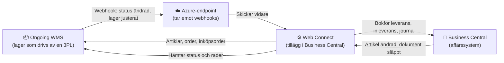

### Orderstatus i Business Central

Varje dokument som skickas till Ongoing har ett lagerdokument i Web Connect som följer ordern genom lagret. Statustexterna kommer från Ongoing och kan skilja sig mellan 3PL-lager. Därför ställs statusen som startar bokföringen in i [logistikinställningarna](../../general/logistics-setup.md).

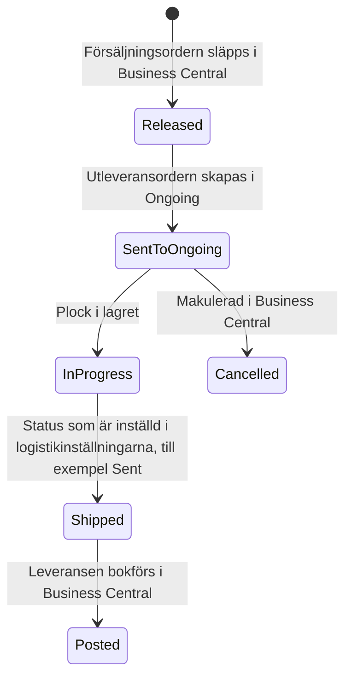

## Välj upplägg

Varje flöde måste passa hur er verksamhet fungerar: vilket system som äger datan, var folk gör sitt jobb och vad redovisningen behöver. Därför bestäms flödena tillsammans när en ny integration sätts upp. Alternativen nedan är de som finns i de fem Web Connect-konfigurationerna för Ongoing i dag. **Vanligt upplägg** markerar det alternativ som minst tre av dem använder. **Rekommenderas** markerar CombineIT:s bästa praxis, där det finns en.

### Utleveransorder

| Alternativ | Så fungerar det | När det passar |
|---|---|---|
| **Skickas när försäljningsordern släpps** (vanligt upplägg) | När försäljningsordern släpps i Business Central skapas utleveransordern i Ongoing. Rader utan lagersaldo, till exempel frakt, skickas inte, men de bokförs tillsammans med leveransen | Business Central är där orderna hanteras, till exempel från en integration med webbshopen |
| **Skickas med Send to Warehouse** | Försäljningsordern släpps som vanligt, men ingenting skickas förrän någon väljer åtgärden Send to Warehouse på ordern | Du vill själv bestämma när varje order går till lagret |
| **Försäljningsorder och flyttorder** (vanligt upplägg) | Flyttorder från det integrerade lagerstället skickas också till Ongoing som utleveransorder | Du har mer än ett lagerställe i Business Central, och varor flyttas mellan dem |

#### Utleveransorder skickas när försäljningsordern släpps

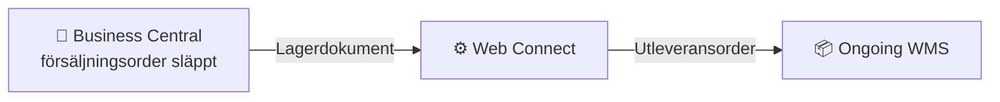

#### Utleveransorder skickas med Send to Warehouse

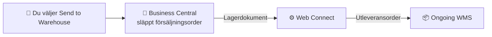

#### Utleveransorder för försäljningsorder och flyttorder

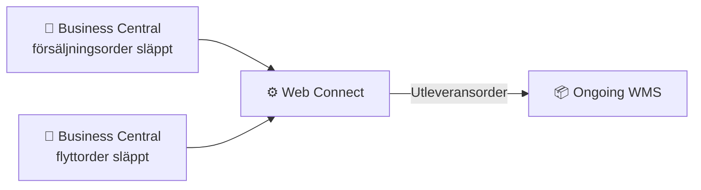

### Orderändringar och makuleringar

| Alternativ | Så fungerar det | När det passar |
|---|---|---|
| **Statusen följer försäljningsordern** (vanligt upplägg) | När försäljningsordern öppnas igen eller släpps på nytt i Business Central uppdaterar Web Connect orderstatusen i Ongoing, så att lagret vet om ordern får plockas. När ordern makuleras i Business Central tas den bort från Ongoing | Kundtjänst ändrar order efter att de har släppts |
| **Bara makulering av hela ordern** | En makulerad order tas bort från Ongoing. Andra ändringar gör lagret | Order ändras sällan efter att de har släppts |

Makulering gäller hela ordern i fyra av fem konfigurationer. En konfiguration tillåter att utvalda rader makuleras.

#### Orderstatusen följer försäljningsordern

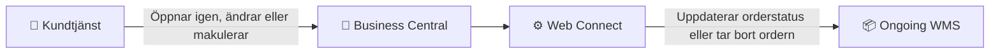

#### Bara makulering av hela ordern

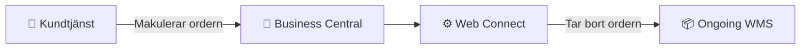

### Inleveranser

| Alternativ | Så fungerar det | När det passar |
|---|---|---|
| **Bokförs automatiskt** (vanligt upplägg) | När inköpsordern får en status som är inställd i logistikinställningarna, till exempel Lagerlagd eller Avvikelse, bokförs de mottagna antalen som en inleverans i Business Central | Lagrets mottagna antal går att lita på utan manuell kontroll |
| **Registreras, du bokför** | Mottagna antal skrivs till inköpsordern, och du bokför inleveransen själv | Du vill kontrollera avvikelser innan något bokförs |

#### Inleveranser bokförs automatiskt

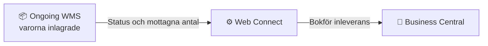

#### Inleveranser registreras, du bokför

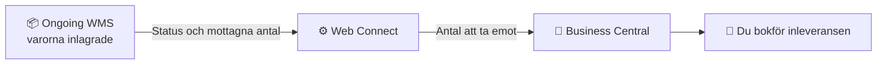

### Returer

| Alternativ | Så fungerar det | När det passar |
|---|---|---|
| **Inte integrerade** | Returer hanteras utanför integrationen | Få returer, eller returerna går till ett annat lagerställe |
| **Returorder i Ongoing, kopplad till originalordern** | Försäljningsreturordern skapas i Business Central från den bokförda leveransen eller fakturan och skickas till Ongoing som en returorder, med Ongoing-id:t för originalordern och dess rader. När varorna har tagits emot bokförs returinleveransen i Business Central | Alla order skickas från Ongoing, och du vill att lagret ska se vilken order returen hör till |
| **Inleveransorder i Ongoing** (rekommenderas) | Försäljningsreturordern skickas till Ongoing som en inleveransorder, på samma sätt som en inköpsorder. När varorna har tagits emot bokförs returinleveransen i Business Central | En del order skickas från ett annat lager eller som direktleverans, så Ongoing kan inte koppla returen till en order |

CombineIT rekommenderar inleveransorder som standard, eftersom Ongoing inte tar emot returorder på order som inte skickades från Ongoing. Två av fem konfigurationer skickar returer som inleveransorder i produktion. Returorder kopplade till originalordern är hittills bara uppsatta i en testmiljö.

#### Returer inte integrerade

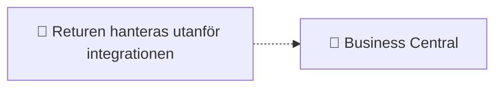

#### Returer som returorder i Ongoing

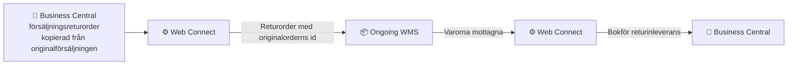

#### Returer som inleveransorder i Ongoing

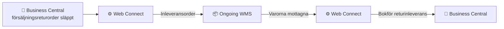

### Lagerjusteringar

| Alternativ | Så fungerar det | När det passar |
|---|---|---|
| **Bokförs automatiskt** (vanligt upplägg, rekommenderas) | Varje justering från Ongoing skrivs till artikeljournalen och bokförs | Du vill att lagersaldot i Business Central ska följa lagret utan ett manuellt steg |
| **Skrivs till journalen, du bokför** | Justeringarna samlas i artikeljournalen, och du bokför den | Du vill granska justeringarna innan de påverkar lagervärdet |

#### Lagerjusteringar bokförs automatiskt

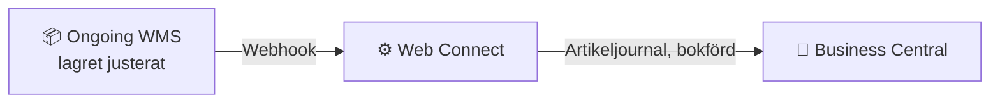

#### Lagerjusteringar som du bokför

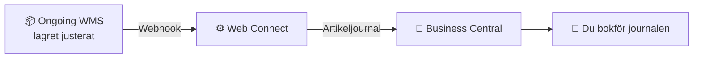

### Artikeldata

| Alternativ | Så fungerar det | När det passar |
|---|---|---|
| **All artikeldata från Business Central** (vanligt upplägg) | Artikelnummer, namn, inköpspris, ursprungsland, tullnummer, mått, vikter och streckkoder skickas från Business Central | Business Central äger artikeldatan |
| **Grunddata från Business Central, resten från en PIM** | Business Central skickar artikelnummer, namn och handelsdata. Mått, vikter, streckkoder och översatta namn skickas inte, så att Business Central inte skriver över det som en PIM lägger in i Ongoing | Ni underhåller logistikdata i en PIM |

#### All artikeldata från Business Central

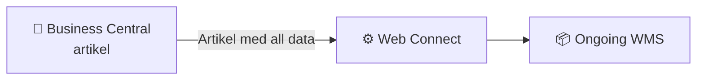

#### Grunddata från Business Central, resten från en PIM

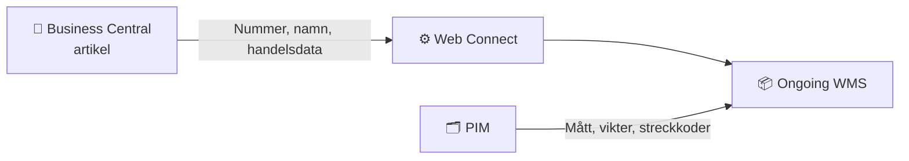

Lagerplatser, plock, packning, transportbokning och 3PL:ens egna artikelinställningar underhålls alltid i Ongoing.

## Det här behöver du

- Microsoft Dynamics 365 Business Central, valfri utgåva, även den senaste versionen
- Web Connect installerat från Microsoft AppSource, med en aktiverad Web Connect-licens
- Ditt godkännande av att Web Connect installeras och agerar i din Business Central-miljö
- Web Connect tillagt som Microsoft Entra-applikation i Business Central, med medgivande från er Entra-administratör. Utan det når webhooks från Ongoing inte Business Central
- En API-användare i 3PL:ens Ongoing-system för er varuägare, och ert varuägar-id. Båda får ni från 3PL:en
- Ett lagerställe i Business Central för lagret som 3PL:en driver, en nummerserie för lagerdokument och en mall för artikeljournaler med en journal för lagerjusteringar och en för lageravstämningen
- Webhooks registrerade på er varuägare i Ongoing för orderstatus, inköpsorderstatus och lagerjusteringar. CombineIT sätter upp dem tillsammans med 3PL:en

## Så kommer du igång

1. Bestäm vilka flöden ni ska använda och vilket alternativ ni väljer för varje, se [Välj upplägg](#choose-your-setup).
2. Installera Web Connect i Business Central, aktivera licensen och ge ditt godkännande. Lägg till Web Connect som Microsoft Entra-applikation och låt er administratör ge medgivande.
3. Importera Ongoing-konfigurationen med integrationen avstängd, och ange sedan lagerställe, varuägare, Ongoing-system och journaler.
4. Ange 3PL:ens API-användare för er varuägare i autentiseringsinställningarna i Web Connect.
5. Registrera webhooks i Ongoing och ange de statusvärden som startar bokföring i [logistikinställningarna](../../general/logistics-setup.md).
6. Testa artiklar, order och inköpsorder i en sandlåda i Business Central mot 3PL:ens testmiljö i Ongoing innan ni går live.

## Konfigurera själv i Business Central

All konfiguration och logik i integrationen syns och går att ändra i Business Central. Det finns ingen extern integrationsplattform där logiken är dold. Azure-endpointen som tar emot webhooks skickar bara anropet vidare till Web Connect.

| Det här kan du ändra | Var i Web Connect | Exempel |
|---|---|---|
| Vilka dokument som integreras | [Logistics Setup](../../general/logistics-setup.md) | Skicka försäljningsorder och inköpsorder, och lägg till flyttorder eller försäljningsreturer |
| När leveranser och inleveranser bokförs | [Logistics Setup](../../general/logistics-setup.md) | Bokför leveransen när orderstatusen i Ongoing är Sent, och inleveransen när inköpsordern är Lagerlagd eller Avvikelse |
| Vad som skickas till Ongoing | [Outgoing Mapping](../../general/outgoing-mapping/outgoing-sync-triggers.md) | Ta bort vikter och streckkoder från artikeln om en PIM äger dem |
| Vad som startar en artikeluppdatering | [Outgoing Sync Triggers](../../general/outgoing-mapping/outgoing-sync-triggers.md) | Skicka artikeln igen när namn, tullnummer eller ursprungsland ändras |
| Fält i orderhuvudet | [WMS-dokument](../../general/wms-documents.md) | Skicka leveransmetoden som leveranssätt |
| Hur värden från Ongoing översätts | [Text Mapping](../../general/text-mapping.md) | Översätt orderstatusen i Business Central till statusnumret i Ongoing |
| Övervakning och omsändning | [Entries](../../general/entries.md) | Se varje order och statusmeddelande, och [skicka ett meddelande igen](../../../../how-to/web-connect/resend-outgoing-message.md) |

## Val i konfigurationen

- **Lagerställe:** vilket lagerställe i Business Central som 3PL:en driver. Bara dokument för det lagerstället skickas till Ongoing.
- **Dokumenttyper:** försäljningsorder, inköpsorder, flyttorder och försäljningsreturer slås på en i taget.
- **Regler för bokföring:** om leveranser, inleveranser, returer och lagerjusteringar bokförs automatiskt, och vid vilken status i Ongoing.
- **Rader utan lagersaldo:** om frakt och andra tjänsterader skickas till Ongoing, och om de bokförs med leveransen.
- **Artikeldata:** vilka artikelfält som skickas, och i vilken valuta inköpspriset visas i Ongoing.
- **Makulering:** om makuleringen gäller hela ordern eller utvalda rader.
- **Felhantering:** hur många gånger Web Connect försöker skicka ett misslyckat meddelande igen, och vem som får felmejlen.

## Begränsningar

- **Ongoing tar bara emot en returorder när originalordern skickades från Ongoing.** Skickas en del order från ett annat lager eller som direktleverans, skickas returerna i stället som inleveransorder.
- **Statustexterna som startar bokföringen skiljer sig mellan 3PL-lager.** De ställs in per integration, och ett felaktigt värde gör att ingenting bokförs.
- **Inleveranser och leveranser är beroende av webhooks från Ongoing.** Slutar en webhook fungera får Business Central inte veta om ändringen. Statusen kan hämtas manuellt för ett enskilt dokument.
- **Order som lagret har börjat arbeta med kan inte makuleras.** När en order har kommit längre än allokerad i Ongoing svarar Ongoing med ett fel när du väljer Send Cancel to Warehouse, och ordern ligger kvar i Ongoing. Kontakta lagret för att stoppa den.
- **Journalen från lageravstämningen bokförs inte automatiskt.** Skillnaderna läggs i en inventeringsjournal som du granskar och bokför.

## Vanliga frågor

### Går det att integrera Business Central med Ongoing WMS?

Ja. Web Connect kopplar Business Central till Ongoing WMS via Ongoings REST API. Artiklar, försäljningsorder, flyttorder, inköpsorder och returer skickas till Ongoing, och leveranser, inleveranser, lagerjusteringar och en lagerkontroll varje natt kommer tillbaka till Business Central.

### Vår 3PL kör Ongoing. Fungerar integrationen med alla 3PL som använder Ongoing?

Ja. Varje 3PL har sitt eget Ongoing-system, och ert företag är en varuägare i det. Web Connect kopplar upp mot 3PL:ens Ongoing-system med en API-användare för er varuägare, som 3PL:en skapar.

### Varför tas inte inköpsordern emot i Business Central fast lagret har lagrat in varorna?

Web Connect bokför bara inleveransen när inköpsordern får någon av de statusar som är inställda i logistikinställningarna, till exempel Lagerlagd eller Avvikelse. Ongoing meddelar Web Connect om statusändringen med en webhook. Har webhooken från Ongoing slutat fungera tas ingenting emot. Leta efter inkommande statusmeddelanden i Web Connect Entries, och be 3PL:en kontrollera webhooken i Ongoing.

### Kan vi skicka en kundretur till Ongoing?

Ja. En försäljningsreturorder i Business Central kan skickas till Ongoing som en returorder kopplad till den ursprungliga ordern. Ongoing tar bara emot en returorder när originalordern skickades från Ongoing, så returer kan också skickas som en inleveransorder. När lagret tar emot varorna bokförs returinleveransen i Business Central.

### Kan vi själva ändra vad som skickas mellan Business Central och Ongoing?

Ja. Fältmappningar, statusregler, triggers och vilka dokumenttyper som integreras konfigureras i Web Connect i ditt eget Business Central. Du kan se och ändra dem utan att be en leverantör ändra i en extern plattform.

## Relaterat

- Flöden: [Artiklar](flows/items.md) · [Utleveransorder](flows/order-outbound.md) · [Orderändringar och makuleringar](flows/order-change-cancellation.md) · [Leveranser](flows/shipment.md) · [Inköpsorder](flows/purchase-order.md) · [Inleveranser](flows/receipt.md) · [Returer](flows/returns.md) · [Lagerjusteringar](flows/stock-adjustment.md) · [Lageravstämning](flows/stock-reconciliation.md)
- Instruktioner: [WMS-förfrågan skickas inte](../../../../how-to/web-connect/wms-request-not-sent-error.md) · [Skicka ett utgående meddelande igen](../../../../how-to/web-connect/resend-outgoing-message.md) · [Integrationer körs inte](../../../../how-to/web-connect/integration-not-running.md)
- Web Connect: [Logistics Setup](../../general/logistics-setup.md) · [WMS-dokument](../../general/wms-documents.md) · [Webhooks](../../general/webhooks.md) · [Orsakskoder för WMS-returer](../../general/wms-return-reason-codes.md)
- [Allmän dokumentation om Web Connect](../../general/README.md)
- [Dokumentation för Ongoing WMS REST API](https://developer.ongoingwarehouse.com/REST/v1/index.html)

## Om Web Connect

Web Connect är en integrationsplattform för Microsoft Dynamics 365 Business Central, utvecklad av CombineIT. Den installeras i ditt eget Business Central och kopplar det till e-handelsplattformar, lagersystem, kassasystem, returer, marknadsplatser och EDI. Varje flöde, varje mappning och varje regel konfigureras i Business Central, där du själv kan se och ändra dem, utan specialkod för varje integration. [Web Connect på Microsoft AppSource](https://marketplace.microsoft.com/sv-se/product/PUBID.martitab1633951001710%7CAID.webconnect%7CPAPPID.9f3a7223-19db-4ac7-832f-cf8e4699186f?tab=Overview) · [Kontakta CombineIT](https://www.combineit.se/contact/)
