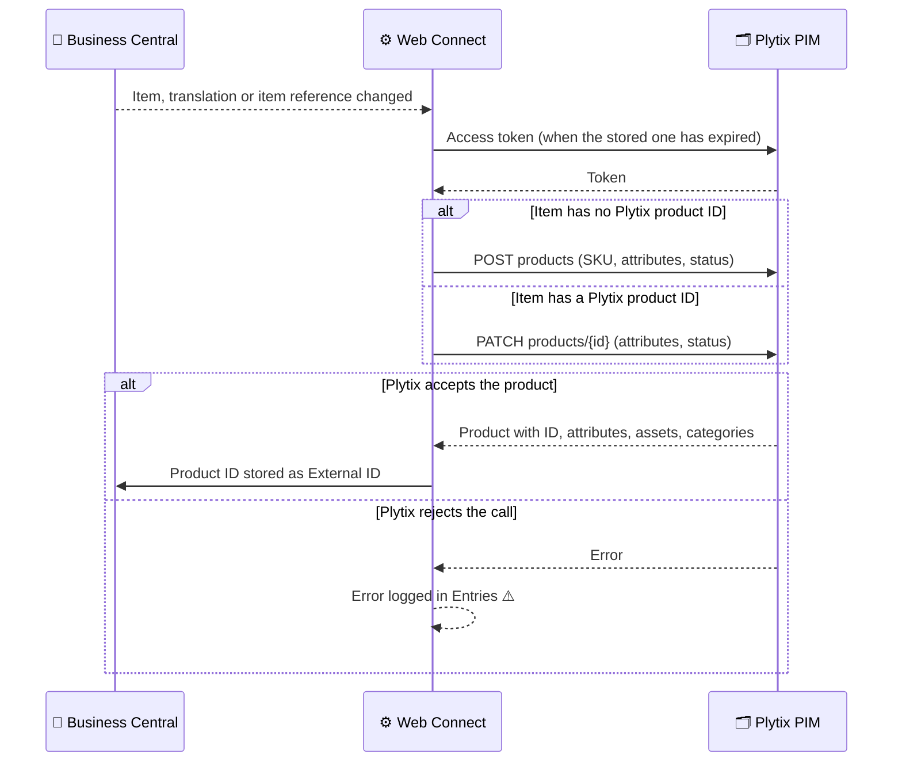

# Business Central to Plytix PIM: product data

When an item changes in Business Central, Web Connect sends it to Plytix PIM. A new item is created as a Plytix product and an existing one is updated, with descriptions, translations, barcode, unit, weights, customs data and item category written to Plytix attributes. The Plytix product ID is stored on the item, so later changes update the same product.

| | |
|---|---|
| **Direction** | Business Central → Plytix |
| **Trigger** | Outgoing sync trigger in Business Central: a change to a mapped item field, or a new or changed item translation or item reference |
| **Result** | The product exists in Plytix with the item number as SKU and the mapped attributes filled in. The Plytix product ID is stored as External ID on the item |
| **Part of** | [Business Central and Plytix PIM integration](../overview.md) |

## Step by step

1. An item field that is set as a trigger field changes, or an item translation or item reference for the item is created or changed.
2. The outgoing sync trigger creates a product message in Web Connect.
3. Web Connect checks whether the item has a Plytix product ID. Without one, the product is created with `POST` to `products`. With one, the product is updated with `PATCH` to `products/{id}`.
4. The message carries the SKU, the attributes and the product status. Values from related records are looked up when the message is built: the translated descriptions from the item translation, the barcode from the item references and the unit from the unit of measure.
5. Plytix returns the product. Web Connect stores the product ID as External ID on the item and keeps the returned product in Entries.

## Data mapping

The names of the Plytix attributes are set in the mapping and differ between Plytix accounts. The table shows the Business Central data that is sent in the standard setup.

| Plytix field | Business Central field | Note |
|---|---|---|
| `sku` | No. | The item number is the SKU in Plytix |
| `status` | A field on the item, or a fixed value | Translated to `Completed` or `Draft` with a text mapping. A condition sends `Archived` instead |
| `attributes` (description) | Description | |
| `attributes` (description 2) | Description 2 | |
| `attributes` (translated description) | Item Translation, Description | The language is set on the table relation, for example ENU |
| `attributes` (translated description 2) | Item Translation, Description 2 | Same language as above |
| `attributes` (unit) | Base Unit of Measure | |
| `attributes` (translated unit) | Unit of Measure | Looked up from the item's base unit of measure. [ATT FYLLA I: which field on Unit of Measure is sent] |
| `attributes` (barcode) | Item Reference, Reference No. | Item references of type bar code |
| `attributes` (gross weight) | Gross Weight | Sent as a decimal |
| `attributes` (net weight) | Net Weight | Sent as a decimal |
| `attributes` (volume) | Unit Volume | Sent as a decimal |
| `attributes` (customs code) | Tariff No. | |
| `attributes` (country of origin) | Country/Region of Origin Code | |
| `attributes` (pieces per carton) | Units per Parcel | |
| `attributes` (category) | Item Category Code | An attribute value, not the Plytix category tree |
| `attributes` (other) | Fields from your own extensions | For example brand, product series, product type or size. A text mapping can translate codes to the values used in Plytix |

## Web Connect objects

| Object | Role |
|---|---|
| `PLY-ITEM` | The product. Posted to `products` on create and patched on `products/{id}` on update |
| `PLY-ITEM-ATTRIBUTE` | The `attributes` object inside the product, with one line per attribute |
| `PLYTIX-ITEM-ID` | Adds `/{id}` to the URL when the item has a Plytix product ID. A text mapping removes the slash when it has none |
| `PLY-DATA` and its child objects | Store the product that Plytix returns, with attributes, assets, categories and relationships, in Entries |
| `PLYTIX-OAUTH` | Gets the access token from the Plytix authentication endpoint with the API key and API password |

## Error handling

| Situation | What happens | What to do |
|---|---|---|
| Plytix rejects the product | The message is logged with the response from Plytix | Read the response in [Entries](../../../general/entries.md), correct the item or the mapping and [resend](../../../../../how-to/web-connect/resend-outgoing-message.md) |
| The product is created twice in Plytix | The item had no Plytix product ID when it was sent, although the product already existed | Match the item by SKU, see [Product matching](product-matching.md), and see ["Entity already exists"](../../../../../how-to/web-connect/entity-already-exists-update-with-external-id.md) |
| Calls fail with 401 Unauthorized | The access token has expired and was not refreshed | See [Calls fail with 401 Unauthorized](../../../../../how-to/web-connect/unauthorized-after-job-queue-stopped.md) |
| The External ID on items is cleared | A retention policy on outgoing data has deleted it, and the next change creates a new product | Leave the retention policy **Sync Outgoing Data After** disabled, see [General Setup](../../../general/general-setup.md) |

## Frequently asked questions

### Does a change to an item translation update the product in Plytix?

Yes. Creating or changing an item translation or an item reference sends the item to Plytix again, so translated descriptions and the barcode stay in sync.

### Can Business Central archive a product in Plytix?

Yes. A condition in Web Connect sets the Plytix status to Archived, for example for items in a specific item category. Other items get the status Completed or Draft from a field on the item.

## Related

- [Business Central and Plytix PIM integration](../overview.md)
- [Product matching](product-matching.md)
- [Outgoing Sync Triggers](../../../general/outgoing-mapping/outgoing-sync-triggers.md)
- [Dynamic Flow Fields](../../../general/dynamic-flow-fields.md)
