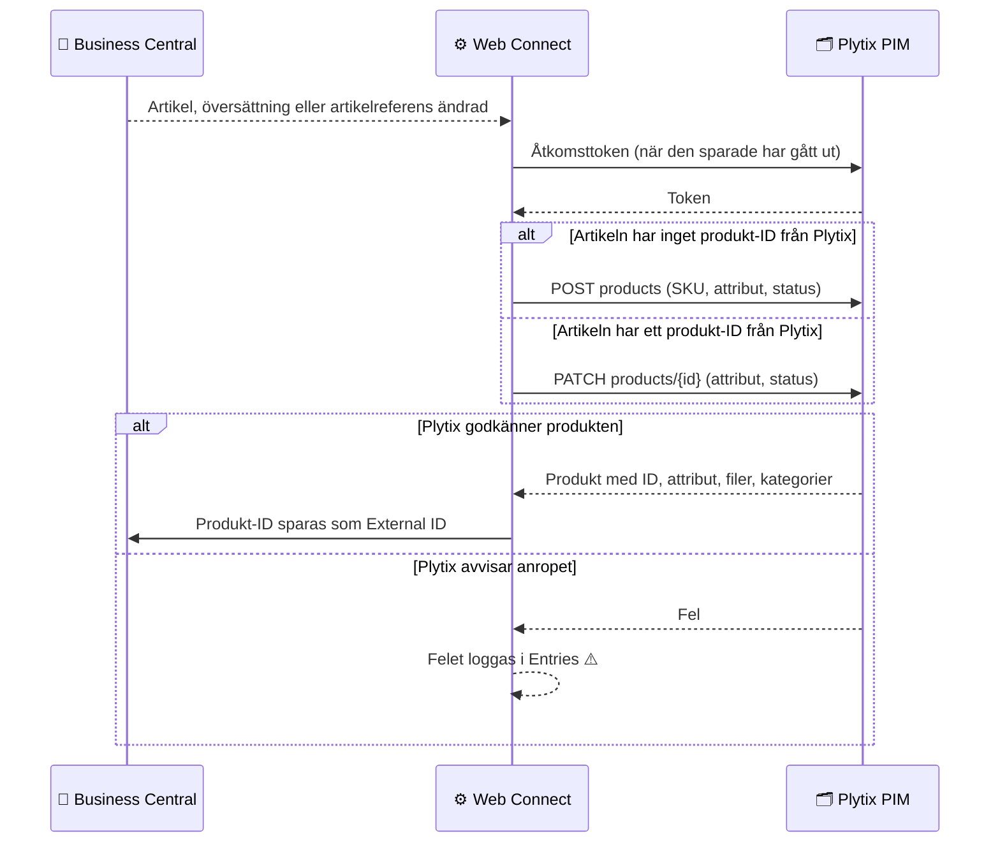

# Från Business Central till Plytix PIM: artikeldata

När en artikel ändras i Business Central skickar Web Connect den till Plytix PIM. En ny artikel skapas som en produkt i Plytix och en befintlig uppdateras, med beskrivningar, översättningar, streckkod, enhet, vikter, tulluppgifter och artikelkategori skrivna till attribut i Plytix. Produkt-ID:t från Plytix sparas på artikeln, så att senare ändringar uppdaterar samma produkt.

| | |
|---|---|
| **Riktning** | Business Central → Plytix |
| **Startas av** | Utgående synktrigger i Business Central: en ändring i ett mappat artikelfält, eller en ny eller ändrad artikelöversättning eller artikelreferens |
| **Resultat** | Produkten finns i Plytix med artikelnumret som SKU och de mappade attributen ifyllda. Produkt-ID:t från Plytix sparas som External ID på artikeln |
| **Del av** | [Integrationen mellan Business Central och Plytix PIM](../overview.md) |

## Steg för steg

1. Ett artikelfält som är satt som triggerfält ändras, eller en artikelöversättning eller artikelreferens för artikeln skapas eller ändras.
2. Den utgående synktriggern skapar ett produktmeddelande i Web Connect.
3. Web Connect kontrollerar om artikeln har ett produkt-ID från Plytix. Saknas det skapas produkten med `POST` till `products`. Finns det uppdateras produkten med `PATCH` till `products/{id}`.
4. Meddelandet innehåller SKU, attributen och produktstatusen. Värden från relaterade poster slås upp när meddelandet byggs: de översatta beskrivningarna från artikelöversättningen, streckkoden från artikelreferenserna och enheten från enhetstabellen.
5. Plytix returnerar produkten. Web Connect sparar produkt-ID:t som External ID på artikeln och sparar den returnerade produkten i Entries.

## Mappning av data

Namnen på attributen i Plytix anges i mappningen och skiljer sig mellan olika Plytix-konton. Tabellen visar den data från Business Central som skickas i standarduppsättningen.

| Fält i Plytix | Fält i Business Central | Kommentar |
|---|---|---|
| `sku` | No. | Artikelnumret är SKU:n i Plytix |
| `status` | Ett fält på artikeln, eller ett fast värde | Översätts till `Completed` eller `Draft` med en textmappning. Ett villkor skickar `Archived` i stället |
| `attributes` (beskrivning) | Description | |
| `attributes` (beskrivning 2) | Description 2 | |
| `attributes` (översatt beskrivning) | Item Translation, Description | Språket anges på tabellrelationen, till exempel ENU |
| `attributes` (översatt beskrivning 2) | Item Translation, Description 2 | Samma språk som ovan |
| `attributes` (enhet) | Base Unit of Measure | |
| `attributes` (översatt enhet) | Unit of Measure | Slås upp från artikelns basenhet. Ett standardfält på Unit of Measure, till exempel International Standard Code. Du väljer fältet i mappningen |
| `attributes` (streckkod) | Item Reference, Reference No. | Artikelreferenser av typen streckkod |
| `attributes` (bruttovikt) | Gross Weight | Skickas som decimaltal |
| `attributes` (nettovikt) | Net Weight | Skickas som decimaltal |
| `attributes` (volym) | Unit Volume | Skickas som decimaltal |
| `attributes` (tullkod) | Tariff No. | |
| `attributes` (ursprungsland) | Country/Region of Origin Code | |
| `attributes` (antal per kartong) | Units per Parcel | |
| `attributes` (kategori) | Item Category Code | Ett attributvärde, inte kategoriträdet i Plytix |
| `attributes` (övriga) | Fält från dina egna tillägg | Till exempel varumärke, produktserie, produkttyp eller storlek. En textmappning kan översätta koder till de värden som används i Plytix |

## Objekt i Web Connect

| Objekt | Roll |
|---|---|
| `PLY-ITEM` | Produkten. Skickas med POST till `products` när den skapas och med PATCH till `products/{id}` när den uppdateras |
| `PLY-ITEM-ATTRIBUTE` | Objektet `attributes` i produkten, med en rad per attribut |
| `PLYTIX-ITEM-ID` | Lägger till `/{id}` i URL:en när artikeln har ett produkt-ID från Plytix. En textmappning tar bort snedstrecket när den saknar ett |
| `PLY-DATA` och dess underobjekt | Sparar produkten som Plytix returnerar, med attribut, filer, kategorier och relationer, i Entries |
| `PLYTIX-OAUTH` | Hämtar åtkomsttoken från Plytix autentiserings-endpoint med API-nyckeln och API-lösenordet |

## Felhantering

| Situation | Vad som händer | Vad du gör |
|---|---|---|
| Plytix avvisar produkten | Meddelandet loggas med svaret från Plytix | Läs svaret i [Entries](../../../general/entries.md), rätta artikeln eller mappningen och [skicka igen](../../../../../how-to/web-connect/resend-outgoing-message.md) |
| Produkten skapas två gånger i Plytix | Artikeln hade inget produkt-ID från Plytix när den skickades, fast produkten redan fanns | Matcha artikeln på SKU, se [Matchning av produkter](product-matching.md), och se ["Entity already exists"](../../../../../how-to/web-connect/entity-already-exists-update-with-external-id.md) |
| Anrop misslyckas med 401 Unauthorized | Åtkomsttoken har gått ut och förnyades inte | Se [Anrop misslyckas med 401 Unauthorized](../../../../../how-to/web-connect/unauthorized-after-job-queue-stopped.md) |
| External ID på artiklarna töms | En lagringspolicy för utgående data har raderat det, och nästa ändring skapar en ny produkt | Låt lagringspolicyn **Sync Outgoing Data After** vara avstängd, se [General Setup](../../../general/general-setup.md) |

## Vanliga frågor

### Uppdateras produkten i Plytix när en artikelöversättning ändras?

Ja. När en artikelöversättning eller artikelreferens skapas eller ändras skickas artikeln till Plytix igen, så att översatta beskrivningar och streckkoden hålls i synk.

### Kan Business Central arkivera en produkt i Plytix?

Ja. Ett villkor i Web Connect sätter statusen i Plytix till Archived, till exempel för artiklar i en viss artikelkategori. Övriga artiklar får statusen Completed eller Draft från ett fält på artikeln.

## Relaterat

- [Integrationen mellan Business Central och Plytix PIM](../overview.md)
- [Matchning av produkter](product-matching.md)
- [Outgoing Sync Triggers](../../../general/outgoing-mapping/outgoing-sync-triggers.md)
- [Dynamic Flow Fields](../../../general/dynamic-flow-fields.md)
