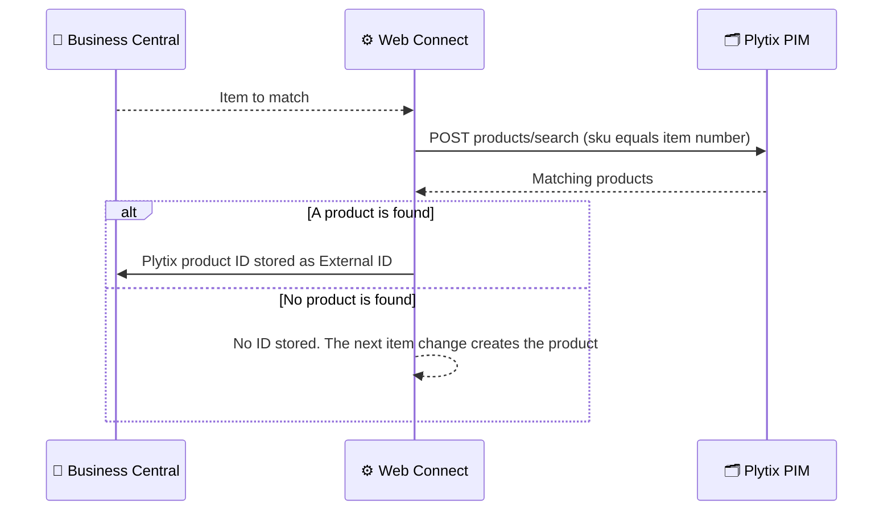

# Plytix PIM to Business Central: product matching by SKU

Web Connect searches Plytix PIM for a product whose SKU equals the Business Central item number and stores the Plytix product ID as External ID on the item. After that, every change to the item updates the same Plytix product. The flow is used when products already exist in Plytix before the integration starts.

| | |
|---|---|
| **Direction** | Plytix → Business Central |
| **Trigger** | [ATT FYLLA I: how the search is started, for example manually for selected items or from the job queue. No trigger or job queue entry for the search is in the configuration export] |
| **Result** | The item has the Plytix product ID as External ID in Web Connect. Nothing else on the item changes |
| **Part of** | [Business Central and Plytix PIM integration](../overview.md) |

## Step by step

1. Web Connect builds a search request for the item, with a filter where the Plytix field `sku` equals the item number.
2. The request is posted to the Plytix `products/search` endpoint. The answer is read page by page.
3. Plytix returns the products that match.
4. Web Connect stores the ID of the first product in the answer as External ID on the item.
5. From now on, the [product data](product-data.md) flow updates that product instead of creating a new one.

## Data mapping

| Plytix field | Business Central field | Note |
|---|---|---|
| `filters`: `sku` `eq` value | No. | The search filter. The item number is the value |
| `data[0].id` | External ID | The first product in the answer. Stored on the outgoing data for the item |

## Web Connect objects

| Object | Role |
|---|---|
| `PLY-GET-ITEMS` | The search, posted to `products/search` with paging |
| `PLY-ITEM-FILTERS` | The filter on `sku` |
| `PLY-PAGINATION` | Page and page size for the search |
| `PLY-DATA1` and its child objects | Store the products in the answer in Entries |

## Error handling

| Situation | What happens | What to do |
|---|---|---|
| No product in Plytix has the item number as SKU | No ID is stored, and the next change to the item creates a new product in Plytix | Correct the SKU in Plytix first if the product should be kept, then run the search again |
| More than one product has the same SKU | The ID of the first product in the answer is stored | Remove the duplicate in Plytix and run the search again |
| Calls fail with 401 Unauthorized | The access token has expired and was not refreshed | See [Calls fail with 401 Unauthorized](../../../../../how-to/web-connect/unauthorized-after-job-queue-stopped.md) |

## Frequently asked questions

### Why does the item need the Plytix product ID?

Plytix updates a product by its ID. With the ID stored on the item, Web Connect sends changes as an update to that product. Without it, Web Connect creates a new product, which gives a duplicate if the product already exists in Plytix.

## Related

- [Business Central and Plytix PIM integration](../overview.md)
- [Product data](product-data.md)
- ["Entity already exists" when sending to an external API](../../../../../how-to/web-connect/entity-already-exists-update-with-external-id.md)
