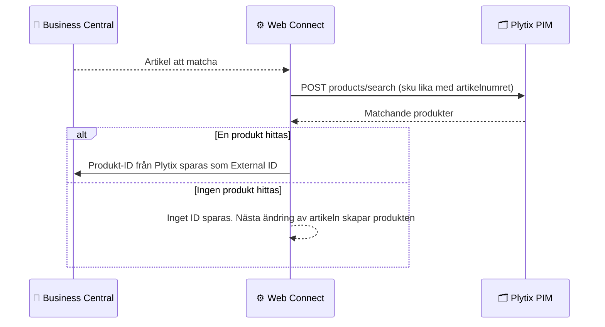

# Från Plytix PIM till Business Central: matchning av produkter på SKU

Web Connect söker i Plytix PIM efter en produkt vars SKU är lika med artikelnumret i Business Central och sparar produkt-ID:t från Plytix som External ID på artikeln. Därefter uppdaterar varje ändring av artikeln samma produkt i Plytix. Flödet används när produkterna redan finns i Plytix innan integrationen startar.

| | |
|---|---|
| **Riktning** | Plytix → Business Central |
| **Startas av** | Utgående synktriggers, som sätts per integration efter hur ni arbetar. Oftast är fälten som skickas till Plytix också triggerfält, så att en ändring i något av dem skickar posten igen. Sökningen skickar artikelnumret |
| **Resultat** | Artikeln har produkt-ID:t från Plytix som External ID i Web Connect. Inget annat på artikeln ändras |
| **Del av** | [Integrationen mellan Business Central och Plytix PIM](../overview.md) |

## Steg för steg

1. Web Connect bygger en sökning för artikeln, med ett filter där fältet `sku` i Plytix är lika med artikelnumret.
2. Sökningen skickas till endpointen `products/search` i Plytix. Svaret läses sida för sida.
3. Plytix returnerar de produkter som matchar.
4. Web Connect sparar ID:t för den första produkten i svaret som External ID på artikeln.
5. Från och med nu uppdaterar flödet för [artikeldata](product-data.md) den produkten i stället för att skapa en ny.

## Mappning av data

| Fält i Plytix | Fält i Business Central | Kommentar |
|---|---|---|
| `filters`: `sku` `eq` värde | No. | Sökfiltret. Artikelnumret är värdet |
| `data[0].id` | External ID | Den första produkten i svaret. Sparas på den utgående datan för artikeln |

## Objekt i Web Connect

| Objekt | Roll |
|---|---|
| `PLY-GET-ITEMS` | Sökningen, som skickas till `products/search` med sidindelning |
| `PLY-ITEM-FILTERS` | Filtret på `sku` |
| `PLY-PAGINATION` | Sida och sidstorlek för sökningen |
| `PLY-DATA1` och dess underobjekt | Sparar produkterna i svaret i Entries |

## Felhantering

| Situation | Vad som händer | Vad du gör |
|---|---|---|
| Ingen produkt i Plytix har artikelnumret som SKU | Inget ID sparas, och nästa ändring av artikeln skapar en ny produkt i Plytix | Rätta först SKU:n i Plytix om produkten ska behållas, och kör sedan sökningen igen |
| Fler än en produkt har samma SKU | ID:t för den första produkten i svaret sparas | Ta bort dubbletten i Plytix och kör sökningen igen |
| Anrop misslyckas med 401 Unauthorized | Åtkomsttoken har gått ut och förnyades inte | Se [Anrop misslyckas med 401 Unauthorized](../../../../../how-to/web-connect/unauthorized-after-job-queue-stopped.md) |

## Vanliga frågor

### Varför behöver artikeln produkt-ID:t från Plytix?

Plytix uppdaterar en produkt utifrån dess ID. När ID:t finns på artikeln skickar Web Connect ändringar som en uppdatering av den produkten. Utan ID skapar Web Connect en ny produkt, vilket ger en dubblett om produkten redan finns i Plytix.

## Relaterat

- [Integrationen mellan Business Central och Plytix PIM](../overview.md)
- [Artikeldata](product-data.md)
- ["Entity already exists" när du skickar till ett externt API](../../../../../how-to/web-connect/entity-already-exists-update-with-external-id.md)
