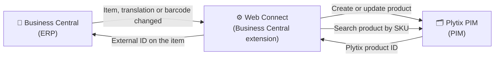
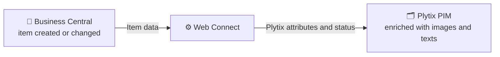
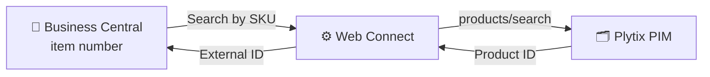
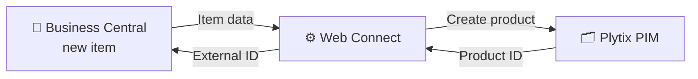

# Business Central and Plytix PIM integration

Web Connect by CombineIT connects Microsoft Dynamics 365 Business Central with Plytix PIM, the product information management system. Item data such as descriptions, translations, barcode, unit, weights, customs data and item category is sent from Business Central to Plytix when it changes, and existing Plytix products are matched to items by SKU. All mappings and rules live in your own Business Central, where you can see and change them yourself.

## At a glance

| | |
|---|---|
| **System** | Plytix PIM (PIM) |
| **Integration product** | Web Connect for Microsoft Dynamics 365 Business Central |
| **Runs in** | Your own Business Central environment, as an extension. Web Connect sends an item to Plytix when the item, its translations or its item references change in Business Central. No webhooks and no external integration platform are involved. All processing and configuration stays in Business Central. |
| **Configured by** | You, in Business Central: mappings, conditions, triggers and flows. You can do all of it yourself. If you want, CombineIT takes part in any step, as a sounding board or by doing the work. |
| **Connection** | Plytix REST API (JSON), with an OAuth access token from the Plytix authentication endpoint |
| **Plytix API** | [Plytix API documentation](https://docs.plytix.com/) |
| **Data flows** | 2: product data and product matching by SKU |
| **Business Central editions** | [ATT FYLLA I: Essentials and Premium, confirm] |
| **Available from** | [Web Connect on Microsoft AppSource](https://marketplace.microsoft.com/sv-se/product/PUBID.martitab1633951001710%7CAID.webconnect%7CPAPPID.9f3a7223-19db-4ac7-832f-cf8e4699186f?tab=Overview). [ATT FYLLA I: whether the Plytix integration is included in the Web Connect Ready Integrations app] |

## What can be synchronized

Web Connect has two data flows between Business Central and Plytix PIM.

| Data | Direction | What happens |
|---|---|---|
| [Product data](flows/product-data.md) | Business Central → Plytix | The item is created or updated as a Plytix product, with item data written to Plytix attributes and a product status |
| [Product matching](flows/product-matching.md) | Plytix → Business Central | Plytix is searched for a product with the item's SKU, and the Plytix product ID is stored on the item so later changes update the same product |

Product data is the core of the integration. Product matching is used when products already exist in Plytix before the integration starts, see [Choose your setup](#choose-your-setup).

## How it works

Web Connect watches the item and the records that belong to it. When a mapped field on the item changes, or an item translation or item reference is created or changed, Web Connect sends the item to Plytix. An item without a Plytix product ID is created with `POST`. An item that already has one is updated with `PATCH` on that product. The product ID that Plytix returns is stored as the item's External ID in Web Connect. The full product that Plytix returns is kept in Web Connect [Entries](../../general/entries.md), where you can see it next to what was sent.

Web Connect gets its access token from the Plytix authentication endpoint with your API key and API password, and refreshes it automatically. How often is set on the authentication in Web Connect.

## Choose your setup

Each flow has to fit how your business works: which system owns the data, where people do their work, and what the accounting needs. That is why the flows are decided together when a new integration is set up. The options below are the ones Web Connect customers use today. **Common setup** marks the option most Web Connect customers with Plytix PIM use. **Recommended** marks CombineIT's best practice, where there is one.

The Plytix integration is in use with one Web Connect customer today. That is too few to say what is common, so no option below is marked as common setup.

### Product data ownership

| Option | How it works | When it fits |
|---|---|---|
| **Basic data in Business Central, enrichment in Plytix** | Item number, descriptions, translations, unit, weights, customs data, barcode and item category are maintained in Business Central and sent to Plytix attributes. Images, documents, marketing texts and other attributes are maintained in Plytix | Business Central is where items are created, and Plytix is used to prepare product content for sales channels |

#### Product data owned in Business Central and enriched in Plytix

### Products that already exist in Plytix

| Option | How it works | When it fits |
|---|---|---|
| **Match by SKU** | Web Connect searches Plytix for a product whose SKU equals the Business Central item number and stores its product ID on the item. After that, the item updates that product | Plytix already has products when the integration starts |
| **Created by Web Connect** | The item has no Plytix product ID, so Web Connect creates the product in Plytix and stores the ID it gets back | The product does not exist in Plytix yet |

#### Existing products matched by SKU

#### New products created by Web Connect

Images, documents, product relationships and other enrichment are always maintained in Plytix.

## What you need

- Microsoft Dynamics 365 Business Central [ATT FYLLA I: edition and version]
- Web Connect installed from Microsoft AppSource, with an activated Web Connect license
- Your approval for Web Connect to be installed and to act in your Business Central environment
- An API key and API password from your Plytix account, created in Plytix by a user with access to the API
- The Plytix attributes that the Business Central data is written to. The attributes are created in Plytix and their names are set in the Web Connect mapping

## Setting it up

1. Decide which data Business Central owns and which is maintained in Plytix, see [Choose your setup](#choose-your-setup).
2. Install Web Connect in Business Central, activate the license and give your approval. [ATT FYLLA I: how the ready Plytix integration is installed]
3. Store the Plytix API password in Web Connect [Secret Value Storage](../../general/secret-value-storage.md) and set up the OAuth authentication with the API key.
4. Create the attributes in Plytix and map them to Business Central fields in the outgoing mapping.
5. Match the products that already exist in Plytix by SKU.
6. Test with a few items in a Business Central sandbox before going live. [ATT FYLLA I: whether Plytix offers a separate test account, or whether testing is done in the production account with test products]

## Configure it yourself in Business Central

All configuration and logic in the integration is visible and editable in Business Central. There is no external integration platform where the logic is hidden.

| What you can change | Where in Web Connect | Example |
|---|---|---|
| Field mapping to Plytix | [Outgoing Data](../../general/outgoing-mapping/outgoing-data-web.md) | Send another Business Central field to a Plytix attribute, or add a field from your own extension, for example brand or product series |
| Values from related records | [Dynamic Flow Fields](../../general/dynamic-flow-fields.md) | Send the English description from the item translation, or the barcode from the item references |
| Conditions | [Condition List](../../general/condition-list.md) | Set the product to archived in Plytix when the item belongs to a specific item category |
| Value mapping | [Text Mapping](../../general/text-mapping.md) | Translate a Business Central code to the value used in a Plytix attribute |
| What triggers an update | [Outgoing Sync Triggers](../../general/outgoing-mapping/outgoing-sync-triggers.md) | Choose which item fields send the item to Plytix when they change, and whether translations and item references also do |
| Monitoring and resending | [Entries](../../general/entries.md) | See every product sent and the product Plytix returned, and [resend a message](../../../../how-to/web-connect/resend-outgoing-message.md) |

## Configuration choices

- **Attributes:** which Business Central fields are sent, and to which Plytix attribute. Standard fields such as description, description 2, base unit of measure, gross and net weight, unit volume, tariff number, country of origin, units per parcel and item category can be sent, as well as fields from your own extensions.
- **Translations:** which language in the item translations is sent to the translated attributes in Plytix.
- **Barcode:** which item reference is sent as the barcode attribute. Item references of type bar code are used.
- **Product status:** how the Plytix status is set. A field on the item can be translated to `Completed` or `Draft`, and a condition can set the status to `Archived`, for example for items in a specific item category.
- **Trigger fields:** which item fields send the item to Plytix when they change.

## Limitations

- **Data goes from Business Central to Plytix.** Images, documents, marketing texts and other attributes enriched in Plytix are not written back to the item in Business Central in the standard setup. Plytix returns the full product after each update, and it is kept in Web Connect Entries, but no Plytix value is mapped to a Business Central field.
- **Items, not variants.** The standard setup sends items. Item variants are not sent as separate Plytix products or Plytix variants.
- **Plytix categories are not maintained from Business Central.** The item category is sent as an attribute value. Assigning the product to categories in the Plytix category tree is done in Plytix.
- **Prices and stock are not part of the integration.**
- **Attributes must exist in Plytix first.** The attributes are created in Plytix before they are mapped in Web Connect. [ATT FYLLA I: what happens to the update when a mapped attribute is missing in Plytix]
- **Matching requires the SKU to be the item number.** A product in Plytix with another SKU is not matched, and a new product is created.

## Frequently asked questions

### Can Business Central be integrated with Plytix PIM?

Yes. Web Connect connects Business Central with Plytix PIM through the Plytix REST API. Item data is sent from Business Central to Plytix as product attributes when the item changes, and existing Plytix products are matched to items by SKU so they are updated instead of duplicated.

### Which system owns the product data?

Business Central owns the basic item data: item number, descriptions, unit, weights, customs data, barcode and item category. Plytix is where the product is enriched with images, documents, marketing texts and other attributes. The standard setup does not write enriched data from Plytix back to Business Central.

### What happens with items that already exist in Plytix?

Web Connect searches Plytix for a product with the same SKU as the Business Central item number and stores the Plytix product ID on the item. After that, changes are sent as updates to that product, so no duplicate is created.

### How does Web Connect log in to Plytix?

With the API key and API password from your Plytix account. Web Connect exchanges them for an access token at the Plytix authentication endpoint and refreshes the token automatically. The password is kept in Web Connect Secret Value Storage.

## Related

- Flows: [Product data](flows/product-data.md) · [Product matching](flows/product-matching.md)
- How-to: ["Entity already exists" when sending to an external API](../../../../how-to/web-connect/entity-already-exists-update-with-external-id.md) · [Resend an outgoing message](../../../../how-to/web-connect/resend-outgoing-message.md) · [Calls fail with 401 Unauthorized after a job queue stopped](../../../../how-to/web-connect/unauthorized-after-job-queue-stopped.md)
- [Web Connect general documentation](../../general/README.md)
- [Plytix API documentation](https://docs.plytix.com/)

## About Web Connect

Web Connect is an integration platform for Microsoft Dynamics 365 Business Central, developed by CombineIT. It is installed in your own Business Central and connects it with e-commerce platforms, warehouse systems, POS, returns, marketplaces and EDI. Every flow, mapping and rule is configured in Business Central, where you can see and change it yourself, without custom code for each integration. [Web Connect on Microsoft AppSource](https://marketplace.microsoft.com/sv-se/product/PUBID.martitab1633951001710%7CAID.webconnect%7CPAPPID.9f3a7223-19db-4ac7-832f-cf8e4699186f?tab=Overview) · [Contact CombineIT](https://www.combineit.se/contact/)
