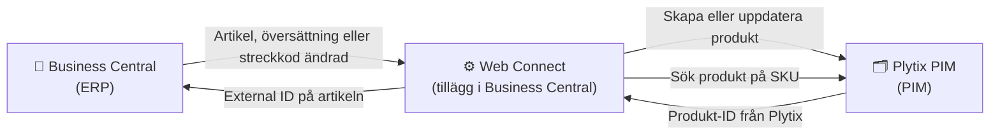
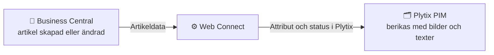
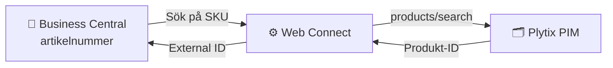
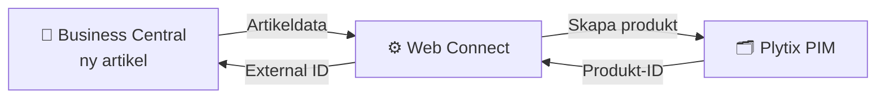

# Business Central och Plytix PIM: integration

Web Connect från CombineIT kopplar Microsoft Dynamics 365 Business Central till Plytix PIM, systemet för produktinformation. Artikeldata som beskrivningar, översättningar, streckkod, enhet, vikter, tulluppgifter och artikelkategori skickas från Business Central till Plytix när den ändras, och befintliga produkter i Plytix matchas mot artiklar på SKU. Alla mappningar och regler finns i ditt eget Business Central, där du själv kan se och ändra dem.

## I korthet

| | |
|---|---|
| **System** | Plytix PIM (PIM) |
| **Integrationsprodukt** | Web Connect för Microsoft Dynamics 365 Business Central |
| **Körs i** | Din egen Business Central-miljö, som ett tillägg. Web Connect skickar en artikel till Plytix när artikeln, dess översättningar eller dess artikelreferenser ändras i Business Central. Inga webhooks och ingen extern integrationsplattform är inblandade. All bearbetning och konfiguration stannar i Business Central. |
| **Konfigureras av** | Dig, i Business Central: mappningar, villkor, triggers och flöden. Du kan göra allt själv. Om du vill är CombineIT med i vilket steg som helst, som bollplank eller genom att göra jobbet. |
| **Koppling** | Plytix REST API (JSON), med en OAuth-åtkomsttoken från Plytix autentiserings-endpoint |
| **Plytix API** | [Plytix API-dokumentation](https://docs.plytix.com/) |
| **Dataflöden** | 2: artikeldata och matchning av produkter på SKU |
| **Business Central-utgåvor** | Alla utgåvor, Essentials och Premium, även den senaste versionen |
| **Finns på** | [Web Connect på Microsoft AppSource](https://marketplace.microsoft.com/sv-se/product/PUBID.martitab1633951001710%7CAID.webconnect%7CPAPPID.9f3a7223-19db-4ac7-832f-cf8e4699186f?tab=Overview). Integrationen med Plytix ingår inte i appen Web Connect Ready Integrations. Den sätts upp i Web Connect som en del av implementationen |

## Det här kan synkas

Web Connect har två dataflöden mellan Business Central och Plytix PIM.

| Data | Riktning | Vad som händer |
|---|---|---|
| [Artikeldata](flows/product-data.md) | Business Central → Plytix | Artikeln skapas eller uppdateras som en produkt i Plytix, där artikeldatan skrivs till attribut i Plytix och produkten får en status |
| [Matchning av produkter](flows/product-matching.md) | Plytix → Business Central | Plytix söks igenom efter en produkt med artikelns SKU, och produkt-ID:t från Plytix sparas på artikeln så att senare ändringar uppdaterar samma produkt |

Artikeldatan är kärnan i integrationen. Matchningen av produkter används när produkterna redan finns i Plytix innan integrationen startar, se [Välj upplägg](#choose-your-setup).

## Så fungerar det

Web Connect bevakar artikeln och de poster som hör till den. När ett mappat fält på artikeln ändras, eller en artikelöversättning eller artikelreferens skapas eller ändras, skickar Web Connect artikeln till Plytix. En artikel utan produkt-ID från Plytix skapas med `POST`. En artikel som redan har ett uppdateras med `PATCH` på den produkten. Produkt-ID:t som Plytix returnerar sparas som artikelns External ID i Web Connect. Hela produkten som Plytix returnerar sparas i Web Connect [Entries](../../general/entries.md), där du kan se den bredvid det som skickades.

Web Connect hämtar sin åtkomsttoken från Plytix autentiserings-endpoint med din API-nyckel och ditt API-lösenord, och förnyar den automatiskt. Hur ofta anges på autentiseringen i Web Connect.

## Välj upplägg

Varje flöde måste passa hur din verksamhet fungerar: vilket system som äger datan, var folk gör sitt arbete och vad bokföringen behöver. Därför bestämmer vi flödena tillsammans när en ny integration sätts upp. Alternativen nedan är de som Web Connect-kunder använder i dag. **Vanligt upplägg** markerar det alternativ som flest Web Connect-kunder med Plytix PIM använder. **Rekommenderas** markerar CombineIT:s bästa praxis, där det finns en.

Integrationen med Plytix används hos en Web Connect-kund i dag. Det är för få för att säga vad som är vanligt, så inget alternativ nedan är markerat som vanligt upplägg.

### Vem som äger produktdatan

| Alternativ | Så fungerar det | När det passar |
|---|---|---|
| **Grunddata i Business Central, berikning i Plytix** | Artikelnummer, beskrivningar, översättningar, enhet, vikter, tulluppgifter, streckkod och artikelkategori underhålls i Business Central och skickas till attribut i Plytix. Bilder, dokument, marknadsföringstexter och andra attribut underhålls i Plytix | Artiklarna skapas i Business Central, och Plytix används för att ta fram produktinnehåll till försäljningskanalerna |

#### Produktdata som ägs i Business Central och berikas i Plytix

### Produkter som redan finns i Plytix

| Alternativ | Så fungerar det | När det passar |
|---|---|---|
| **Matchning på SKU** | Web Connect söker i Plytix efter en produkt vars SKU är lika med artikelnumret i Business Central och sparar dess produkt-ID på artikeln. Därefter uppdaterar artikeln den produkten | Plytix har redan produkter när integrationen startar |
| **Skapas av Web Connect** | Artikeln har inget produkt-ID från Plytix, så Web Connect skapar produkten i Plytix och sparar det ID den får tillbaka | Produkten finns inte i Plytix än |

#### Befintliga produkter matchas på SKU

#### Nya produkter skapas av Web Connect

Bilder, dokument, produktrelationer och annan berikning underhålls alltid i Plytix.

## Det här behöver du

- Microsoft Dynamics 365 Business Central, valfri utgåva (Essentials eller Premium), även den senaste versionen
- Web Connect installerat från Microsoft AppSource, med en aktiverad Web Connect-licens
- Ditt godkännande av att Web Connect installeras och agerar i din Business Central-miljö
- En API-nyckel och ett API-lösenord från ditt Plytix-konto, skapade i Plytix av en användare med åtkomst till API:t
- De attribut i Plytix som datan från Business Central skrivs till. Attributen skapas i Plytix och deras namn anges i mappningen i Web Connect

## Så kommer du igång

1. Bestäm vilken data Business Central äger och vilken som underhålls i Plytix, se [Välj upplägg](#choose-your-setup).
2. Installera Web Connect i Business Central, aktivera licensen och ge ditt godkännande. Integrationen med Plytix ingår inte i appen Ready Integrations, så dess objekt, mappningar och triggers sätts upp i Web Connect som en del av implementationen.
3. Spara API-lösenordet för Plytix i Web Connect [Secret Value Storage](../../general/secret-value-storage.md) och sätt upp OAuth-autentiseringen med API-nyckeln.
4. Skapa attributen i Plytix och mappa dem mot fält i Business Central i den utgående mappningen.
5. Matcha de produkter som redan finns i Plytix på SKU.
6. Testa med några artiklar, med en sandlåda i Business Central mot ett testkonto i Plytix, innan ni går live.

## Konfigurera själv i Business Central

All konfiguration och logik i integrationen går att se och ändra i Business Central. Det finns ingen extern integrationsplattform där logiken är dold.

| Det här kan du ändra | Var i Web Connect | Exempel |
|---|---|---|
| Fältmappning till Plytix | [Outgoing Data](../../general/outgoing-mapping/outgoing-data-web.md) | Skicka ett annat fält i Business Central till ett attribut i Plytix, eller lägg till ett fält från ditt eget tillägg, till exempel varumärke eller produktserie |
| Värden från relaterade poster | [Dynamic Flow Fields](../../general/dynamic-flow-fields.md) | Skicka den engelska beskrivningen från artikelöversättningen, eller streckkoden från artikelreferenserna |
| Villkor | [Condition List](../../general/condition-list.md) | Sätt produkten till arkiverad i Plytix när artikeln hör till en viss artikelkategori |
| Värdemappning | [Text Mapping](../../general/text-mapping.md) | Översätt en kod i Business Central till det värde som används i ett attribut i Plytix |
| Vad som startar en uppdatering | [Outgoing Sync Triggers](../../general/outgoing-mapping/outgoing-sync-triggers.md) | Välj vilka artikelfält som skickar artikeln till Plytix när de ändras, och om översättningar och artikelreferenser också gör det |
| Övervakning och omsändning | [Entries](../../general/entries.md) | Se varje produkt som skickats och den produkt som Plytix returnerade, och [skicka ett meddelande igen](../../../../how-to/web-connect/resend-outgoing-message.md) |

## Val i konfigurationen

- **Attribut:** vilka fält i Business Central som skickas, och till vilket attribut i Plytix. Standardfält som beskrivning, beskrivning 2, basenhet, brutto- och nettovikt, volym, tulltaxenummer, ursprungsland, antal per kolli och artikelkategori kan skickas, liksom fält från dina egna tillägg.
- **Översättningar:** vilket språk i artikelöversättningarna som skickas till de översatta attributen i Plytix.
- **Streckkod:** vilken artikelreferens som skickas som streckkodsattribut. Artikelreferenser av typen streckkod används.
- **Produktstatus:** hur statusen i Plytix sätts. Ett fält på artikeln kan översättas till `Completed` eller `Draft`, och ett villkor kan sätta statusen till `Archived`, till exempel för artiklar i en viss artikelkategori.
- **Triggerfält:** vilka artikelfält som skickar artikeln till Plytix när de ändras.

## Begränsningar

- **Datan går från Business Central till Plytix.** Bilder, dokument, marknadsföringstexter och andra attribut som berikats i Plytix skrivs inte tillbaka till artikeln i Business Central i standarduppsättningen. Plytix returnerar hela produkten efter varje uppdatering och den sparas i Web Connect Entries, men inget värde från Plytix mappas till ett fält i Business Central.
- **Artiklar, inte varianter.** Standarduppsättningen skickar artiklar. Artikelvarianter skickas inte som egna produkter eller varianter i Plytix.
- **Kategorierna i Plytix underhålls inte från Business Central.** Artikelkategorin skickas som ett attributvärde. Att placera produkten i kategoriträdet i Plytix görs i Plytix.
- **Priser och lager ingår inte i integrationen.**
- **Attributen måste finnas i Plytix först.** Attributen skapas i Plytix innan de mappas i Web Connect. Avvisar Plytix en uppdatering stannar meddelandet i Web Connect Entries med felet från Plytix, och det kan skickas igen när attributet finns.
- **Matchningen kräver att SKU:n är artikelnumret.** En produkt i Plytix med en annan SKU matchas inte, och en ny produkt skapas.

## Vanliga frågor

### Går det att integrera Business Central med Plytix PIM?

Ja. Web Connect kopplar Business Central till Plytix PIM via Plytix REST API. Artikeldata skickas från Business Central till Plytix som produktattribut när artikeln ändras, och befintliga produkter i Plytix matchas mot artiklar på SKU, så att de uppdateras i stället för att dubbleras.

### Vilket system äger produktdatan?

Business Central äger grunddatan för artikeln: artikelnummer, beskrivningar, enhet, vikter, tulluppgifter, streckkod och artikelkategori. I Plytix berikas produkten med bilder, dokument, marknadsföringstexter och andra attribut. Standarduppsättningen skriver inte tillbaka berikad data från Plytix till Business Central.

### Vad händer med artiklar som redan finns i Plytix?

Web Connect söker i Plytix efter en produkt med samma SKU som artikelnumret i Business Central och sparar produkt-ID:t från Plytix på artikeln. Därefter skickas ändringar som uppdateringar av den produkten, så att ingen dubblett skapas.

### Hur loggar Web Connect in i Plytix?

Med API-nyckeln och API-lösenordet från ditt Plytix-konto. Web Connect byter dem mot en åtkomsttoken hos Plytix autentiserings-endpoint och förnyar token automatiskt. Lösenordet sparas i Web Connect Secret Value Storage.

## Relaterat

- Flöden: [Artikeldata](flows/product-data.md) · [Matchning av produkter](flows/product-matching.md)
- Instruktioner: ["Entity already exists" när du skickar till ett externt API](../../../../how-to/web-connect/entity-already-exists-update-with-external-id.md) · [Skicka ett utgående meddelande igen](../../../../how-to/web-connect/resend-outgoing-message.md) · [Anrop misslyckas med 401 Unauthorized efter att en jobbkö stoppats](../../../../how-to/web-connect/unauthorized-after-job-queue-stopped.md)
- [Allmän dokumentation för Web Connect](../../general/README.md)
- [Plytix API-dokumentation](https://docs.plytix.com/)

## Om Web Connect

Web Connect är en integrationsplattform för Microsoft Dynamics 365 Business Central, utvecklad av CombineIT. Den installeras i ditt eget Business Central och kopplar det till e-handelsplattformar, lagersystem, kassasystem, returer, marknadsplatser och EDI. Varje flöde, mappning och regel konfigureras i Business Central, där du själv kan se och ändra dem, utan specialkod för varje integration. [Web Connect på Microsoft AppSource](https://marketplace.microsoft.com/sv-se/product/PUBID.martitab1633951001710%7CAID.webconnect%7CPAPPID.9f3a7223-19db-4ac7-832f-cf8e4699186f?tab=Overview) · [Kontakta CombineIT](https://www.combineit.se/contact/)
