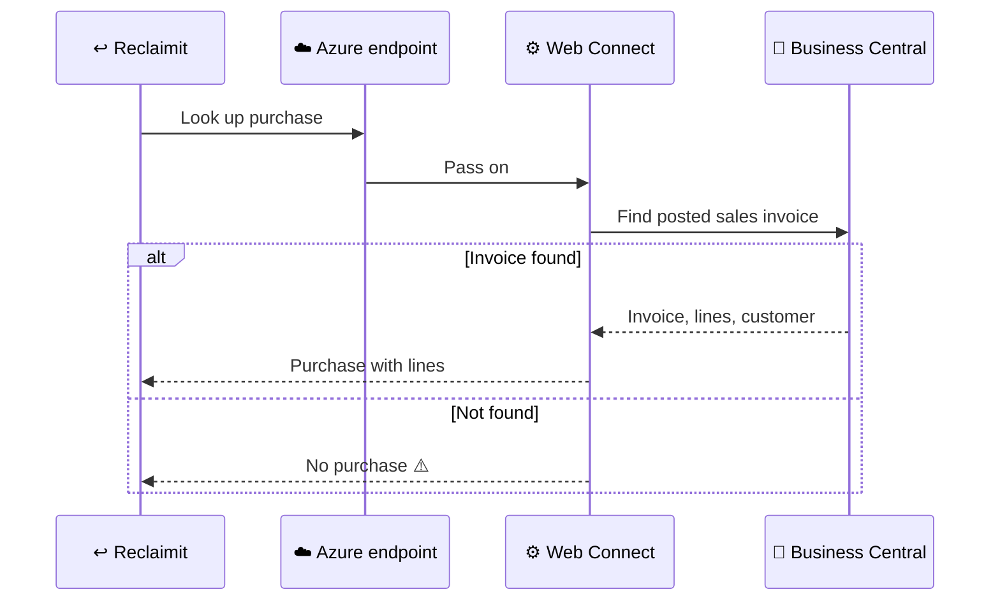

# Business Central to Reclaimit: purchase lookup

When a customer starts a return in Reclaimit, Reclaimit looks up the original purchase in Business Central through Web Connect. Web Connect finds the posted sales invoice and answers right away with the lines, prices, VAT, customer, delivery address and tracking number. Reclaimit uses the answer to show what can be returned.

| | |
|---|---|
| **Direction** | Business Central → Reclaimit, on request from Reclaimit |
| **Trigger** | A call from Reclaimit, received by an Azure endpoint that passes it on to Web Connect. |
| **Result** | Reclaimit has the purchase and can register the return against it. Nothing changes in Business Central |
| **Part of** | [Business Central and Reclaimit integration](../overview.md) |

## Step by step

1. A customer starts a return in Reclaimit with an order or receipt number (Reclaimit).
2. Reclaimit calls Web Connect with the number (Reclaimit).
3. Web Connect finds the posted sales invoice and builds the answer from the invoice, its lines, the customer and the company information (Web Connect).
4. Web Connect answers in the same call (Web Connect).
5. Reclaimit shows the lines that can be returned (Reclaimit).

## Data mapping

| Business Central field | Reclaimit field | Note |
|---|---|---|
| Sales invoice: Order No. | `OrderNo`, `OriginOrderNo` | |
| Sales invoice: No. | `ReceiptNo` | |
| External ID of the order | `ExternalOrderNo` | The order number from the e-commerce platform |
| Order Date, Shipment Date | `OrderDate`, `ShipmentDate` | |
| Currency Code | `CurrencyCode` | Blank is translated to your local currency |
| Language Code, Salesperson Code, Your Reference | `LanguageCode`, `SalesPersonCode`, `CustomerReference` | |
| Amount, Amount Including VAT | `TotalAmount`, `TotalAmountInclVAT` | VAT is calculated from the lines |
| Shipping Agent Code, Shipment Method Code | `ShippingAgentCode`, `ShipmentMethodCode` | |
| Customer: name, address, VAT and registration number, email, phone | `SellToCustomer` | |
| Ship-to name and address | `ShippingContact` | |
| Package Tracking No. | `TrackingInfos[].TrackingNumber` | |
| Company information | `CompanyInformation` | Your company name, address and VAT number |
| Line: No., Variant Code, GTIN, Description and Description 2 | `SalesLines[]`: `Code`, `VariantCode`, `Gtin`, `Description` | |
| Line: Quantity, Unit of Measure Code | `Quantity`, `UnitOfMeasureCode` | |
| Line: Unit Price, Line Discount, Amount Including VAT | `UnitPrice`, `DiscountAmount`, `TotalAmountInclVat` | |
| Line: Location Code, Bin Code, Item Category Code | `LocationCode`, `BinCode`, `ItemCategoryCode` | |
| Item: country of origin, tariff number | `ItemCountryOfOriginCode`, `ItemTariffCode` | |
| A field on the item | `Returnable` | Calculated per line, so you decide which items can be returned |

## Web Connect objects

| Object | Role |
|---|---|
| `RECL-RECEIPTSEARCH` | Finds the posted sales invoice and answers Reclaimit |
| `RECL-SALESLINES` | The invoice lines in the answer |
| `RECL-SELLTOCUSTOMER`, `RECL-SHIPPINGCONTACT`, `RECL-TRACKINGINFOS`, `RECL-COMPANYINFORMATION` | Customer, delivery address, tracking number and company information in the answer |

## Error handling

| Situation | What happens | What to do |
|---|---|---|
| The order is not invoiced yet | No purchase is found | Invoice the order, or ask the customer to wait until the order has been delivered |
| The answer misses a field Reclaimit needs | Reclaimit cannot register the return | Add the field in [Outgoing Mapping](../../../general/outgoing-mapping/README.md) |
| The lookup fails | The error is shown in Entries | Read the error in [Entries](../../../general/entries.md) |

## Frequently asked questions

### Why can Reclaimit not find an order in Business Central?

The lookup reads posted sales invoices. An order that has not been invoiced yet is not found. Check that the order is invoiced, and look for the lookup in Web Connect Entries.

### Can we decide which items are returnable?

Yes. Each line can carry a returnable flag calculated from a field on the item, so Reclaimit only offers returns of items you allow.

## Related

- [Business Central and Reclaimit integration](../overview.md)
- [Return orders](return-orders.md) · [Return status](return-status.md)
- [Webhooks](../../../general/webhooks.md) · [Outgoing Mapping](../../../general/outgoing-mapping/README.md) · [Dynamic FlowFields](../../../general/dynamic-flow-fields.md)
