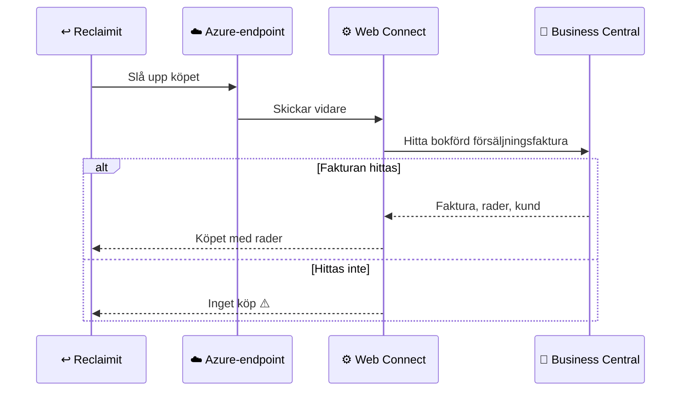

# Från Business Central till Reclaimit: köpuppslag

När en kund påbörjar en retur i Reclaimit slår Reclaimit upp det ursprungliga köpet i Business Central via Web Connect. Web Connect hittar den bokförda försäljningsfakturan och svarar direkt med rader, priser, moms, kund, leveransadress och spårningsnummer. Reclaimit använder svaret för att visa vad som går att returnera.

| | |
|---|---|
| **Riktning** | Business Central → Reclaimit, på begäran från Reclaimit |
| **Startas av** | Ett anrop från Reclaimit som tas emot av en Azure-endpoint och skickas vidare till Web Connect. |
| **Resultat** | Reclaimit har köpet och kan registrera returen mot det. Inget ändras i Business Central |
| **Del av** | [Business Central och Reclaimit: integration](../overview.md) |

## Steg för steg

1. En kund påbörjar en retur i Reclaimit med ett order- eller kvittonummer (Reclaimit).
2. Reclaimit anropar Web Connect med numret (Reclaimit).
3. Web Connect hittar den bokförda försäljningsfakturan och bygger svaret från fakturan, dess rader, kunden och företagsuppgifterna (Web Connect).
4. Web Connect svarar i samma anrop (Web Connect).
5. Reclaimit visar de rader som går att returnera (Reclaimit).

## Mappning av data

| Fält i Business Central | Fält i Reclaimit | Kommentar |
|---|---|---|
| Försäljningsfaktura: Order No. | `OrderNo`, `OriginOrderNo` | |
| Försäljningsfaktura: No. | `ReceiptNo` | |
| Orderns External ID | `ExternalOrderNo` | Ordernumret från e-handelsplattformen |
| Order Date, Shipment Date | `OrderDate`, `ShipmentDate` | |
| Currency Code | `CurrencyCode` | Tomt värde översätts till din lokala valuta |
| Language Code, Salesperson Code, Your Reference | `LanguageCode`, `SalesPersonCode`, `CustomerReference` | |
| Amount, Amount Including VAT | `TotalAmount`, `TotalAmountInclVAT` | Momsen räknas fram från raderna |
| Shipping Agent Code, Shipment Method Code | `ShippingAgentCode`, `ShipmentMethodCode` | |
| Kund: namn, adress, momsnummer och organisationsnummer, e-post, telefon | `SellToCustomer` | |
| Leveransnamn och leveransadress | `ShippingContact` | |
| Package Tracking No. | `TrackingInfos[].TrackingNumber` | |
| Företagsuppgifter | `CompanyInformation` | Ditt företagsnamn, din adress och ditt momsnummer |
| Rad: No., Variant Code, GTIN, Description och Description 2 | `SalesLines[]`: `Code`, `VariantCode`, `Gtin`, `Description` | |
| Rad: Quantity, Unit of Measure Code | `Quantity`, `UnitOfMeasureCode` | |
| Rad: Unit Price, Line Discount, Amount Including VAT | `UnitPrice`, `DiscountAmount`, `TotalAmountInclVat` | |
| Rad: Location Code, Bin Code, Item Category Code | `LocationCode`, `BinCode`, `ItemCategoryCode` | |
| Artikel: ursprungsland, tulltaxenummer | `ItemCountryOfOriginCode`, `ItemTariffCode` | |
| Ett fält på artikeln | `Returnable` | Räknas fram per rad, så att du bestämmer vilka artiklar som går att returnera |

## Objekt i Web Connect

| Objekt | Roll |
|---|---|
| `RECL-RECEIPTSEARCH` | Hittar den bokförda försäljningsfakturan och svarar Reclaimit |
| `RECL-SALESLINES` | Fakturans rader i svaret |
| `RECL-SELLTOCUSTOMER`, `RECL-SHIPPINGCONTACT`, `RECL-TRACKINGINFOS`, `RECL-COMPANYINFORMATION` | Kund, leveransadress, spårningsnummer och företagsuppgifter i svaret |

## Felhantering

| Situation | Vad som händer | Vad du gör |
|---|---|---|
| Ordern är inte fakturerad än | Inget köp hittas | Fakturera ordern, eller be kunden vänta tills ordern har levererats |
| Svaret saknar ett fält som Reclaimit behöver | Reclaimit kan inte registrera returen | Lägg till fältet i [Outgoing Mapping](../../../general/outgoing-mapping/README.md) |
| Uppslaget misslyckas | Felet visas i Entries | Läs felet i [Entries](../../../general/entries.md) |

## Vanliga frågor

### Varför hittar Reclaimit inte en order i Business Central?

Uppslaget läser bokförda försäljningsfakturor. En order som inte fakturerats än hittas inte. Kontrollera att ordern är fakturerad, och leta efter uppslaget i Web Connect Entries.

### Kan vi själva bestämma vilka artiklar som går att returnera?

Ja. Varje rad kan få en returnerbar-flagga som räknas fram från ett fält på artikeln, så att Reclaimit bara erbjuder retur av de artiklar du tillåter.

## Relaterat

- [Business Central och Reclaimit: integration](../overview.md)
- [Returorder](return-orders.md) · [Returstatus](return-status.md)
- [Webhooks](../../../general/webhooks.md) · [Outgoing Mapping](../../../general/outgoing-mapping/README.md) · [Dynamic FlowFields](../../../general/dynamic-flow-fields.md)
