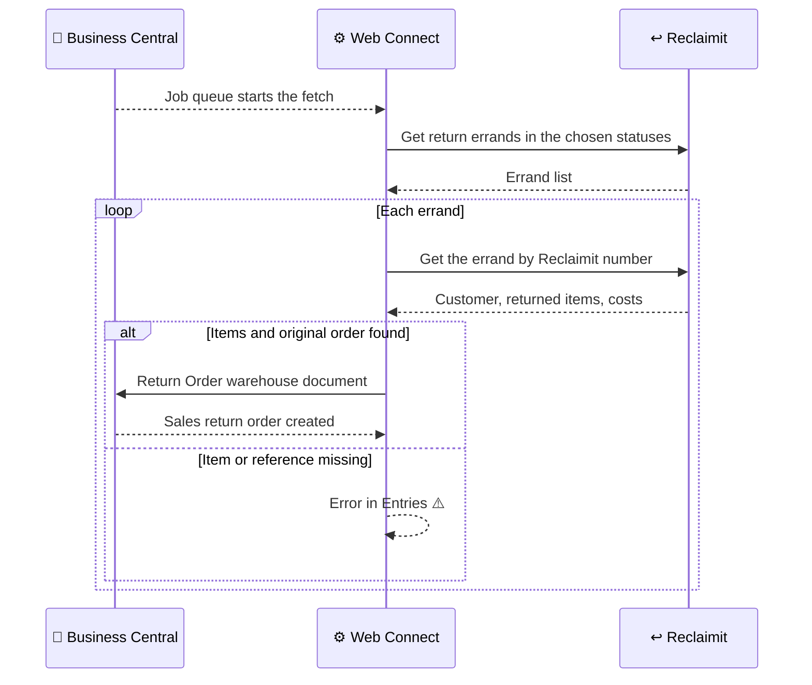
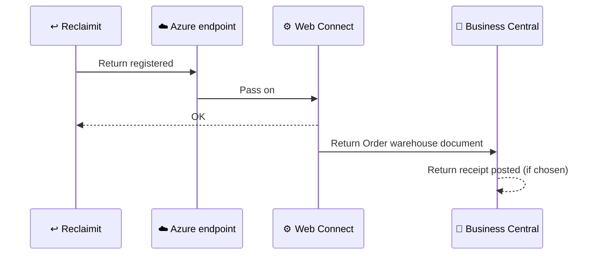

# Reclaimit to Business Central: return orders

When a customer registers a return in Reclaimit, Web Connect creates a return order in Business Central, linked to the original order, with items, quantities, return reasons, prices and return freight. Returns are fetched from the Reclaimit API on a schedule, or sent by Reclaimit as webhooks. The logistics setup decides whether the return is sent on to the warehouse or the return receipt is posted directly.

| | |
|---|---|
| **Direction** | Reclaimit → Business Central |
| **Trigger** | Schedule in the Business Central job queue, or a webhook from Reclaimit |
| **Result** | A warehouse document of the type Return Order and a sales return order in Business Central, numbered with the Reclaimit number |
| **Part of** | [Business Central and Reclaimit integration](../overview.md) |

## Step by step

### Fetched from Reclaimit on a schedule

1. The job queue starts the fetch at the times you have set (Business Central).
2. Web Connect asks the Reclaimit API for return errands in the chosen statuses, from a start date up to today (Web Connect).
3. For each errand in the list, Web Connect fetches the full errand with its customer, returned items and costs (Web Connect).
4. Web Connect creates a warehouse document of the type Return Order, with the Reclaimit number as document number and the original receipt or order number as reference (Web Connect).
5. Each returned item becomes a line with item, quantity, price and return reason. Return costs become a return freight line (Web Connect).
6. The logistics setup creates the sales return order and, if chosen, sends it on to the warehouse as an expected receipt (Business Central).

### Sent by Reclaimit as a webhook

1. A return is registered in Reclaimit (Reclaimit).
2. Reclaimit sends the return to the Azure endpoint, which passes it on to Web Connect (Reclaimit).
3. Web Connect answers OK and creates a warehouse document of the type Return Order, with the Reclaimit order number as document number and the original order number as reference (Web Connect).
4. Each line becomes a return line with item, variant, quantity, unit price and return reason. Freight lines are translated to return freight (Web Connect).
5. The logistics setup decides what happens next. In the setup in use today, the return receipt is posted automatically (Business Central). [ATT FYLLA I: confirm that a sales return order is created in this setup, since Integrate Sales Return is turned off in the logistics setup]

## Data mapping

### Fetched from Reclaimit

| Reclaimit field | Business Central field | Note |
|---|---|---|
| `ReclaimNumber` | Warehouse document number | Also used as the return order number when Use WMS Document No. on Return is set |
| `Reclaims[0].ReceiptNumber` | Applies-to document number | The original order or receipt the return refers to |
| `Reclaims[0].Created` | Document date | |
| `Reclaims[0].ShipmentData[0].ParcelNumber` | Tracking number | The parcel the customer sent back |
| `Customer`: name, address, postal code, city, country, email, mobile phone | Customer details on the warehouse document | |
| `Reclaims[].ArticleNumber` | Item number | Can be translated to item number and variant with text mapping |
| `Reclaims[].ArticleName` | Description | |
| `Reclaims[].QuantityToReclaim` | Quantity | |
| `Reclaims[].SalesPrice` | Unit price | |
| `Reclaims[].ReclaimTypeId` and `BoxListRef` | Return reason | Joined with a hyphen and matched in WMS/Return Reason Codes |
| `Reclaims[].ReclaimId` | External ID on the line | Used to send the [return status](return-status.md) back to Reclaimit |
| `Costs[].Cost`, `Description` | Return freight line | Quantity 1, with the cost as unit price |

### Sent by Reclaimit

| Reclaimit field | Business Central field | Note |
|---|---|---|
| `OrderNo` | Warehouse document number | External ID, used to find the return in Entries |
| `OriginOrderNo`, `ReturnedOrderNo` | Applies-to document number | The original order |
| `SalesLines[].Code` | Item number | Freight codes are translated to return freight with text mapping |
| `SalesLines[].VariantCode` | Variant code | |
| `SalesLines[].Quantity` | Quantity | |
| `SalesLines[].UnitPrice` | Unit price | |
| `SalesLines[].ReturnedReasonCode` | Return reason | |
| `SalesLines[].SequenceNo` | Line number | |

## Web Connect objects

| Object | Role |
|---|---|
| `RECL_GET_RETURN_ERRAND` | Asks the Reclaimit API for the list of return errands. One object per Reclaimit status that is fetched |
| `RECL_GET_RETURNORDER` | Fetches one errand by Reclaimit number and creates the Return Order warehouse document |
| `RECL_CUSTOMER`, `RECL_RECLAIMS`, `RECL_COSTS` | Customer details, returned items and return costs on the errand |
| `RECL-RETURNORDER`, `RECL-RETURNLINES` | Receive the return when Reclaimit sends it as a webhook |

## Error handling

| Situation | What happens | What to do |
|---|---|---|
| The article number is not found in Business Central | The return is not created and the error is shown in Entries | Create the item or add a translation in [Text Mapping](../../../general/text-mapping.md), then process the entry again |
| The return has no reference to the original order | The return order is not created when an original sales reference is required | Check the errand in Reclaimit, or turn off the requirement in the [logistics setup](../../../general/logistics-setup.md) |
| The access token cannot be fetched | No returns are fetched | Check the password for the Reclaimit API user in [Secret Value Storage](../../../general/secret-value-storage.md) |
| The same return comes in again | The existing warehouse document is updated | Nothing |

## Frequently asked questions

### Why has a return from Reclaimit not become a return order in Business Central?

Check the return in Web Connect Entries. Common reasons are an article number that is not found in Business Central, or a return without a reference to the original order when one is required. Fix the cause and process the entry again.

### Can the same return be created twice?

No. The Reclaimit number and the id of each returned item identify the return. If the same return comes in again, Web Connect updates the existing warehouse document instead of creating a new one.

## Related

- [Business Central and Reclaimit integration](../overview.md)
- [Return status](return-status.md) · [Purchase lookup](purchase-lookup.md)
- [WMS documents](../../../general/wms-documents.md) · [Logistics Setup](../../../general/logistics-setup.md) · [WMS/Return Reason Codes](../../../general/wms-return-reason-codes.md) · [Webhooks](../../../general/webhooks.md)
