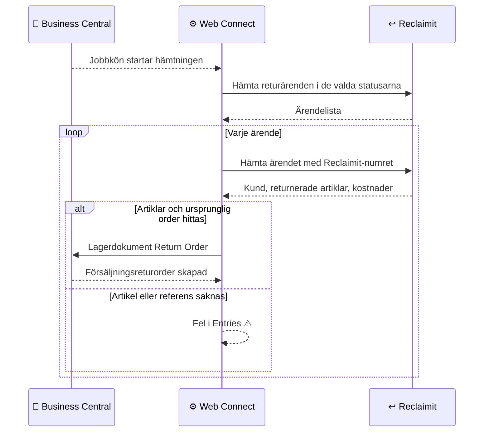
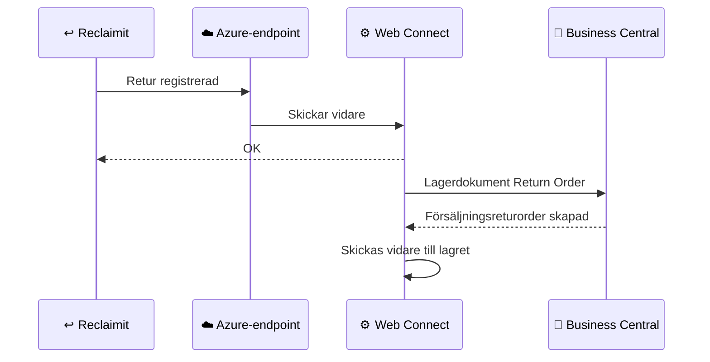

# Från Reclaimit till Business Central: returorder

När en kund registrerar en retur i Reclaimit skapar Web Connect en returorder i Business Central, kopplad till den ursprungliga ordern, med artiklar, antal, returorsaker, priser och returfrakt. Returerna hämtas från Reclaimits API enligt schema, eller skickas av Reclaimit som webhooks. Returordern skickas sedan vidare till lagret som en förväntad inleverans.

| | |
|---|---|
| **Riktning** | Reclaimit → Business Central |
| **Startas av** | Schema i jobbkön i Business Central, eller en webhook från Reclaimit |
| **Resultat** | Ett lagerdokument av typen Return Order och en försäljningsreturorder i Business Central, numrerad med Reclaimit-numret |
| **Del av** | [Business Central och Reclaimit: integration](../overview.md) |

## Steg för steg

### Hämtas från Reclaimit enligt schema

1. Jobbkön startar hämtningen vid de tider du har ställt in (Business Central).
2. Web Connect frågar Reclaimits API efter returärenden i de valda statusarna, från ett startdatum fram till i dag (Web Connect).
3. För varje ärende i listan hämtar Web Connect hela ärendet med kund, returnerade artiklar och kostnader (Web Connect).
4. Web Connect skapar ett lagerdokument av typen Return Order, med Reclaimit-numret som dokumentnummer och det ursprungliga kvitto- eller ordernumret som referens (Web Connect).
5. Varje returnerad artikel blir en rad med artikel, antal, pris och returorsak. Returkostnader blir en rad för returfrakt (Web Connect).
6. Logistikinställningarna skapar försäljningsreturordern och skickar den vidare till lagret som en förväntad inleverans (Business Central).

### Skickas av Reclaimit som webhook

1. En retur registreras i Reclaimit (Reclaimit).
2. Reclaimit skickar returen till Azure-endpointen, som skickar den vidare till Web Connect (Reclaimit).
3. Web Connect svarar OK och skapar ett lagerdokument av typen Return Order, med Reclaimits ordernummer som dokumentnummer och det ursprungliga ordernumret som referens (Web Connect).
4. Varje rad blir en returrad med artikel, variant, antal, enhetspris och returorsak. Fraktrader översätts till returfrakt (Web Connect).
5. Logistikinställningarna skapar försäljningsreturordern och skickar den vidare till lagret som en förväntad inleverans (Business Central).

## Mappning av data

### Hämtas från Reclaimit

| Fält i Reclaimit | Fält i Business Central | Kommentar |
|---|---|---|
| `ReclaimNumber` | Lagerdokumentets nummer | Används också som returorderns nummer när Use WMS Document No. on Return är ikryssat |
| `Reclaims[0].ReceiptNumber` | Kopplat dokumentnummer (applies-to) | Den ursprungliga ordern eller det kvitto som returen gäller |
| `Reclaims[0].Created` | Dokumentdatum | |
| `Reclaims[0].ShipmentData[0].ParcelNumber` | Spårningsnummer | Paketet som kunden skickade tillbaka |
| `Customer`: namn, adress, postnummer, ort, land, e-post, mobilnummer | Kunduppgifter på lagerdokumentet | |
| `Reclaims[].ArticleNumber` | Artikelnummer | Kan översättas till artikelnummer och variant med textmappning |
| `Reclaims[].ArticleName` | Beskrivning | |
| `Reclaims[].QuantityToReclaim` | Antal | |
| `Reclaims[].SalesPrice` | Enhetspris | |
| `Reclaims[].ReclaimTypeId` och `BoxListRef` | Returorsak | Sätts ihop med ett bindestreck och matchas i WMS/Return Reason Codes |
| `Reclaims[].ReclaimId` | External ID på raden | Används för att skicka [returstatus](return-status.md) tillbaka till Reclaimit |
| `Costs[].Cost`, `Description` | Rad för returfrakt | Antal 1, med kostnaden som enhetspris |

### Skickas av Reclaimit

| Fält i Reclaimit | Fält i Business Central | Kommentar |
|---|---|---|
| `OrderNo` | Lagerdokumentets nummer | External ID, används för att hitta returen i Entries |
| `OriginOrderNo`, `ReturnedOrderNo` | Kopplat dokumentnummer (applies-to) | Den ursprungliga ordern |
| `SalesLines[].Code` | Artikelnummer | Fraktkoder översätts till returfrakt med textmappning |
| `SalesLines[].VariantCode` | Variantkod | |
| `SalesLines[].Quantity` | Antal | |
| `SalesLines[].UnitPrice` | Enhetspris | |
| `SalesLines[].ReturnedReasonCode` | Returorsak | |
| `SalesLines[].SequenceNo` | Radnummer | |

## Objekt i Web Connect

| Objekt | Roll |
|---|---|
| `RECL_GET_RETURN_ERRAND` | Frågar Reclaimits API efter listan med returärenden. Ett objekt per status i Reclaimit som hämtas |
| `RECL_GET_RETURNORDER` | Hämtar ett ärende med Reclaimit-numret och skapar lagerdokumentet Return Order |
| `RECL_CUSTOMER`, `RECL_RECLAIMS`, `RECL_COSTS` | Kunduppgifter, returnerade artiklar och returkostnader i ärendet |
| `RECL-RETURNORDER`, `RECL-RETURNLINES` | Tar emot returen när Reclaimit skickar den som webhook |

## Felhantering

| Situation | Vad som händer | Vad du gör |
|---|---|---|
| Artikelnumret finns inte i Business Central | Returen skapas inte och felet visas i Entries | Skapa artikeln eller lägg till en översättning i [Text Mapping](../../../general/text-mapping.md), och bearbeta sedan posten igen |
| Returen saknar hänvisning till den ursprungliga ordern | Returordern skapas inte när en hänvisning till den ursprungliga försäljningen krävs | Kontrollera ärendet i Reclaimit, eller stäng av kravet i [logistikinställningarna](../../../general/logistics-setup.md) |
| Åtkomsttoken går inte att hämta | Inga returer hämtas | Kontrollera lösenordet för API-användaren i Reclaimit i [Secret Value Storage](../../../general/secret-value-storage.md) |
| Samma retur kommer in igen | Det befintliga lagerdokumentet uppdateras | Inget |

## Vanliga frågor

### Varför har en retur från Reclaimit inte blivit en returorder i Business Central?

Kontrollera returen i Web Connect Entries. Vanliga orsaker är ett artikelnummer som inte finns i Business Central, eller en retur utan hänvisning till den ursprungliga ordern när en sådan krävs. Rätta orsaken och bearbeta posten igen.

### Kan samma retur skapas två gånger?

Nej. Reclaimit-numret och id:t för varje returnerad artikel identifierar returen. Kommer samma retur in igen uppdaterar Web Connect det befintliga lagerdokumentet i stället för att skapa ett nytt.

## Relaterat

- [Business Central och Reclaimit: integration](../overview.md)
- [Returstatus](return-status.md) · [Köpuppslag](purchase-lookup.md)
- [WMS-dokument](../../../general/wms-documents.md) · [Logistics Setup](../../../general/logistics-setup.md) · [WMS/Return Reason Codes](../../../general/wms-return-reason-codes.md) · [Webhooks](../../../general/webhooks.md)
