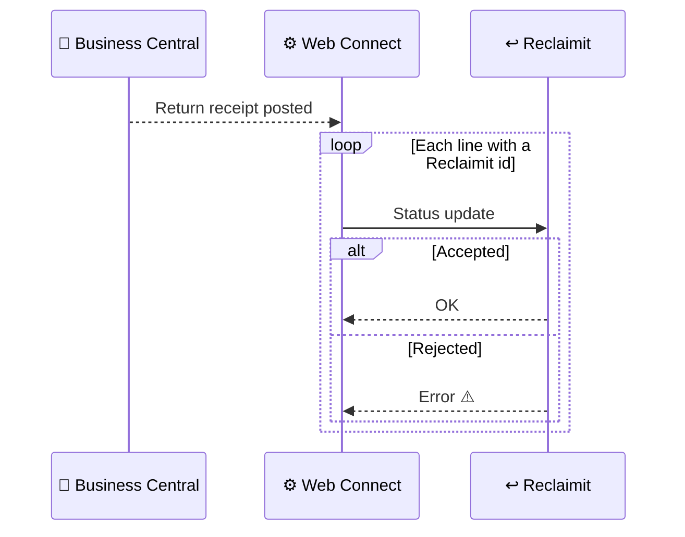

# Business Central to Reclaimit: return status

When the return receipt for a Reclaimit return is posted in Business Central, Web Connect updates the status of each returned item in Reclaimit. Customer service and the customer can then see in Reclaimit that the return has been received. Only receipt lines that came from Reclaimit are reported.

| | |
|---|---|
| **Direction** | Business Central → Reclaimit |
| **Trigger** | Posting of the return receipt in Business Central: an outgoing sync trigger on posting |
| **Result** | Each returned item has the received status in Reclaimit |
| **Part of** | [Business Central and Reclaimit integration](../overview.md) |

## Step by step

1. The return receipt is posted, either by you, by Web Connect or after the warehouse has reported the receipt (Business Central).
2. Web Connect picks the lines on the posted return receipt that have a Reclaimit id, which was stored when the [return order](return-orders.md) was created (Web Connect).
3. For each line, Web Connect sends a status update with the Reclaimit id and the status code for received (Web Connect).
4. Reclaimit updates the returned item (Reclaimit).

## Data mapping

| Business Central field | Reclaimit field | Note |
|---|---|---|
| External ID on the return receipt line | `reclaimId` | The id of the returned item in Reclaimit |
| | `statusCode` | Fixed value in the mapping, the Reclaimit status for received |

## Web Connect objects

| Object | Role |
|---|---|
| `RECL_SETERRANDSTATUS` | Sends the status update for each posted return receipt line with a Reclaimit id |

## Error handling

| Situation | What happens | What to do |
|---|---|---|
| The trigger on posting is switched off | No status is sent | Switch on the trigger in [Outgoing Sync Triggers](../../../general/outgoing-mapping/outgoing-sync-triggers.md), or [resend the message](../../../../../how-to/web-connect/resend-outgoing-message.md) |
| Reclaimit rejects the update | The error is shown in Entries | Read the error in [Entries](../../../general/entries.md) and resend the message |
| The access token cannot be fetched | Nothing is sent | Check the password for the Reclaimit API user in [Secret Value Storage](../../../general/secret-value-storage.md) |

## Frequently asked questions

### Why does a return still show as not received in Reclaimit?

The status is sent when the return receipt is posted in Business Central. Check that the receipt is posted, that the trigger on posting is switched on, and look for the status message in Web Connect Entries.

## Related

- [Business Central and Reclaimit integration](../overview.md)
- [Return orders](return-orders.md) · [Purchase lookup](purchase-lookup.md)
- [Outgoing Sync Triggers](../../../general/outgoing-mapping/outgoing-sync-triggers.md) · [Entries](../../../general/entries.md)
