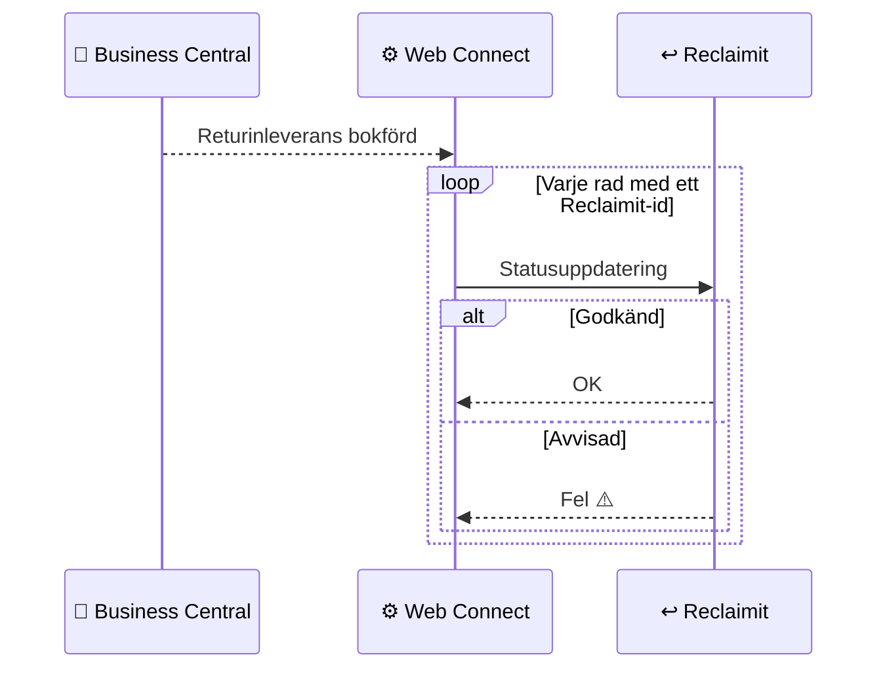

# Från Business Central till Reclaimit: returstatus

När returinleveransen för en retur från Reclaimit bokförs i Business Central uppdaterar Web Connect statusen för varje returnerad artikel i Reclaimit. Kundtjänst och kunden ser då i Reclaimit att returen har tagits emot. Bara inleveransrader som kom från Reclaimit rapporteras.

| | |
|---|---|
| **Riktning** | Business Central → Reclaimit |
| **Startas av** | Bokföring av returinleveransen i Business Central: en utgående synktrigger vid bokföring |
| **Resultat** | Varje returnerad artikel har statusen mottagen i Reclaimit |
| **Del av** | [Business Central och Reclaimit: integration](../overview.md) |

## Steg för steg

1. Returinleveransen bokförs, antingen av dig, av Web Connect eller efter att lagret har rapporterat inleveransen (Business Central).
2. Web Connect väljer de rader på den bokförda returinleveransen som har ett Reclaimit-id, som sparades när [returordern](return-orders.md) skapades (Web Connect).
3. För varje rad skickar Web Connect en statusuppdatering med Reclaimit-id:t och statuskoden för mottagen (Web Connect).
4. Reclaimit uppdaterar den returnerade artikeln (Reclaimit).

## Mappning av data

| Fält i Business Central | Fält i Reclaimit | Kommentar |
|---|---|---|
| External ID på returinleveransens rad | `reclaimId` | Id:t för den returnerade artikeln i Reclaimit |
| | `statusCode` | Fast värde i mappningen, Reclaimits status för mottagen |

## Objekt i Web Connect

| Objekt | Roll |
|---|---|
| `RECL_SETERRANDSTATUS` | Skickar statusuppdateringen för varje bokförd rad på returinleveransen som har ett Reclaimit-id |

## Felhantering

| Situation | Vad som händer | Vad du gör |
|---|---|---|
| Triggern vid bokföring är avstängd | Ingen status skickas | Slå på triggern i [Outgoing Sync Triggers](../../../general/outgoing-mapping/outgoing-sync-triggers.md), eller [skicka meddelandet igen](../../../../../how-to/web-connect/resend-outgoing-message.md) |
| Reclaimit avvisar uppdateringen | Felet visas i Entries | Läs felet i [Entries](../../../general/entries.md) och skicka meddelandet igen |
| Åtkomsttoken går inte att hämta | Inget skickas | Kontrollera lösenordet för API-användaren i Reclaimit i [Secret Value Storage](../../../general/secret-value-storage.md) |

## Vanliga frågor

### Varför visas en retur fortfarande som inte mottagen i Reclaimit?

Statusen skickas när returinleveransen bokförs i Business Central. Kontrollera att inleveransen är bokförd och att triggern vid bokföring är påslagen, och leta efter statusmeddelandet i Web Connect Entries.

## Relaterat

- [Business Central och Reclaimit: integration](../overview.md)
- [Returorder](return-orders.md) · [Köpuppslag](purchase-lookup.md)
- [Outgoing Sync Triggers](../../../general/outgoing-mapping/outgoing-sync-triggers.md) · [Entries](../../../general/entries.md)
