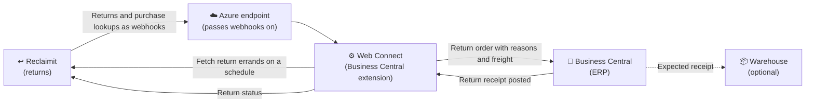
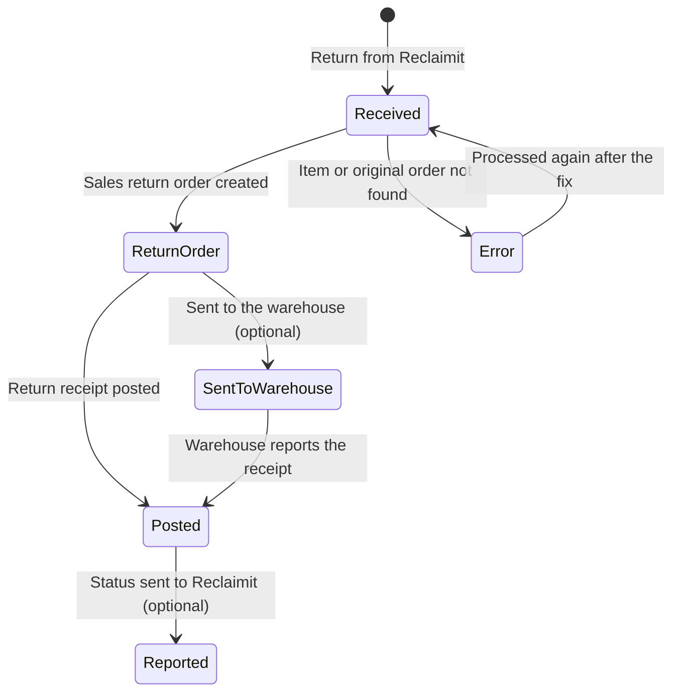
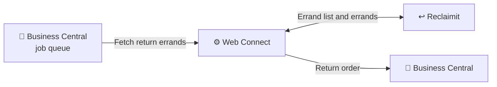
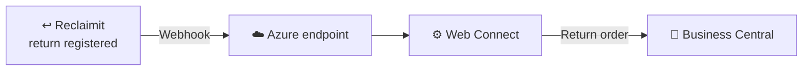
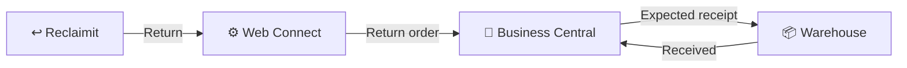
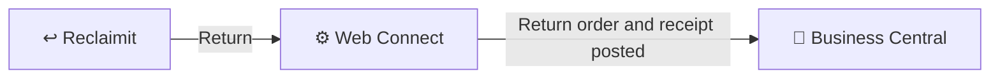
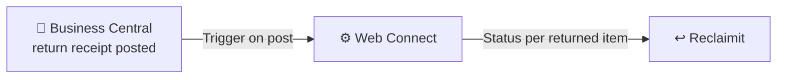
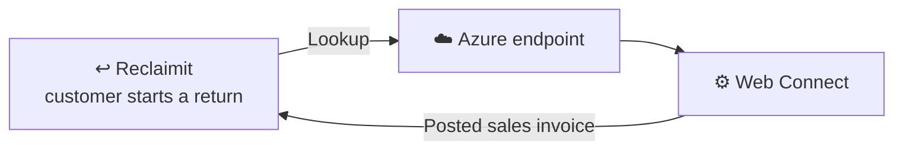

# Business Central and Reclaimit integration

Web Connect by CombineIT connects Microsoft Dynamics 365 Business Central with Reclaimit, the returns management platform. Returns registered in Reclaimit become return orders in Business Central, with return reasons and return freight. Business Central can tell Reclaimit when a return has been received, and Reclaimit can look up the original purchase in Business Central. All mappings and rules live in your own Business Central, where you can see and change them yourself.

## At a glance

| | |
|---|---|
| **System** | Reclaimit (returns) |
| **Integration product** | Web Connect for Microsoft Dynamics 365 Business Central |
| **Runs in** | Your own Business Central environment, as an extension. Depending on the setup, Web Connect fetches new returns from Reclaimit on a schedule in the Business Central job queue, or Reclaimit sends returns and purchase lookups to an Azure endpoint that passes them on to Web Connect. The return status is sent to Reclaimit when the return receipt is posted. All processing and configuration stays in Business Central. |
| **Configured by** | You, in Business Central: mappings, conditions, triggers and flows. You can do all of it yourself. If you want, CombineIT takes part in any step, as a sounding board or by doing the work. |
| **Connection** | Reclaimit web API (REST with JSON) with OAuth 2.0. The API user is created in Reclaimit. Calls from Reclaimit to Business Central come as webhooks |
| **Reclaimit API** | [ATT FYLLA I: link to Reclaimit's API documentation, if it is public] |
| **Data flows** | 3: return orders, return status and purchase lookup |
| **Business Central editions** | All editions, Essentials and Premium, including the latest version |
| **Available from** | [Web Connect on Microsoft AppSource](https://marketplace.microsoft.com/sv-se/product/PUBID.martitab1633951001710%7CAID.webconnect%7CPAPPID.9f3a7223-19db-4ac7-832f-cf8e4699186f?tab=Overview). [ATT FYLLA I: whether the Reclaimit integration is part of the Web Connect Ready Integrations app] |

## What can be synchronized

Web Connect has three data flows between Business Central and Reclaimit.

| Data | Direction | What happens |
|---|---|---|
| [Return orders](flows/return-orders.md) | Reclaimit → Business Central | A return registered in Reclaimit becomes a return order in Business Central, linked to the original order, with items, quantities, return reasons, prices and return freight |
| [Return status](flows/return-status.md) | Business Central → Reclaimit | When the return receipt is posted in Business Central, Web Connect updates the status of each returned item in Reclaimit |
| [Purchase lookup](flows/purchase-lookup.md) | Business Central → Reclaimit, on request | When a customer starts a return, Reclaimit looks up the posted sales invoice in Business Central and gets the lines, prices, customer and tracking number back |

Return orders are part of every Reclaimit integration. The other two flows are chosen at setup. See [Choose your setup](#choose-your-setup).

## How it works

Web Connect uses the [WMS documents](../../general/wms-documents.md) in Business Central, the same layer that handles warehouse and POS systems. A return from Reclaimit first becomes a warehouse document of the type Return Order, and the [logistics setup](../../general/logistics-setup.md) for Reclaimit decides what happens next: a sales return order is created, it can be sent on to the warehouse, and the return receipt can be posted. Returns either come in on a schedule, when Web Connect asks the Reclaimit API for new return errands, or as webhooks from Reclaimit. Before each call to Reclaimit, Web Connect gets an access token and renews it automatically. Every message in both directions is logged in Web Connect [Entries](../../general/entries.md), where it can be inspected and resent, and a daily error summary can be emailed to you.

### Return document status in Business Central

## Choose your setup

Each flow has to fit how your business works: which system owns the data, where people do their work, and what the accounting needs. That is why the flows are decided together when a new integration is set up. The options below are the ones Web Connect customers use today. **Common setup** marks the option most Web Connect customers with Reclaimit use. **Recommended** marks CombineIT's best practice, where there is one.

### Return orders

| Option | How it works | When it fits |
|---|---|---|
| **Fetched from Reclaimit on a schedule** (common setup) | The Business Central job queue asks the Reclaimit API for return errands in the statuses you choose, then fetches each errand and creates the return order | Reclaimit holds the return, and you want Business Central to pick it up without anything set up on the Reclaimit side |
| **Sent by Reclaimit as a webhook** | Reclaimit sends the registered return to an Azure endpoint, which passes it on to Web Connect. The return order is created when the call arrives | You want the return in Business Central as soon as it is registered, and Reclaimit is set up to call Business Central |

Two of the three Reclaimit integrations in Web Connect today fetch returns on a schedule.

#### Return orders fetched from Reclaimit on a schedule

#### Return orders sent by Reclaimit as a webhook

### Return receipt

| Option | How it works | When it fits |
|---|---|---|
| **Return order sent on to the warehouse** (common setup) | The return order is sent to your warehouse system as an expected receipt. The return receipt is posted when the warehouse reports that the goods have arrived | Returned goods arrive at a warehouse that is also connected through Web Connect |
| **Return receipt posted by Web Connect** | Web Connect posts the return receipt as soon as the return comes in from Reclaimit | The return is already checked when Reclaimit registers it, and no warehouse needs to confirm it |

#### Return receipt after the warehouse has received the goods

#### Return receipt posted by Web Connect

### Return status

| Option | How it works | When it fits |
|---|---|---|
| **Status sent when the return receipt is posted** | When the return receipt is posted, Web Connect sets the status of each returned item in Reclaimit | Customer service and the customer follow the return in Reclaimit, and should see when it has been received |
| **No status sent** | Business Central does not update Reclaimit | The return is followed up in Reclaimit or in the warehouse, not from Business Central |

#### Return status sent when the return receipt is posted

### Purchase lookup

| Option | How it works | When it fits |
|---|---|---|
| **Reclaimit looks up the purchase in Business Central** | When a customer starts a return, Reclaimit asks Web Connect for the posted sales invoice and gets lines, prices, customer and tracking number back right away | Business Central holds the purchase history Reclaimit needs, for example when sales come from several channels |
| **No purchase lookup** | Reclaimit finds the purchase in another source, for example the e-commerce platform | The purchase history Reclaimit needs is already available elsewhere |

#### Purchase lookup in Business Central

The return portal, the return policy and the customer communication are always maintained in Reclaimit.

## What you need

- Microsoft Dynamics 365 Business Central, any edition (Essentials or Premium), including the latest version
- Web Connect installed from Microsoft AppSource, with an activated Web Connect license
- Your approval for Web Connect to be installed and to act in your Business Central environment
- An API user for Web Connect, created in Reclaimit, if returns are fetched or the status is sent back
- A location in Business Central for returns and a logistics setup for Reclaimit with sales returns switched on
- Return reason codes in Business Central for the return reasons you use in Reclaimit, and an item or account for return freight
- If Reclaimit calls Business Central: the address of the Azure endpoint, which CombineIT gives you to enter in Reclaimit

## Setting it up

1. Decide which flows to use and which option to choose for each, see [Choose your setup](#choose-your-setup).
2. Install Web Connect in Business Central, activate the license and give your approval.
3. Import the Reclaimit configuration with the integration turned off, then set your location and logistics setup.
4. Store the password for the Reclaimit API user in [Secret Value Storage](../../general/secret-value-storage.md).
5. Map the return reasons in Reclaimit to return reason codes in [WMS/Return Reason Codes](../../general/wms-return-reason-codes.md).
6. If Reclaimit uses other article numbers than your item numbers, translate them in [Text Mapping](../../general/text-mapping.md).
7. Set how often return errands are fetched, or give Reclaimit the address of the Azure endpoint.
8. Test a return, a return with freight and a return of an item that does not exist in Business Central before going live.

## Configure it yourself in Business Central

All configuration and logic in the integration is visible and editable in Business Central. There is no external integration platform where the logic is hidden. When Reclaimit calls Business Central, the Azure endpoint that receives the call only passes it on to Web Connect.

| What you can change | Where in Web Connect | Example |
|---|---|---|
| What happens with a return | [Logistics Setup](../../general/logistics-setup.md) | Create a sales return order, send it to the warehouse, or post the return receipt directly |
| Return reasons | [WMS/Return Reason Codes](../../general/wms-return-reason-codes.md) | Map a Reclaimit return reason to a return reason code in Business Central |
| Item numbers | [Text Mapping](../../general/text-mapping.md) | Translate the article number in Reclaimit to item number and variant in Business Central |
| Which returns are fetched | [Objects](../../general/objects.md) | Fetch errands in another Reclaimit status, or change how often they are fetched |
| What is returned to Reclaimit | [Outgoing Mapping](../../general/outgoing-mapping/README.md) | Add a field to the purchase lookup, or change the status sent when a return is received |
| When the status is sent | [Outgoing Sync Triggers](../../general/outgoing-mapping/outgoing-sync-triggers.md) | Send the status when the return receipt is posted |
| Return freight | [Condition List](../../general/condition-list.md) | Decide which lines from Reclaimit are return fees |
| Monitoring and resending | [Entries](../../general/entries.md) | See every return and status message, and [resend a message](../../../../how-to/web-connect/resend-outgoing-message.md) |

## Configuration choices

- **How returns come in:** fetched from the Reclaimit API on a schedule, or sent by Reclaimit as webhooks.
- **Which returns are fetched:** the Reclaimit statuses Web Connect asks for, and the earliest date to include.
- **Schedule:** how often return errands are fetched, set to your needs.
- **Return order number:** whether the return order in Business Central gets the Reclaimit number or a number from your number series.
- **Original order:** whether every return must refer to the original sales document.
- **Return receipt:** whether the return order is sent on to the warehouse, or the return receipt is posted when the return comes in.
- **Return reasons:** how each Reclaimit return reason is translated to a return reason code, and whether a reason adds a return fee.
- **Item matching:** whether the article number in Reclaimit is the item number, or is translated to item number and variant.
- **Return freight:** which item or account the return freight line uses.
- **Return status:** whether Reclaimit is updated when the return receipt is posted, and which status it gets.
- **Purchase lookup:** which fields Reclaimit gets back, for example whether an item is returnable.
- **Error handling:** how many times a failed return is retried, and who receives the daily error summary email.

## Limitations

- **Fetched returns arrive on a schedule.** With the scheduled option, a return is in Business Central first after the next run. Choose webhooks if returns are needed sooner.
- **Each fetch reads up to 200 errands per status.** The errand list is read one page at a time with 200 errands, without paging further.
- **The item must exist in Business Central.** A return line with an article number that is not found stops the return with an error in Entries until the item or the translation is fixed.
- **Refunds are not sent to Reclaimit.** The integration creates the return in Business Central. The credit memo and the refund are handled in Business Central and the payment provider.
- **The purchase lookup reads posted sales invoices.** Orders that are not invoiced yet are not found.

## Frequently asked questions

### Can Business Central be integrated with Reclaimit?

Yes. Web Connect connects Business Central with Reclaimit. Returns registered in Reclaimit become return orders in Business Central, Business Central can report back to Reclaimit when the return has been received, and Reclaimit can look up the original purchase in Business Central.

### How do return reasons from Reclaimit end up in Business Central?

Each return reason in Reclaimit is matched to a row in Web Connect WMS/Return Reason Codes, which sets the return reason code in Business Central. You maintain that table yourself, so a new return reason in Reclaimit only needs a new row.

### Is the return freight the customer pays included on the return order?

Yes. Return costs from Reclaimit are added to the return order in Business Central as a return freight line, so the credit memo can deduct them.

### Is the return sent on to our warehouse?

It can be. If your warehouse system is also connected through Web Connect, the return order created from Reclaimit can be sent on to the warehouse as an expected receipt. This is a setting in the logistics setup.

## Related

- Flows: [Return orders](flows/return-orders.md) · [Return status](flows/return-status.md) · [Purchase lookup](flows/purchase-lookup.md)
- How-to: [Resend an outgoing message](../../../../how-to/web-connect/resend-outgoing-message.md) · [Integrations not running](../../../../how-to/web-connect/integration-not-running.md) · [Unauthorized after the job queue stopped](../../../../how-to/web-connect/unauthorized-after-job-queue-stopped.md)
- Web Connect: [Logistics Setup](../../general/logistics-setup.md) · [WMS documents](../../general/wms-documents.md) · [WMS/Return Reason Codes](../../general/wms-return-reason-codes.md) · [Webhooks](../../general/webhooks.md) · [Secret Value Storage](../../general/secret-value-storage.md)
- [Web Connect general documentation](../../general/README.md)
- [Reclaimit](https://www.reclaimit.com/)

## About Web Connect

Web Connect is an integration platform for Microsoft Dynamics 365 Business Central, developed by CombineIT. It is installed in your own Business Central and connects it with e-commerce platforms, warehouse systems, POS, returns, marketplaces and EDI. Every flow, mapping and rule is configured in Business Central, where you can see and change it yourself, without custom code for each integration. [Web Connect on Microsoft AppSource](https://marketplace.microsoft.com/sv-se/product/PUBID.martitab1633951001710%7CAID.webconnect%7CPAPPID.9f3a7223-19db-4ac7-832f-cf8e4699186f?tab=Overview) · [Contact CombineIT](https://www.combineit.se/contact/)
