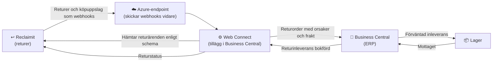
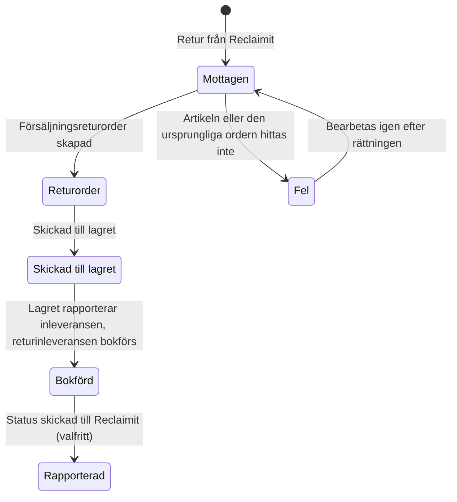
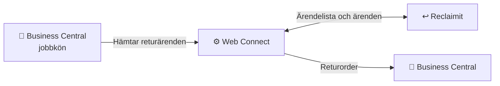
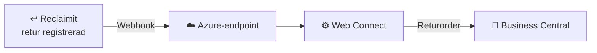
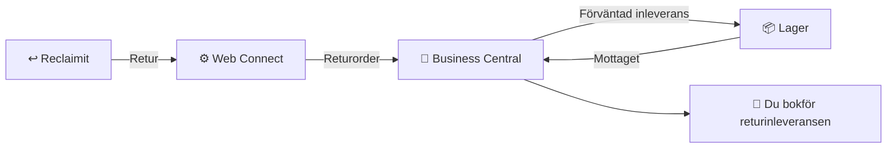
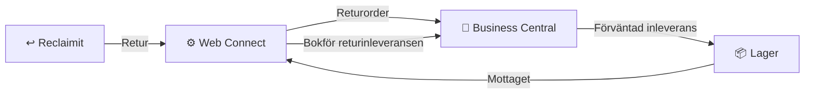
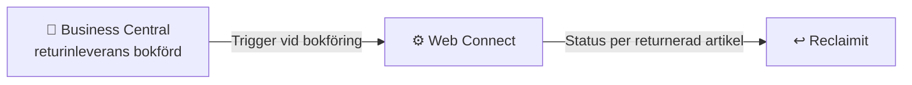
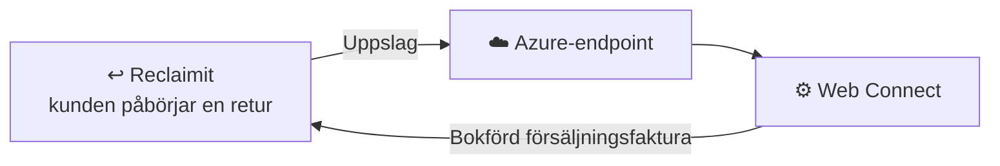

# Business Central och Reclaimit: integration

Web Connect från CombineIT kopplar ihop Microsoft Dynamics 365 Business Central med returplattformen Reclaimit. Returer som registreras i Reclaimit blir returorder i Business Central, med returorsaker och returfrakt. Business Central kan meddela Reclaimit när en retur har tagits emot, och Reclaimit kan slå upp det ursprungliga köpet i Business Central. Alla mappningar och regler finns i ditt eget Business Central, där du själv kan se och ändra dem.

## I korthet

| | |
|---|---|
| **System** | Reclaimit (returer) |
| **Integrationsprodukt** | Web Connect för Microsoft Dynamics 365 Business Central |
| **Körs i** | Din egen Business Central-miljö, som ett tillägg. Beroende på upplägg hämtar Web Connect nya returer från Reclaimit enligt schema i jobbkön i Business Central, eller så skickar Reclaimit returer och köpuppslag till en Azure-endpoint som skickar dem vidare till Web Connect. Returstatus skickas till Reclaimit när returinleveransen bokförs. All bearbetning och konfiguration ligger kvar i Business Central. |
| **Konfigureras av** | Dig, i Business Central: mappningar, villkor, triggers och flöden. Du kan göra allt själv. Vill du kan CombineIT vara med i vilket steg som helst, som bollplank eller genom att göra jobbet. |
| **Koppling** | Reclaimits webb-API (REST med JSON) med OAuth 2.0. API-användaren skapas i Reclaimit. Anrop från Reclaimit till Business Central kommer som webhooks |
| **Reclaimit API** | [Reclaimit Web API Help](https://live.reclaimit.com/webapi/help) |
| **Dataflöden** | 3: returorder, returstatus och köpuppslag |
| **Business Central-utgåvor** | Alla utgåvor, Essentials och Premium, även den senaste versionen |
| **Finns på** | [Web Connect på Microsoft AppSource](https://marketplace.microsoft.com/sv-se/product/PUBID.martitab1633951001710%7CAID.webconnect%7CPAPPID.9f3a7223-19db-4ac7-832f-cf8e4699186f?tab=Overview). Integrationen med Reclaimit ingår inte i appen Web Connect Ready Integrations. Den sätts upp som en konfiguration i Web Connect |

## Det här kan synkas

Web Connect har tre dataflöden mellan Business Central och Reclaimit.

| Data | Riktning | Vad som händer |
|---|---|---|
| [Returorder](flows/return-orders.md) | Reclaimit → Business Central | En retur som registreras i Reclaimit blir en returorder i Business Central, kopplad till den ursprungliga ordern, med artiklar, antal, returorsaker, priser och returfrakt |
| [Returstatus](flows/return-status.md) | Business Central → Reclaimit | När returinleveransen bokförs i Business Central uppdaterar Web Connect statusen för varje returnerad artikel i Reclaimit |
| [Köpuppslag](flows/purchase-lookup.md) | Business Central → Reclaimit, på begäran | När en kund påbörjar en retur slår Reclaimit upp den bokförda försäljningsfakturan i Business Central och får tillbaka rader, priser, kund och spårningsnummer |

Returorder ingår i varje integration med Reclaimit. De andra två flödena väljs när integrationen sätts upp. Se [Välj upplägg](#choose-your-setup).

## Så fungerar det

Web Connect använder [WMS-dokumenten](../../general/wms-documents.md) i Business Central, samma lager som hanterar lagersystem och kassasystem. En retur från Reclaimit blir först ett lagerdokument av typen Return Order. [Logistikinställningarna](../../general/logistics-setup.md) för Reclaimit skapar sedan en försäljningsreturorder, skickar den vidare till lagret och avgör om returinleveransen bokförs automatiskt när lagret rapporterar den. Returer kommer antingen in enligt schema, när Web Connect frågar Reclaimits API efter nya returärenden, eller som webhooks från Reclaimit. Före varje anrop till Reclaimit hämtar Web Connect en åtkomsttoken och förnyar den automatiskt. Varje meddelande i båda riktningarna loggas i Web Connect [Entries](../../general/entries.md), där det går att granska och skicka igen, och du kan få en daglig sammanställning av felen via e-post.

### Returdokumentets status i Business Central

## Välj upplägg

Varje flöde måste passa hur ditt företag arbetar: vilket system som äger datan, var personalen gör sitt arbete och vad bokföringen behöver. Därför bestäms flödena tillsammans när en ny integration sätts upp. Alternativen nedan är de som Web Connect-kunder använder i dag. **Vanligt upplägg** markerar det alternativ som flest Web Connect-kunder med Reclaimit använder. **Rekommenderas** markerar CombineIT:s bästa praxis, där det finns en.

### Returorder

| Alternativ | Så fungerar det | När det passar |
|---|---|---|
| **Hämtas från Reclaimit enligt schema** (vanligt upplägg) | Jobbkön i Business Central frågar Reclaimits API efter returärenden i de statusar du väljer, hämtar sedan varje ärende och skapar returordern | Reclaimit håller returen, och du vill att Business Central hämtar den utan att något behöver sättas upp hos Reclaimit |
| **Skickas av Reclaimit som webhook** | Reclaimit skickar den registrerade returen till en Azure-endpoint, som skickar den vidare till Web Connect. Returordern skapas när anropet kommer in | Du vill ha returen i Business Central så fort den registreras, och Reclaimit är uppsatt för att anropa Business Central |

Två av de tre integrationerna med Reclaimit i Web Connect i dag hämtar returer enligt schema.

#### Returorder hämtas från Reclaimit enligt schema

#### Returorder skickas av Reclaimit som webhook

### Returinleverans

Returordern som skapas från Reclaimit skickas vidare till ditt lagersystem som en förväntad inleverans, när lagret också är kopplat via Web Connect. Det som skiljer är hur returinleveransen bokförs när lagret rapporterar att varorna har kommit.

| Alternativ | Så fungerar det | När det passar |
|---|---|---|
| **Bokförs av dig** (vanligt upplägg) | Lagret rapporterar inleveransen, och du bokför returinleveransen i Business Central | Du vill kontrollera de returnerade varorna innan inleveransen bokförs |
| **Bokförs automatiskt** | Web Connect bokför returinleveransen så fort lagret rapporterar att varorna har kommit | Lagrets kontroll av de returnerade varorna räcker, utan ett manuellt steg |

#### Returinleveransen bokförs av dig

#### Returinleveransen bokförs automatiskt

### Returstatus

| Alternativ | Så fungerar det | När det passar |
|---|---|---|
| **Status skickas när returinleveransen bokförs** | När returinleveransen bokförs sätter Web Connect statusen för varje returnerad artikel i Reclaimit | Kundtjänst och kunden följer returen i Reclaimit och ska se när den har tagits emot |
| **Ingen status skickas** | Business Central uppdaterar inte Reclaimit | Returen följs upp i Reclaimit eller i lagret, inte från Business Central |

#### Returstatus skickas när returinleveransen bokförs

### Köpuppslag

| Alternativ | Så fungerar det | När det passar |
|---|---|---|
| **Reclaimit slår upp köpet i Business Central** | När en kund påbörjar en retur frågar Reclaimit Web Connect efter den bokförda försäljningsfakturan och får direkt tillbaka rader, priser, kund och spårningsnummer | Business Central har den köphistorik som Reclaimit behöver, till exempel när försäljningen kommer från flera kanaler |
| **Inget köpuppslag** | Reclaimit hittar köpet i en annan källa, till exempel e-handelsplattformen | Köphistoriken som Reclaimit behöver finns redan någon annanstans |

#### Köpuppslag i Business Central

Returportalen, returpolicyn och kommunikationen med kunden sköts alltid i Reclaimit.

## Det här behöver du

- Microsoft Dynamics 365 Business Central, valfri utgåva (Essentials eller Premium), även den senaste versionen
- Web Connect installerat från Microsoft AppSource, med en aktiverad Web Connect-licens
- Ditt godkännande av att Web Connect installeras och får agera i din Business Central-miljö
- En API-användare för Web Connect, skapad i Reclaimit, om returer hämtas eller status skickas tillbaka
- Ett lagerställe i Business Central för returer och logistikinställningar för Reclaimit med försäljningsreturer påslaget
- Returorsakskoder i Business Central för de returorsaker du använder i Reclaimit, och en artikel eller ett konto för returfrakt
- Om Reclaimit anropar Business Central: adressen till Azure-endpointen, som du får av CombineIT och lägger in i Reclaimit

## Så kommer du igång

1. Bestäm vilka flöden som ska användas och vilket alternativ som väljs för vart och ett, se [Välj upplägg](#choose-your-setup).
2. Installera Web Connect i Business Central, aktivera licensen och lämna ditt godkännande.
3. Importera konfigurationen för Reclaimit med integrationen avstängd, och ange sedan lagerställe och logistikinställningar.
4. Spara lösenordet för API-användaren i Reclaimit i [Secret Value Storage](../../general/secret-value-storage.md).
5. Mappa returorsakerna i Reclaimit till returorsakskoder i [WMS/Return Reason Codes](../../general/wms-return-reason-codes.md).
6. Använder Reclaimit andra artikelnummer än dina: översätt dem i [Text Mapping](../../general/text-mapping.md).
7. Ställ in hur ofta returärenden ska hämtas, eller ge Reclaimit adressen till Azure-endpointen.
8. Testa en retur, en retur med frakt och en retur av en artikel som inte finns i Business Central innan ni går live.

## Konfigurera själv i Business Central

All konfiguration och logik i integrationen går att se och ändra i Business Central. Det finns ingen extern integrationsplattform där logiken är dold. När Reclaimit anropar Business Central tar Azure-endpointen emot anropet och skickar det bara vidare till Web Connect.

| Det här kan du ändra | Var i Web Connect | Exempel |
|---|---|---|
| Vad som händer med en retur | [Logistics Setup](../../general/logistics-setup.md) | Skicka returordern till lagret, och bokför returinleveransen automatiskt när lagret rapporterar den |
| Returorsaker | [WMS/Return Reason Codes](../../general/wms-return-reason-codes.md) | Mappa en returorsak i Reclaimit till en returorsakskod i Business Central |
| Artikelnummer | [Text Mapping](../../general/text-mapping.md) | Översätt artikelnumret i Reclaimit till artikelnummer och variant i Business Central |
| Vilka returer som hämtas | [Objects](../../general/objects.md) | Hämta ärenden i en annan status i Reclaimit, eller ändra hur ofta de hämtas |
| Vad som skickas tillbaka till Reclaimit | [Outgoing Mapping](../../general/outgoing-mapping/README.md) | Lägg till ett fält i köpuppslaget, eller ändra statusen som skickas när en retur tas emot |
| När statusen skickas | [Outgoing Sync Triggers](../../general/outgoing-mapping/outgoing-sync-triggers.md) | Skicka statusen när returinleveransen bokförs |
| Returfrakt | [Condition List](../../general/condition-list.md) | Bestäm vilka rader från Reclaimit som är returavgifter |
| Övervakning och omsändning | [Entries](../../general/entries.md) | Se varje retur och varje statusmeddelande, och [skicka ett meddelande igen](../../../../how-to/web-connect/resend-outgoing-message.md) |

## Val i konfigurationen

- **Hur returer kommer in:** hämtas från Reclaimits API enligt schema, eller skickas av Reclaimit som webhooks.
- **Vilka returer som hämtas:** de statusar i Reclaimit som Web Connect frågar efter, och det tidigaste datum som tas med.
- **Schema:** hur ofta returärenden hämtas, inställt efter dina behov.
- **Returordernummer:** om returordern i Business Central får Reclaimits nummer eller ett nummer från din nummerserie.
- **Ursprunglig order:** om varje retur måste hänvisa till det ursprungliga försäljningsdokumentet.
- **Returinleverans:** om returordern skickas vidare till lagret, och om returinleveransen bokförs automatiskt när lagret rapporterar den.
- **Returorsaker:** hur varje returorsak i Reclaimit översätts till en returorsakskod, och om en orsak lägger till en returavgift.
- **Artikelmatchning:** om artikelnumret i Reclaimit är artikelnumret i Business Central, eller översätts till artikelnummer och variant.
- **Returfrakt:** vilken artikel eller vilket konto raden för returfrakt använder.
- **Returstatus:** om Reclaimit uppdateras när returinleveransen bokförs, och vilken status den får.
- **Köpuppslag:** vilka fält Reclaimit får tillbaka, till exempel om en artikel går att returnera.
- **Felhantering:** hur många gånger en misslyckad retur försöks igen, och vem som får den dagliga sammanställningen av felen via e-post.

## Begränsningar

- **Hämtade returer kommer enligt schema.** Med alternativet att hämta enligt schema finns en retur i Business Central först efter nästa körning. Välj webhooks om returerna behövs snabbare.
- **Varje hämtning läser upp till 200 ärenden per status.** Ärendelistan läses en sida i taget med 200 ärenden, utan att bläddra vidare.
- **Artikeln måste finnas i Business Central.** En returrad med ett artikelnummer som inte hittas stoppar returen med ett fel i Entries tills artikeln eller översättningen är rättad.
- **Återbetalningar skickas inte till Reclaimit.** Integrationen skapar returen i Business Central. Kreditnotan och återbetalningen hanteras i Business Central och hos betalleverantören.
- **Köpuppslaget läser bokförda försäljningsfakturor.** Order som inte fakturerats än hittas inte.

## Vanliga frågor

### Går det att integrera Business Central med Reclaimit?

Ja. Web Connect kopplar ihop Business Central med Reclaimit. Returer som registreras i Reclaimit blir returorder i Business Central, Business Central kan meddela Reclaimit när returen har tagits emot, och Reclaimit kan slå upp det ursprungliga köpet i Business Central.

### Hur hamnar returorsakerna från Reclaimit i Business Central?

Varje returorsak i Reclaimit matchas mot en rad i Web Connect WMS/Return Reason Codes, som sätter returorsakskoden i Business Central. Du sköter själv den tabellen, så en ny returorsak i Reclaimit kräver bara en ny rad.

### Kommer returfrakten som kunden betalar med på returordern?

Ja. Returkostnader från Reclaimit läggs till på returordern i Business Central som en rad för returfrakt, så att kreditnotan kan dra av dem.

### Skickas returen vidare till vårt lager?

Ja, när ditt lagersystem också är kopplat via Web Connect. Returordern som skapas från Reclaimit skickas vidare till lagret som en förväntad inleverans, och returinleveransen kan bokföras automatiskt när lagret rapporterar den.

## Relaterat

- Flöden: [Returorder](flows/return-orders.md) · [Returstatus](flows/return-status.md) · [Köpuppslag](flows/purchase-lookup.md)
- Instruktioner: [Skicka ett utgående meddelande igen](../../../../how-to/web-connect/resend-outgoing-message.md) · [Integrationerna körs inte](../../../../how-to/web-connect/integration-not-running.md) · [Unauthorized efter att jobbkön stoppats](../../../../how-to/web-connect/unauthorized-after-job-queue-stopped.md)
- Web Connect: [Logistics Setup](../../general/logistics-setup.md) · [WMS-dokument](../../general/wms-documents.md) · [WMS/Return Reason Codes](../../general/wms-return-reason-codes.md) · [Webhooks](../../general/webhooks.md) · [Secret Value Storage](../../general/secret-value-storage.md)
- [Allmän dokumentation för Web Connect](../../general/README.md)
- [Reclaimit](https://www.reclaimit.com/)

## Om Web Connect

Web Connect är en integrationsplattform för Microsoft Dynamics 365 Business Central, utvecklad av CombineIT. Den installeras i ditt eget Business Central och kopplar ihop det med e-handelsplattformar, lagersystem, kassasystem, returer, marknadsplatser och EDI. Varje flöde, mappning och regel konfigureras i Business Central, där du själv kan se och ändra den, utan specialkod för varje integration. [Web Connect på Microsoft AppSource](https://marketplace.microsoft.com/sv-se/product/PUBID.martitab1633951001710%7CAID.webconnect%7CPAPPID.9f3a7223-19db-4ac7-832f-cf8e4699186f?tab=Overview) · [Kontakta CombineIT](https://www.combineit.se/contact/)
