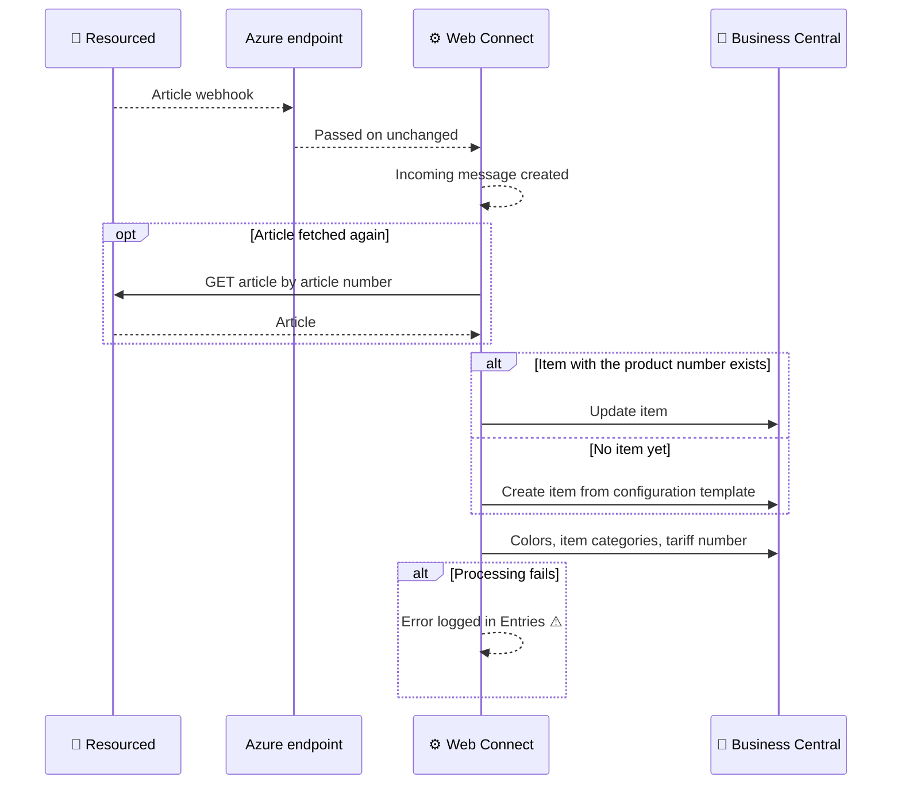

# Resourced PLM to Business Central: product data

When an article is sent from Resourced, Web Connect creates the item in Business Central from a configuration template, or updates it if it exists. Description, unit, vendor, country of origin, net weight, tariff number and item category come from the article, together with season, color, gender, size chart and status where you have fields for them.

| | |
|---|---|
| **Direction** | Resourced → Business Central |
| **Trigger** | Webhook from Resourced with the article. Which changes send it is decided when the webhook is set up in Resourced |
| **Result** | The item exists in Business Central with the product number as item number, and its item category, colors and season are created where they were missing |
| **Part of** | [Business Central and Resourced PLM integration](../overview.md) |

## Step by step

1. Resourced sends the article as a webhook. An Azure endpoint receives it and passes it on to Web Connect.
2. Web Connect checks that the message contains an article number and creates an incoming message from it. A second webhook object can instead fetch the article from the Resourced API by its article number.
3. The download job processes the message. Web Connect looks for an item with the product number. If it exists, the item is updated. If not, the item is created from the configuration template.
4. The article's colors are created in Business Central and linked to the item, where you have a table for colors.
5. The levels of the product hierarchy create item categories, and the item gets its item category.
6. The tariff code on the SKU is written to the item.
7. The message and the result are kept in Web Connect Entries.

## Data mapping

The table shows the standard Business Central fields that the article is written to. Fields from a fashion extension or your own extensions are set in the mapping.

| Resourced field | Business Central field | Note |
|---|---|---|
| `product.productNumber` | Item, No. | The item is found by this number, or created with it |
| `product.name` | Item, Description | |
| Fixed value | Item, Base Unit of Measure | Set in the mapping, for example pieces |
| `suppliers[0].supplierNumber` | Item, Vendor No. | The first supplier on the article |
| `suppliers[0].country.code` | Item, Country/Region of Origin Code | |
| `skus[0].netWeight` | Item, Net Weight | Taken from the first SKU |
| `skus[].tariffCodes[].code` | Item, Tariff No. | |
| `hierarchy` levels | Item Category, and Item, Item Category Code | A level creates an item category with the level above as parent. Other levels can go to fields from your own extensions |
| `color` | Color and item color in a fashion extension | Created if missing and linked to the item |
| `currentSeason` | Season in a fashion extension | |
| `genders` | Gender in a fashion extension | Translated with a text mapping |
| `sizeSystemVersion.name` | Size chart in a fashion extension | Translated with a text mapping. Only set when the item has no size chart yet |
| `status` | Item status in a fashion extension | Translated with a text mapping |
| `customFieldValues` | Fields from your own extensions | For example care instructions or hazard codes |

## Web Connect objects

| Object | Role |
|---|---|
| `RS_ARTICLE` | Receives the article webhook and creates the incoming message. Its condition requires an article number |
| `RS_WEBHOOK` | Alternative webhook that only notifies. Web Connect then fetches the article with `RS_RESOURCE` |
| `RS_RESOURCE` | The article. Can be fetched from `articles/{articleNumber}` in the Resourced API |
| `RS_ARTICLE_RETAIL` | Writes the article to the item, and creates the item from the configuration template when it is new |
| `RS_COLOR`, `RS_ITEMCOLOR` | Create the color and link it to the item |
| `RS_HIERARCHY` and `RS_LEVEL1` to `RS_LEVEL4` | Create item categories from the product hierarchy and set them on the item |
| `RS_TARIFFCODES` | Writes the tariff number to the item |

## Error handling

| Situation | What happens | What to do |
|---|---|---|
| The webhook has no article number | The condition stops the message, and no item is created | Check the article in Resourced and send it again |
| The item cannot be created or updated | The message is logged with the error from Business Central, for example a missing vendor or item category | Read the error in [Entries](../../../general/entries.md), correct the data in Resourced or Business Central and process the message again |
| A size system has no mapping | The size chart is not set on the item | Add the size system to the text mapping in [Text Mapping](../../../general/text-mapping.md) |

## Frequently asked questions

### Is the item number taken from Resourced?

Yes. The product number in Resourced becomes the item number in Business Central. Web Connect looks for an item with that number and updates it, or creates a new item from the configuration template.

### Can the product hierarchy in Resourced become item categories?

Yes. Levels in the Resourced product hierarchy can create item categories in Business Central, with the lower level under the higher one, and the item gets the item category. Other levels can be written to fields from your own extensions.

## Related

- [Business Central and Resourced PLM integration](../overview.md)
- [Variants and barcodes](variants-and-barcodes.md)
- [Webhooks](../../../general/webhooks.md)
- [Incoming Data mapping](../../../general/incoming-data/mapping.md)
