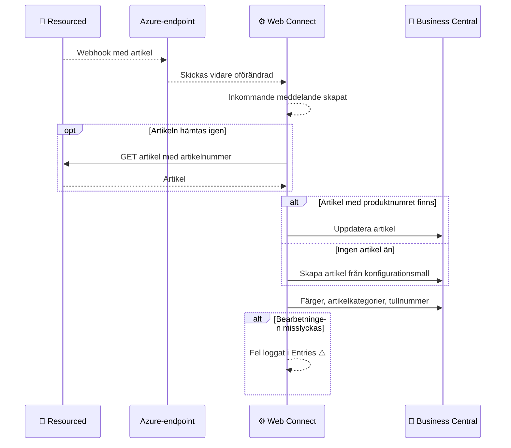

# Från Resourced PLM till Business Central: produktdata

När en artikel skickas från Resourced skapar Web Connect artikeln i Business Central från en konfigurationsmall, eller uppdaterar den om den finns. Beskrivning, enhet, leverantör, ursprungsland, nettovikt, tullnummer och artikelkategori kommer från artikeln i Resourced, tillsammans med säsong, färg, kön, storlekstabell och status där du har fält för dem.

| | |
|---|---|
| **Riktning** | Resourced → Business Central |
| **Startas av** | En webhook från Resourced med artikeln. Vilka ändringar som skickar den bestäms när webhooken sätts upp i Resourced |
| **Resultat** | Artikeln finns i Business Central med produktnumret som artikelnummer, och dess artikelkategori, färger och säsong har skapats där de saknades |
| **Del av** | [Business Central och Resourced PLM: integration](../overview.md) |

## Steg för steg

1. Resourced skickar artikeln som en webhook. En Azure-endpoint tar emot den och skickar den vidare till Web Connect.
2. Web Connect kontrollerar att meddelandet innehåller ett artikelnummer och skapar ett inkommande meddelande av det. Ett andra webhookobjekt kan i stället hämta artikeln från API:t i Resourced med artikelnumret.
3. Nedladdningsjobbet bearbetar meddelandet. Web Connect letar efter en artikel med produktnumret. Finns den uppdateras artikeln. Annars skapas artikeln från konfigurationsmallen.
4. Artikelns färger skapas i Business Central och kopplas till artikeln, där du har en tabell för färger.
5. Nivåerna i produkthierarkin skapar artikelkategorier, och artikeln får sin artikelkategori.
6. Tullkoden på SKU:n skrivs till artikeln.
7. Meddelandet och resultatet sparas i Web Connect Entries.

## Mappning av data

Tabellen visar de standardfält i Business Central som artikeln skrivs till. Fält från ett tillägg för mode eller från era egna tillägg ställs in i mappningen.

| Fält i Resourced | Fält i Business Central | Kommentar |
|---|---|---|
| `product.productNumber` | Item, No. | Artikeln hittas med det här numret, eller skapas med det |
| `product.name` | Item, Description | |
| Fast värde | Item, Base Unit of Measure | Ställs in i mappningen, till exempel styck |
| `suppliers[0].supplierNumber` | Item, Vendor No. | Den första leverantören på artikeln |
| `suppliers[0].country.code` | Item, Country/Region of Origin Code | |
| `skus[0].netWeight` | Item, Net Weight | Hämtas från den första SKU:n |
| `skus[].tariffCodes[].code` | Item, Tariff No. | |
| Nivåer i `hierarchy` | Item Category, och Item, Item Category Code | En nivå skapar en artikelkategori med nivån ovanför som överordnad. Andra nivåer kan gå till fält från era egna tillägg |
| `color` | Färg och artikelfärg i ett tillägg för mode | Skapas om den saknas och kopplas till artikeln |
| `currentSeason` | Säsong i ett tillägg för mode | |
| `genders` | Kön i ett tillägg för mode | Översätts med en textmappning |
| `sizeSystemVersion.name` | Storlekstabell i ett tillägg för mode | Översätts med en textmappning. Sätts bara när artikeln inte har någon storlekstabell än |
| `status` | Artikelstatus i ett tillägg för mode | Översätts med en textmappning |
| `customFieldValues` | Fält från era egna tillägg | Till exempel skötselråd eller farokoder |

## Objekt i Web Connect

| Objekt | Roll |
|---|---|
| `RS_ARTICLE` | Tar emot webhooken med artikeln och skapar det inkommande meddelandet. Villkoret kräver ett artikelnummer |
| `RS_WEBHOOK` | Alternativ webhook som bara aviserar. Web Connect hämtar sedan artikeln med `RS_RESOURCE` |
| `RS_RESOURCE` | Artikeln. Kan hämtas från `articles/{articleNumber}` i API:t i Resourced |
| `RS_ARTICLE_RETAIL` | Skriver uppgifterna från Resourced till artikeln i Business Central, och skapar artikeln från konfigurationsmallen när den är ny |
| `RS_COLOR`, `RS_ITEMCOLOR` | Skapar färgen och kopplar den till artikeln |
| `RS_HIERARCHY` och `RS_LEVEL1` till `RS_LEVEL4` | Skapar artikelkategorier från produkthierarkin och sätter dem på artikeln |
| `RS_TARIFFCODES` | Skriver tullnumret till artikeln |

## Felhantering

| Situation | Vad som händer | Vad du gör |
|---|---|---|
| Webhooken saknar artikelnummer | Villkoret stoppar meddelandet, och ingen artikel skapas | Kontrollera artikeln i Resourced och skicka den igen |
| Artikeln går inte att skapa eller uppdatera | Meddelandet loggas med felet från Business Central, till exempel en leverantör eller artikelkategori som saknas | Läs felet i [Entries](../../../general/entries.md), rätta uppgifterna i Resourced eller Business Central och bearbeta meddelandet igen |
| Ett storlekssystem saknar mappning | Storlekstabellen sätts inte på artikeln | Lägg till storlekssystemet i textmappningen i [Text Mapping](../../../general/text-mapping.md) |

## Vanliga frågor

### Hämtas artikelnumret från Resourced?

Ja. Produktnumret i Resourced blir artikelnumret i Business Central. Web Connect letar efter en artikel med det numret och uppdaterar den, eller skapar en ny artikel från konfigurationsmallen.

### Kan produkthierarkin i Resourced bli artikelkategorier?

Ja. Nivåer i produkthierarkin i Resourced kan skapa artikelkategorier i Business Central, med den lägre nivån under den högre, och artikeln får artikelkategorin. Andra nivåer kan skrivas till fält från era egna tillägg.

## Relaterat

- [Business Central och Resourced PLM: integration](../overview.md)
- [Varianter och streckkoder](variants-and-barcodes.md)
- [Webhooks](../../../general/webhooks.md)
- [Incoming Data mapping](../../../general/incoming-data/mapping.md)
