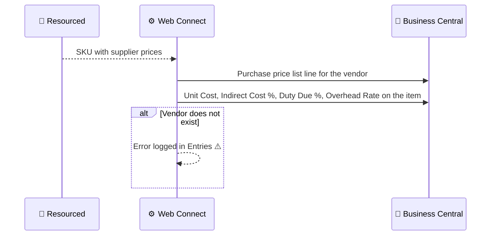

# Resourced PLM to Business Central: purchase prices and costs

The costing done in Resourced reaches Business Central. The supplier cost price on the SKU is written to a purchase price list line for the vendor, and the landed cost, freight and duty percentages and label cost are written to the cost fields on the item.

| | |
|---|---|
| **Direction** | Resourced → Business Central |
| **Trigger** | The same article webhook as [product data](product-data.md) |
| **Result** | A purchase price list line for the vendor and the item, starting today, and updated cost fields on the item |
| **Part of** | [Business Central and Resourced PLM integration](../overview.md) |

## Step by step

1. For each SKU, Web Connect reads the supplier prices.
2. The cost price is written to a price list line with the vendor as source and the item as asset. The starting date is the day the message is processed.
3. The landed cost is written to Unit Cost on the item, and the freight and duty percentages to Indirect Cost %.
4. The duty percentage is also written to Duty Due %, and the label cost to Overhead Rate.

## Data mapping

| Resourced field | Business Central field | Note |
|---|---|---|
| `suppliers[0].supplierNumber` | Price List Line, Source No. | Source Type Vendor |
| `skus[].skuNumber` | Price List Line, Asset No. | Asset Type Item |
| `supplierPrices[].costPrice.amount` | Price List Line, purchase price | |
| `supplierPrices[].costPrice.currency` | Price List Line, Currency Code | |
| Processing date | Price List Line, Starting Date | |
| `supplierPrices[].landedCost.amount` | Item, Unit Cost | |
| `supplierPrices[].freight.percentage` and `duties.percentage` | Item, Indirect Cost % | |
| `supplierPrices[].duties.percentage` | Item, Duty Due % | |
| `supplierPrices[].label.amount` | Item, Overhead Rate | |

## Web Connect objects

| Object | Role |
|---|---|
| `RS_SUPPLIERPRICES` | Writes the cost price to the purchase price list line for the vendor |
| `RS_COSTPRICE` | The cost price amount on the SKU |
| `RS_DUTIES` | Writes the duty percentage to the item |
| `RS_LABEL` | Writes the label cost to the item |
| `RS_FREIGHT`, `RS_LANDEDCOST`, `RS_COSTPRICETARGET` | Carry freight, landed cost and target cost from Resourced |

## Error handling

| Situation | What happens | What to do |
|---|---|---|
| The vendor does not exist in Business Central | The purchase price list line and the vendor on the item are rejected, and the error is logged in [Entries](../../../general/entries.md) | Create the vendor with the supplier number from Resourced and process the message again |
| The article has more than one supplier | Only the first supplier is used | Put the main supplier first in Resourced |

## Frequently asked questions

### Which vendor gets the purchase price?

The vendor with the same number as the first supplier on the article in Resourced. The vendor must exist in Business Central with that number.

### Is the landed cost imported?

Yes. The landed cost on the supplier price is written to Unit Cost on the item, and the freight and duty percentages to Indirect Cost %.

## Related

- [Business Central and Resourced PLM integration](../overview.md)
- [Sales prices](sales-prices.md)
- [Product data](product-data.md)
