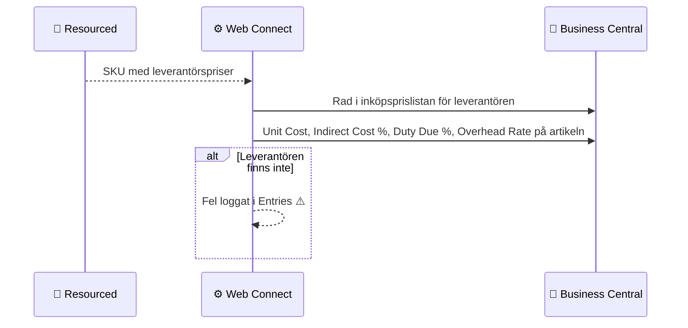

# Från Resourced PLM till Business Central: inköpspriser och kostnader

Kalkylen som görs i Resourced når Business Central. Leverantörens kostpris på SKU:n skrivs till en rad i en inköpsprislista för leverantören, och landad kostnad, procentsatserna för frakt och tull samt etikettkostnaden skrivs till kostnadsfälten på artikeln.

| | |
|---|---|
| **Riktning** | Resourced → Business Central |
| **Startas av** | Samma webhook med artikeln som för [produktdata](product-data.md) |
| **Resultat** | En rad i inköpsprislistan för leverantören och artikeln, som gäller från i dag, och uppdaterade kostnadsfält på artikeln |
| **Del av** | [Business Central och Resourced PLM: integration](../overview.md) |

## Steg för steg

1. För varje SKU läser Web Connect leverantörspriserna.
2. Kostpriset skrivs till en prislisterad med leverantören som källa och artikeln som tillgång. Startdatumet är den dag meddelandet bearbetas.
3. Den landade kostnaden skrivs till Unit Cost på artikeln, och procentsatserna för frakt och tull till Indirect Cost %.
4. Procentsatsen för tull skrivs också till Duty Due %, och etikettkostnaden till Overhead Rate.

## Mappning av data

| Fält i Resourced | Fält i Business Central | Kommentar |
|---|---|---|
| `suppliers[0].supplierNumber` | Price List Line, Source No. | Source Type Vendor |
| `skus[].skuNumber` | Price List Line, Asset No. | Asset Type Item |
| `supplierPrices[].costPrice.amount` | Price List Line, inköpspris | |
| `supplierPrices[].costPrice.currency` | Price List Line, Currency Code | |
| Bearbetningsdatum | Price List Line, Starting Date | |
| `supplierPrices[].landedCost.amount` | Item, Unit Cost | |
| `supplierPrices[].freight.percentage` och `duties.percentage` | Item, Indirect Cost % | |
| `supplierPrices[].duties.percentage` | Item, Duty Due % | |
| `supplierPrices[].label.amount` | Item, Overhead Rate | |

## Objekt i Web Connect

| Objekt | Roll |
|---|---|
| `RS_SUPPLIERPRICES` | Skriver kostpriset till raden i inköpsprislistan för leverantören |
| `RS_COSTPRICE` | Kostprisets belopp på SKU:n |
| `RS_DUTIES` | Skriver procentsatsen för tull till artikeln |
| `RS_LABEL` | Skriver etikettkostnaden till artikeln |
| `RS_FREIGHT`, `RS_LANDEDCOST`, `RS_COSTPRICETARGET` | Bär frakt, landad kostnad och målkostnad från Resourced |

## Felhantering

| Situation | Vad som händer | Vad du gör |
|---|---|---|
| Leverantören finns inte i Business Central | Raden i inköpsprislistan och leverantören på artikeln avvisas, och felet loggas i [Entries](../../../general/entries.md) | Skapa leverantören med leverantörsnumret från Resourced och bearbeta meddelandet igen |
| Artikeln har mer än en leverantör | Bara den första leverantören används | Lägg huvudleverantören först i Resourced |

## Vanliga frågor

### Vilken leverantör får inköpspriset?

Leverantören med samma nummer som den första leverantören på artikeln i Resourced. Leverantören måste finnas i Business Central med det numret.

### Importeras den landade kostnaden?

Ja. Den landade kostnaden på leverantörspriset skrivs till Unit Cost på artikeln, och procentsatserna för frakt och tull till Indirect Cost %.

## Relaterat

- [Business Central och Resourced PLM: integration](../overview.md)
- [Försäljningspriser](sales-prices.md)
- [Produktdata](product-data.md)
