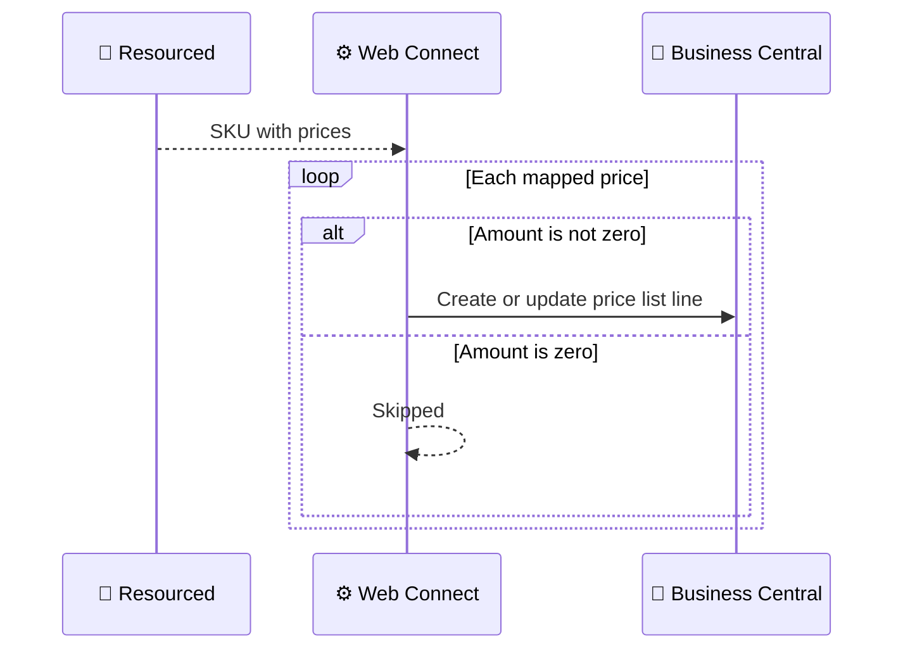

# Resourced PLM to Business Central: sales prices

Sales prices set in Resourced are written to sales price lists in Business Central. Each price on the SKU, for example one per web shop currency or wholesale market, goes to its own price list with its currency, and a price of zero is skipped so it never overwrites a price in Business Central.

| | |
|---|---|
| **Direction** | Resourced → Business Central |
| **Trigger** | The same article webhook as [product data](product-data.md) |
| **Result** | One price list line per price, for the item, on the price list that the price is mapped to |
| **Part of** | [Business Central and Resourced PLM integration](../overview.md) |

## Step by step

1. For each SKU, Web Connect reads the prices on the SKU. Each named price in Resourced has its own object in Web Connect.
2. A condition checks that the amount is not zero. A price of zero is skipped.
3. Web Connect looks for the price list line for the item on the mapped price list and updates it, or creates it.
4. The price list line gets the amount and the currency from Resourced.

## Data mapping

| Resourced field | Business Central field | Note |
|---|---|---|
| Price name, for example a web shop price in one currency | Price List Line, Price List Code | One Web Connect object per price, each mapped to a price list |
| Fixed value | Price List Line, Source Type | Customer Price Group |
| Fixed value | Price List Line, Source No. | The customer price group that the price list is for |
| Fixed value | Price List Line, Asset Type | Item |
| `skus[].skuNumber` | Price List Line, Asset No. | The item number from the SKU |
| `prices.<price>.amount` | Price List Line, Unit Price | Skipped when zero |
| `prices.<price>.currency` | Price List Line, Currency Code | |

## Web Connect objects

| Object | Role |
|---|---|
| `RS_PRICES` | The prices on the SKU |
| One object per price, named after the price in Resourced | Writes that price to its price list, with a condition that skips a zero price |

## Error handling

| Situation | What happens | What to do |
|---|---|---|
| A new price is added in Resourced | It is received but not written, since no object is mapped to it | Add an object for the price and map it to a price list |
| The price list or currency does not exist in Business Central | The price list line is rejected and the error is logged in [Entries](../../../general/entries.md) | Create the price list or currency and process the message again |

## Frequently asked questions

### Can I have prices in several currencies?

Yes. Each price in Resourced is mapped to its own price list in Business Central, and the currency is taken from the price in Resourced.

### What happens if a price is empty in Resourced?

A condition skips prices that are zero, so the price list line in Business Central is left as it is.

## Related

- [Business Central and Resourced PLM integration](../overview.md)
- [Purchase prices and costs](purchase-prices-and-costs.md)
- [Condition List](../../../general/condition-list.md)
