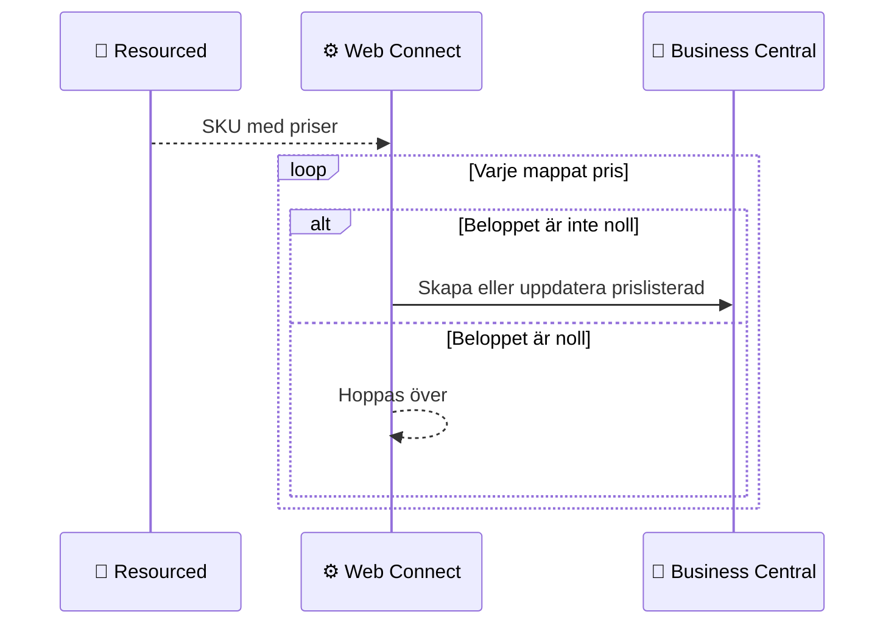

# Från Resourced PLM till Business Central: försäljningspriser

Försäljningspriser som sätts i Resourced skrivs till försäljningsprislistor i Business Central. Varje pris på SKU:n, till exempel ett per valuta i webbshopen eller per grossistmarknad, går till en egen prislista med sin valuta, och ett pris som är noll hoppas över så att det aldrig skriver över ett pris i Business Central.

| | |
|---|---|
| **Riktning** | Resourced → Business Central |
| **Startas av** | Samma webhook med artikeln som för [produktdata](product-data.md) |
| **Resultat** | En prislisterad per pris, för artikeln, i den prislista som priset är mappat till |
| **Del av** | [Business Central och Resourced PLM: integration](../overview.md) |

## Steg för steg

1. För varje SKU läser Web Connect priserna på SKU:n. Varje namngivet pris i Resourced har ett eget objekt i Web Connect.
2. Ett villkor kontrollerar att beloppet inte är noll. Ett pris som är noll hoppas över.
3. Web Connect letar efter prislisteraden för artikeln i den mappade prislistan och uppdaterar den, eller skapar den.
4. Prislisteraden får beloppet och valutan från Resourced.

## Mappning av data

| Fält i Resourced | Fält i Business Central | Kommentar |
|---|---|---|
| Prisets namn, till exempel ett pris för webbshopen i en valuta | Price List Line, Price List Code | Ett objekt i Web Connect per pris, vart och ett mappat till en prislista |
| Fast värde | Price List Line, Source Type | Customer Price Group |
| Fast värde | Price List Line, Source No. | Kundprisgruppen som prislistan gäller |
| Fast värde | Price List Line, Asset Type | Item |
| `skus[].skuNumber` | Price List Line, Asset No. | Artikelnumret från SKU:n |
| `prices.<price>.amount` | Price List Line, Unit Price | Hoppas över när det är noll |
| `prices.<price>.currency` | Price List Line, Currency Code | |

## Objekt i Web Connect

| Objekt | Roll |
|---|---|
| `RS_PRICES` | Priserna på SKU:n |
| Ett objekt per pris, namngivet efter priset i Resourced | Skriver priset till sin prislista, med ett villkor som hoppar över ett pris som är noll |

## Felhantering

| Situation | Vad som händer | Vad du gör |
|---|---|---|
| Ett nytt pris läggs till i Resourced | Det tas emot men skrivs inte, eftersom inget objekt är mappat till det | Lägg till ett objekt för priset och mappa det till en prislista |
| Prislistan eller valutan finns inte i Business Central | Prislisteraden avvisas och felet loggas i [Entries](../../../general/entries.md) | Skapa prislistan eller valutan och bearbeta meddelandet igen |

## Vanliga frågor

### Kan jag ha priser i flera valutor?

Ja. Varje pris i Resourced mappas till en egen prislista i Business Central, och valutan hämtas från priset i Resourced.

### Vad händer om ett pris är tomt i Resourced?

Ett villkor hoppar över priser som är noll, så raden i prislistan i Business Central lämnas som den är.

## Relaterat

- [Business Central och Resourced PLM: integration](../overview.md)
- [Inköpspriser och kostnader](purchase-prices-and-costs.md)
- [Condition List](../../../general/condition-list.md)
