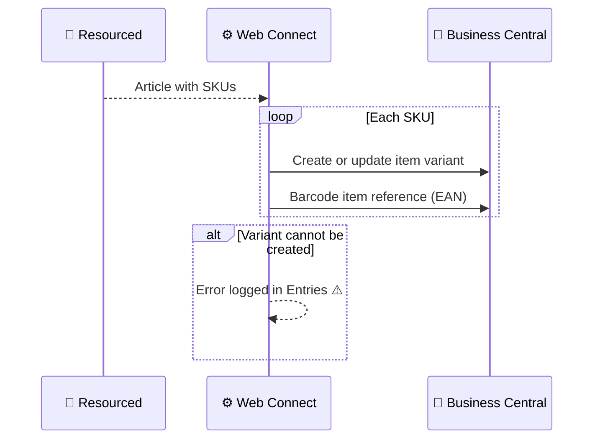

# Resourced PLM to Business Central: variants and barcodes

Each SKU on an article in Resourced becomes an item variant in Business Central. The variant code and item number are taken from the SKU number, and the EAN code on the SKU is stored as a barcode item reference on the variant, so it can be scanned and sent on to sales channels.

| | |
|---|---|
| **Direction** | Resourced → Business Central |
| **Trigger** | The same article webhook as [product data](product-data.md) |
| **Result** | One item variant per SKU, with a barcode item reference for the EAN code |
| **Part of** | [Business Central and Resourced PLM integration](../overview.md) |

## Step by step

1. After the item is created or updated, Web Connect goes through the SKUs on the article.
2. For each SKU, Web Connect splits the SKU number into item number and variant code and looks for the variant. It is updated if it exists and created if not.
3. Color, color group, collection and season from the article are written to the variant where you have fields for them.
4. The EAN code on the SKU is stored as an item reference of type bar code for the item and the variant.

## Data mapping

| Resourced field | Business Central field | Note |
|---|---|---|
| `skus[].skuNumber` | Item Variant, Item No. and Code | The mapping sets which characters of the SKU number are the item number and which are the variant code |
| `color.name`, `color.group.name` | Item Variant, color fields from a fashion extension | |
| `currentSeason` | Item Variant, season field from your own extension | |
| `skus[].codes.ean` | Item Reference, Reference No. | Reference type bar code, with the item number and variant code from the SKU |
| `status` | A field on the variant | Translated with a text mapping, so that only some statuses mark the variant as ready |
| `customFieldValues` | Fields from your own extensions | For example a never out of stock flag |

## Web Connect objects

| Object | Role |
|---|---|
| `RS_SKUS` | Creates or updates the item variant for each SKU |
| `RS_CODES` | Creates the barcode item reference from the EAN code |
| `RS_SIZE`, `RS_SIZESYSTEMVERSION` | Carry the size and size system of the SKU |

## Error handling

| Situation | What happens | What to do |
|---|---|---|
| The SKU number does not follow the expected numbering | The variant gets the wrong item number or variant code, or is not created | Check the SKU number in Resourced, or change how the SKU number is split in the mapping |
| The variant cannot be created | The error is logged in [Entries](../../../general/entries.md) | Read the error, correct the data in Resourced or Business Central and process the message again |

## Frequently asked questions

### How is the variant code decided?

From the SKU number in Resourced. The mapping sets which part of the SKU number is the item number and which part is the variant code, so it follows the numbering you use in Resourced.

### Which barcode is imported?

The EAN code on the SKU. It is stored as an item reference of type bar code on the item variant.

## Related

- [Business Central and Resourced PLM integration](../overview.md)
- [Product data](product-data.md)
- [Sales prices](sales-prices.md)
