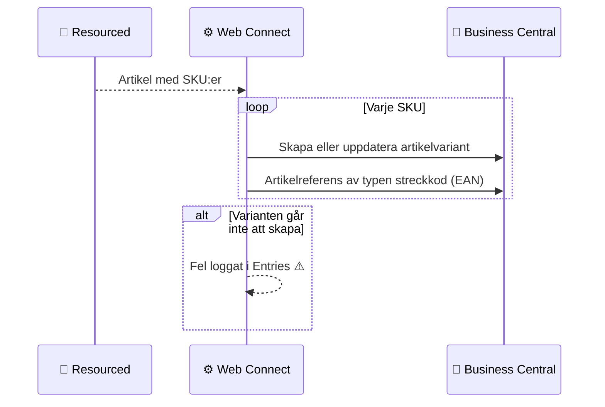

# Från Resourced PLM till Business Central: varianter och streckkoder

Varje SKU på en artikel i Resourced blir en artikelvariant i Business Central. Variantkoden och artikelnumret hämtas från SKU-numret, och EAN-koden på SKU:n sparas som en artikelreferens av typen streckkod på varianten, så att den kan skannas och skickas vidare till försäljningskanaler.

| | |
|---|---|
| **Riktning** | Resourced → Business Central |
| **Startas av** | Samma webhook med artikeln som för [produktdata](product-data.md) |
| **Resultat** | En artikelvariant per SKU, med en artikelreferens av typen streckkod för EAN-koden |
| **Del av** | [Business Central och Resourced PLM: integration](../overview.md) |

## Steg för steg

1. När artikeln har skapats eller uppdaterats går Web Connect igenom SKU:erna på artikeln.
2. För varje SKU delar Web Connect upp SKU-numret i artikelnummer och variantkod och letar efter varianten. Den uppdateras om den finns och skapas annars.
3. Färg, färggrupp, kollektion och säsong från artikeln skrivs till varianten där du har fält för dem.
4. EAN-koden på SKU:n sparas som en artikelreferens av typen streckkod för artikeln och varianten.

## Mappning av data

| Fält i Resourced | Fält i Business Central | Kommentar |
|---|---|---|
| `skus[].skuNumber` | Item Variant, Item No. och Code | Mappningen anger vilka tecken i SKU-numret som är artikelnummer och vilka som är variantkod |
| `color.name`, `color.group.name` | Item Variant, färgfält från ett tillägg för mode | |
| `currentSeason` | Item Variant, säsongsfält från ert eget tillägg | |
| `skus[].codes.ean` | Item Reference, Reference No. | Referenstyp streckkod, med artikelnummer och variantkod från SKU:n |
| `status` | Ett fält på varianten | Översätts med en textmappning, så att bara vissa statusar markerar varianten som klar |
| `customFieldValues` | Fält från era egna tillägg | Till exempel en flagga för never out of stock |

## Objekt i Web Connect

| Objekt | Roll |
|---|---|
| `RS_SKUS` | Skapar eller uppdaterar artikelvarianten för varje SKU |
| `RS_CODES` | Skapar artikelreferensen av typen streckkod från EAN-koden |
| `RS_SIZE`, `RS_SIZESYSTEMVERSION` | Bär SKU:ns storlek och storlekssystem |

## Felhantering

| Situation | Vad som händer | Vad du gör |
|---|---|---|
| SKU-numret följer inte den förväntade numreringen | Varianten får fel artikelnummer eller variantkod, eller skapas inte | Kontrollera SKU-numret i Resourced, eller ändra hur SKU-numret delas upp i mappningen |
| Varianten går inte att skapa | Felet loggas i [Entries](../../../general/entries.md) | Läs felet, rätta uppgifterna i Resourced eller Business Central och bearbeta meddelandet igen |

## Vanliga frågor

### Hur bestäms variantkoden?

Utifrån SKU-numret i Resourced. Mappningen anger vilken del av SKU-numret som är artikelnummer och vilken del som är variantkod, så att den följer numreringen ni använder i Resourced.

### Vilken streckkod importeras?

EAN-koden på SKU:n. Den sparas som en artikelreferens av typen streckkod på artikelvarianten.

## Relaterat

- [Business Central och Resourced PLM: integration](../overview.md)
- [Produktdata](product-data.md)
- [Försäljningspriser](sales-prices.md)
