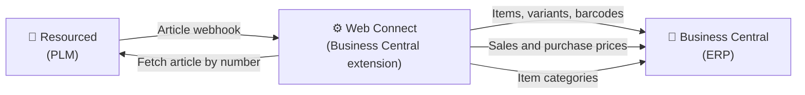
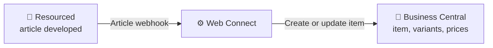
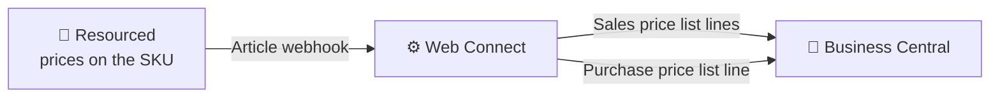

# Business Central and Resourced PLM integration

Web Connect by CombineIT connects Microsoft Dynamics 365 Business Central with Resourced, the PLM system for brands that develop physical products. When an article is sent from Resourced, Web Connect creates or updates the item in Business Central with its variants, barcodes, item category, sales prices per price list and purchase price. All mappings and rules live in your own Business Central, where you can see and change them yourself.

## At a glance

| | |
|---|---|
| **System** | Resourced PLM (PLM) |
| **Integration product** | Web Connect for Microsoft Dynamics 365 Business Central |
| **Runs in** | Your own Business Central environment, as an extension. Resourced sends each article as a webhook. An Azure endpoint receives it and passes it on to Web Connect, which processes it from the Business Central job queue. All processing and configuration stays in Business Central. |
| **Configured by** | You, in Business Central: mappings, conditions, triggers and flows. You can do all of it yourself. If you want, CombineIT takes part in any step, as a sounding board or by doing the work. |
| **Connection** | Resourced REST API (JSON) and webhooks from Resourced, with an API key from your Resourced account |
| **Resourced API** | [ATT FYLLA I: link to the Resourced API documentation] |
| **Data flows** | 4: product data, variants and barcodes, sales prices, and purchase prices and costs |
| **Business Central editions** | All editions, Essentials and Premium, including the latest version |
| **Available from** | [Web Connect on Microsoft AppSource](https://marketplace.microsoft.com/sv-se/product/PUBID.martitab1633951001710%7CAID.webconnect%7CPAPPID.9f3a7223-19db-4ac7-832f-cf8e4699186f?tab=Overview). [ATT FYLLA I: is Resourced part of the Web Connect Ready Integrations app, or set up as part of the implementation?] |

## What can be synchronized

Web Connect has four data flows between Business Central and Resourced PLM. All four go from Resourced to Business Central and are carried by the same article message.

| Data | Direction | What happens |
|---|---|---|
| [Product data](flows/product-data.md) | Resourced → Business Central | The item is created or updated with description, unit, vendor, country of origin, weight, tariff number, item category and the season, color and size data from the article |
| [Variants and barcodes](flows/variants-and-barcodes.md) | Resourced → Business Central | Each SKU becomes an item variant, and its EAN code becomes a barcode item reference on the variant |
| [Sales prices](flows/sales-prices.md) | Resourced → Business Central | Each price on the SKU is written to a sales price list line, one price list per price in Resourced |
| [Purchase prices and costs](flows/purchase-prices-and-costs.md) | Resourced → Business Central | The supplier cost price is written to a purchase price list line for the vendor, and landed cost, freight, duty and label cost are written to the item |

Product data is the core of the integration. The other flows are chosen at setup, see [Choose your setup](#choose-your-setup).

## How it works

When an article is sent from Resourced, the webhook reaches Web Connect through an Azure endpoint that only passes the call on. Web Connect creates an incoming message from the article and processes it from the Business Central job queue: first the item, then colors, variants, barcodes, prices and item categories, in an order that you can see and change on the objects. Web Connect can also fetch an article from the Resourced API by its article number, so a single article can be loaded again without a new webhook. Every message is kept in Web Connect [Entries](../../general/entries.md), where you can see what arrived and what was created.

[ATT FYLLA I: which event in Resourced sends the webhook, for example a status change on the article or a manual export]

## Choose your setup

Each flow has to fit how your business works: which system owns the data, where people do their work, and what the accounting needs. That is why the flows are decided together when a new integration is set up. The options below are the ones Web Connect customers use today. **Common setup** marks the option most Web Connect customers with Resourced PLM use. **Recommended** marks CombineIT's best practice, where there is one.

The Resourced integration is in use with one Web Connect customer today. That is too few to say what is common, so no option below is marked as common setup.

### Product data ownership

| Option | How it works | When it fits |
|---|---|---|
| **Articles developed in Resourced, items created in Business Central** | The article, its SKUs, colors, sizes, prices and supplier costs are maintained in Resourced. Web Connect creates the item from a configuration template the first time and updates it after that | Product development happens in Resourced, and Business Central is used for purchasing, stock and sales |

#### Product data owned in Resourced

### Prices

| Option | How it works | When it fits |
|---|---|---|
| **Sales and purchase prices from Resourced** | Sales prices per sales channel and currency, and the supplier cost price, are set in Resourced and written to price lists in Business Central. A price of zero is skipped | Prices are decided as part of product development and costing in Resourced |

#### Prices set in Resourced

Product development, materials, compositions and supplier collaboration are always maintained in Resourced.

## What you need

- Microsoft Dynamics 365 Business Central, any edition (Essentials or Premium), including the latest version
- Web Connect installed from Microsoft AppSource, with an activated Web Connect license
- Your approval for Web Connect to be installed and to act in your Business Central environment
- An API key from your Resourced account, created in Resourced
- A webhook in Resourced that sends articles to the Web Connect endpoint [ATT FYLLA I: where the webhook is set up in Resourced]
- A configuration template for new items in Business Central, and the price lists that prices are written to
- Vendors in Business Central with the same number as the supplier number in Resourced

## Setting it up

1. Decide which flows to use and which option to choose for each, see [Choose your setup](#choose-your-setup).
2. Install Web Connect in Business Central, activate the license and give your approval. [ATT FYLLA I: install the ready integration for Resourced, or set up its objects as part of the implementation]
3. Store the Resourced API key in Web Connect [Secret Value Storage](../../general/secret-value-storage.md) and set up the connection to the Resourced API.
4. Set up the webhook in Resourced so that articles are sent to Web Connect.
5. Map the configuration choices below: item template, price lists, size systems, statuses and the product hierarchy.
6. Test with a few articles, with a Business Central sandbox, before going live.

## Configure it yourself in Business Central

All configuration and logic in the integration is visible and editable in Business Central. There is no external integration platform where the logic is hidden. The Azure endpoint that receives webhooks only passes the call on to Web Connect.

| What you can change | Where in Web Connect | Example |
|---|---|---|
| Field mapping | [Incoming Data mapping](../../general/incoming-data/mapping.md) | Write a custom field from Resourced, for example a care instruction or a hazard code, to a field from your own extension |
| Conditions | [Condition List](../../general/condition-list.md) | Skip a price that is zero, or leave the size chart on an item unchanged once it is set |
| Value mapping | [Text Mapping](../../general/text-mapping.md) | Translate a size system in Resourced to a size chart code, or an article status to a status in Business Central |
| Processing order | [Objects](../../general/objects.md) | Create colors and item categories before the item that uses them |
| What happens on a webhook | [Webhooks](../../general/webhooks.md) | Process the article in the webhook directly, or fetch it from the Resourced API by article number |
| Monitoring and reprocessing | [Entries](../../general/entries.md) | See every article received and what was created from it |

## Configuration choices

- **Item numbering:** which Resourced number becomes the item number, and how the SKU number is split into item number and variant code.
- **Item template:** which configuration template new items are created from.
- **Price lists:** which price in Resourced goes to which price list in Business Central, and whether the price list is for a customer price group or a vendor.
- **Size systems:** how each size system in Resourced is translated to a size chart or size code in Business Central.
- **Statuses:** how the article status in Resourced is translated to a status on the item, and which statuses mark a variant as ready for sales.
- **Product hierarchy:** which levels of the Resourced product hierarchy become item categories, and which go to other fields.
- **Custom fields:** which custom fields in Resourced are written to Business Central, for example a never out of stock flag or a hazard code.

## Limitations

- **Data goes from Resourced to Business Central.** Nothing is sent from Business Central back to Resourced in the standard setup.
- **Compositions and bill of materials are not imported.** The material composition and the bill of materials on the article are received but not written to Business Central.
- **Deliveries are not imported.** Delivery and allocation data on the article is received but does not create purchase orders in Business Central.
- **Images are not imported.** Images and files stay in Resourced.
- **Color, season, gender and size chart need fields to write to.** Standard Business Central has no fields for them. They are written to a fashion extension or your own fields, set in the mapping.

## Frequently asked questions

### Can Business Central be integrated with Resourced PLM?

Yes. Web Connect connects Business Central with Resourced through the Resourced REST API and webhooks. Articles developed in Resourced are created or updated in Business Central as items with variants, barcodes, item category, sales prices and purchase price.

### Which system owns the product data?

Resourced. Articles, SKUs, colors, sizes, prices and supplier costs are maintained in Resourced and flow to Business Central. The integration does not send anything from Business Central back to Resourced.

### Does the integration create new items in Business Central?

Yes. If no item with the product number exists, Web Connect creates it from a configuration template that you choose. If it exists, the item is updated.

### Are sales prices in other currencies supported?

Yes. Each price in Resourced, for example one per sales channel and currency, is mapped to its own price list in Business Central. A price of zero is skipped, so an empty price in Resourced never overwrites a price in Business Central.

## Related

- Flows: [Product data](flows/product-data.md) · [Variants and barcodes](flows/variants-and-barcodes.md) · [Sales prices](flows/sales-prices.md) · [Purchase prices and costs](flows/purchase-prices-and-costs.md)
- [Web Connect general documentation](../../general/README.md)
- [Resourced](https://www.resourced.com/)

## About Web Connect

Web Connect is an integration platform for Microsoft Dynamics 365 Business Central, developed by CombineIT. It is installed in your own Business Central and connects it with e-commerce platforms, warehouse systems, POS, returns, marketplaces and EDI. Every flow, mapping and rule is configured in Business Central, where you can see and change it yourself, without custom code for each integration. [Web Connect on Microsoft AppSource](https://marketplace.microsoft.com/sv-se/product/PUBID.martitab1633951001710%7CAID.webconnect%7CPAPPID.9f3a7223-19db-4ac7-832f-cf8e4699186f?tab=Overview) · [Contact CombineIT](https://www.combineit.se/contact/)
