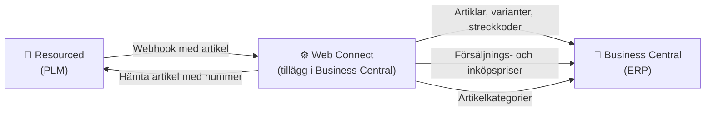
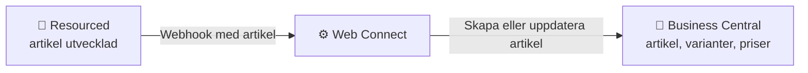
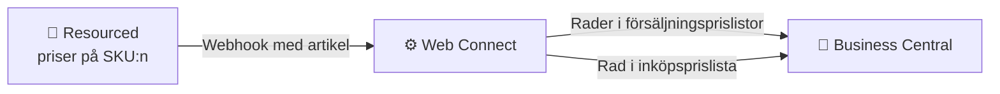

# Business Central och Resourced PLM: integration

Web Connect från CombineIT kopplar Microsoft Dynamics 365 Business Central till Resourced, PLM-systemet för varumärken som utvecklar fysiska produkter. När en artikel skickas från Resourced skapar eller uppdaterar Web Connect artikeln i Business Central med varianter, streckkoder, artikelkategori, försäljningspriser per prislista och inköpspris. Alla mappningar och regler finns i ditt eget Business Central, där du själv kan se och ändra dem.

## I korthet

| | |
|---|---|
| **System** | Resourced PLM (PLM) |
| **Integrationsprodukt** | Web Connect för Microsoft Dynamics 365 Business Central |
| **Körs i** | Din egen Business Central-miljö, som ett tillägg. Resourced skickar varje artikel som en webhook. En Azure-endpoint tar emot den och skickar den vidare till Web Connect, som bearbetar den från jobbkön i Business Central. All bearbetning och konfiguration stannar i Business Central. |
| **Konfigureras av** | Dig, i Business Central: mappningar, villkor, triggers och flöden. Du kan göra allt själv. Vill du kan CombineIT vara med i vilket steg som helst, som bollplank eller genom att göra jobbet. |
| **Koppling** | REST API:t i Resourced (JSON) och webhooks från Resourced, med en API-nyckel från ditt konto i Resourced |
| **API för Resourced** | REST API:t som Resourced erbjuder för att koppla in ERP, WMS och BI-verktyg, se [Resourced integrations](https://www.resourced.com/platform/#integrations). API-dokumentationen är inte publik |
| **Dataflöden** | 4: produktdata, varianter och streckkoder, försäljningspriser samt inköpspriser och kostnader |
| **Business Central-utgåvor** | Alla utgåvor, Essentials och Premium, även den senaste versionen |
| **Finns på** | [Web Connect på Microsoft AppSource](https://marketplace.microsoft.com/sv-se/product/PUBID.martitab1633951001710%7CAID.webconnect%7CPAPPID.9f3a7223-19db-4ac7-832f-cf8e4699186f?tab=Overview). Integrationen med Resourced ingår inte i appen Web Connect Ready Integrations. Den sätts upp i Web Connect som en del av implementeringen |

## Det här kan synkas

Web Connect har fyra dataflöden mellan Business Central och Resourced PLM. Alla fyra går från Resourced till Business Central och kommer i samma artikelmeddelande.

| Data | Riktning | Vad som händer |
|---|---|---|
| [Produktdata](flows/product-data.md) | Resourced → Business Central | Artikeln skapas eller uppdateras med beskrivning, enhet, leverantör, ursprungsland, vikt, tullnummer, artikelkategori och uppgifterna om säsong, färg och storlek från artikeln i Resourced |
| [Varianter och streckkoder](flows/variants-and-barcodes.md) | Resourced → Business Central | Varje SKU blir en artikelvariant, och dess EAN-kod blir en artikelreferens av typen streckkod på varianten |
| [Försäljningspriser](flows/sales-prices.md) | Resourced → Business Central | Varje pris på SKU:n skrivs till en rad i en försäljningsprislista, en prislista per pris i Resourced |
| [Inköpspriser och kostnader](flows/purchase-prices-and-costs.md) | Resourced → Business Central | Leverantörens kostpris skrivs till en rad i en inköpsprislista för leverantören, och landad kostnad, frakt, tull och etikettkostnad skrivs till artikeln |

Produktdata är kärnan i integrationen. De andra flödena väljs vid uppsättningen, se [Välj upplägg](#choose-your-setup).

## Så fungerar det

När en artikel skickas från Resourced når webhooken Web Connect via en Azure-endpoint som bara skickar anropet vidare. Web Connect skapar ett inkommande meddelande av artikeln och bearbetar det från jobbkön i Business Central: först artikeln, sedan färger, varianter, streckkoder, priser och artikelkategorier, i en ordning som du kan se och ändra på objekten. Web Connect kan också hämta en artikel från API:t i Resourced med artikelnumret, så att en enskild artikel kan läsas in igen utan en ny webhook. Varje meddelande sparas i Web Connect [Entries](../../general/entries.md), där du ser vad som kom in och vad som skapades.

Vilka ändringar i Resourced som skickar en artikel bestäms när webhooken sätts upp i Resourced.

## Välj upplägg

Varje flöde måste passa hur ert företag arbetar: vilket system som äger informationen, var medarbetarna gör sitt jobb och vad redovisningen behöver. Därför bestämmer vi flödena tillsammans när en ny integration sätts upp. Alternativen nedan är de som Web Connect-kunder använder i dag. **Vanligt upplägg** markerar det alternativ som flest Web Connect-kunder med Resourced PLM använder. **Rekommenderas** markerar CombineIT:s bästa praxis, där det finns en.

Integrationen med Resourced används hos en Web Connect-kund i dag. Det är för få för att säga vad som är vanligt, så inget alternativ nedan är markerat som vanligt upplägg.

### Vem som äger produktdatan

| Alternativ | Så fungerar det | När det passar |
|---|---|---|
| **Artiklar utvecklas i Resourced, artiklar skapas i Business Central** | Artikeln, dess SKU:er, färger, storlekar, priser och leverantörskostnader underhålls i Resourced. Web Connect skapar artikeln från en konfigurationsmall första gången och uppdaterar den sedan | Produktutvecklingen sker i Resourced, och Business Central används för inköp, lager och försäljning |

#### Produktdata som ägs i Resourced

### Priser

| Alternativ | Så fungerar det | När det passar |
|---|---|---|
| **Försäljnings- och inköpspriser från Resourced** | Försäljningspriser per försäljningskanal och valuta, och leverantörens kostpris, sätts i Resourced och skrivs till prislistor i Business Central. Ett pris som är noll hoppas över | Priserna bestäms som en del av produktutvecklingen och kalkylen i Resourced |

#### Priser som sätts i Resourced

Produktutveckling, material, materialsammansättning och samarbetet med leverantörer underhålls alltid i Resourced.

## Det här behöver du

- Microsoft Dynamics 365 Business Central, valfri utgåva (Essentials eller Premium), även den senaste versionen
- Web Connect installerat från Microsoft AppSource, med en aktiverad licens för Web Connect
- Ditt godkännande av att Web Connect installeras och agerar i din Business Central-miljö
- En API-nyckel från ditt konto i Resourced, som skapas i Resourced
- En webhook i Resourced som skickar artiklar till endpointen för Web Connect. Den sätts upp i Resourced
- En konfigurationsmall för nya artiklar i Business Central, och de prislistor som priserna skrivs till
- Leverantörer i Business Central med samma nummer som leverantörsnumret i Resourced

## Så kommer du igång

1. Bestäm vilka flöden ni ska använda och vilket alternativ ni väljer för vart och ett, se [Välj upplägg](#choose-your-setup).
2. Installera Web Connect i Business Central, aktivera licensen och ge ditt godkännande. Integrationen med Resourced ingår inte i appen Ready Integrations, så dess objekt, mappningar och villkor sätts upp i Web Connect som en del av implementeringen.
3. Spara API-nyckeln för Resourced i Web Connect [Secret Value Storage](../../general/secret-value-storage.md) och sätt upp kopplingen till API:t i Resourced.
4. Sätt upp webhooken i Resourced så att artiklar skickas till Web Connect.
5. Mappa valen i konfigurationen nedan: artikelmall, prislistor, storlekssystem, statusar och produkthierarkin.
6. Testa med några artiklar i en sandlåda för Business Central innan ni går live.

## Konfigurera själv i Business Central

All konfiguration och logik i integrationen går att se och ändra i Business Central. Det finns ingen extern integrationsplattform där logiken är dold. Azure-endpointen som tar emot webhooks skickar bara anropet vidare till Web Connect.

| Det här kan du ändra | Var i Web Connect | Exempel |
|---|---|---|
| Fältmappning | [Incoming Data mapping](../../general/incoming-data/mapping.md) | Skriv ett eget fält från Resourced, till exempel skötselråd eller en farokod, till ett fält från ert eget tillägg |
| Villkor | [Condition List](../../general/condition-list.md) | Hoppa över ett pris som är noll, eller låt storlekstabellen på en artikel vara orörd när den väl är satt |
| Värdemappning | [Text Mapping](../../general/text-mapping.md) | Översätt ett storlekssystem i Resourced till en kod för storlekstabell, eller en artikelstatus till en status i Business Central |
| Bearbetningsordning | [Objects](../../general/objects.md) | Skapa färger och artikelkategorier före artikeln som använder dem |
| Vad som händer vid en webhook | [Webhooks](../../general/webhooks.md) | Bearbeta artikeln direkt i webhooken, eller hämta den från API:t i Resourced med artikelnumret |
| Övervakning och ny bearbetning | [Entries](../../general/entries.md) | Se varje artikel som kommit in och vad som skapades av den |

## Val i konfigurationen

- **Artikelnumrering:** vilket nummer i Resourced som blir artikelnummer, och hur SKU-numret delas upp i artikelnummer och variantkod.
- **Artikelmall:** vilken konfigurationsmall nya artiklar skapas från.
- **Prislistor:** vilket pris i Resourced som går till vilken prislista i Business Central, och om prislistan gäller en kundprisgrupp eller en leverantör.
- **Storlekssystem:** hur varje storlekssystem i Resourced översätts till en storlekstabell eller storlekskod i Business Central.
- **Statusar:** hur artikelstatusen i Resourced översätts till en status på artikeln, och vilka statusar som markerar en variant som klar för försäljning.
- **Produkthierarki:** vilka nivåer i produkthierarkin i Resourced som blir artikelkategorier, och vilka som går till andra fält.
- **Egna fält:** vilka egna fält i Resourced som skrivs till Business Central, till exempel en flagga för never out of stock eller en farokod.

## Begränsningar

- **Data går från Resourced till Business Central.** Inget skickas från Business Central tillbaka till Resourced i standardupplägget.
- **Materialsammansättning och stycklista importeras inte.** Materialsammansättningen och stycklistan på artikeln tas emot men skrivs inte till Business Central.
- **Leveranser importeras inte.** Uppgifter om leveranser och allokering på artikeln tas emot men skapar inga inköpsorder i Business Central.
- **Bilder importeras inte.** Bilder och filer stannar i Resourced.
- **Färg, säsong, kön och storlekstabell behöver fält att skrivas till.** Standard Business Central har inga fält för dem. De skrivs till ett tillägg för mode eller till era egna fält, vilket ställs in i mappningen.

## Vanliga frågor

### Går det att koppla ihop Business Central med Resourced PLM?

Ja. Web Connect kopplar Business Central till Resourced via REST API:t och webhooks från Resourced. Artiklar som utvecklas i Resourced skapas eller uppdateras i Business Central som artiklar med varianter, streckkoder, artikelkategori, försäljningspriser och inköpspris.

### Vilket system äger produktdatan?

Resourced. Artiklar, SKU:er, färger, storlekar, priser och leverantörskostnader underhålls i Resourced och flödar till Business Central. Integrationen skickar inget från Business Central tillbaka till Resourced.

### Skapar integrationen nya artiklar i Business Central?

Ja. Finns ingen artikel med produktnumret skapar Web Connect den från en konfigurationsmall som du väljer. Finns den uppdateras artikeln.

### Stöds försäljningspriser i andra valutor?

Ja. Varje pris i Resourced, till exempel ett per försäljningskanal och valuta, mappas till en egen prislista i Business Central. Ett pris som är noll hoppas över, så ett tomt pris i Resourced skriver aldrig över ett pris i Business Central.

## Relaterat

- Flöden: [Produktdata](flows/product-data.md) · [Varianter och streckkoder](flows/variants-and-barcodes.md) · [Försäljningspriser](flows/sales-prices.md) · [Inköpspriser och kostnader](flows/purchase-prices-and-costs.md)
- [Allmän dokumentation för Web Connect](../../general/README.md)
- [Resourced integrations](https://www.resourced.com/platform/#integrations)

## Om Web Connect

Web Connect är en integrationsplattform för Microsoft Dynamics 365 Business Central, utvecklad av CombineIT. Den installeras i ditt eget Business Central och kopplar det till e-handelsplattformar, lagersystem, kassasystem, returlösningar, marknadsplatser och EDI. Varje flöde, mappning och regel konfigureras i Business Central, där du själv kan se och ändra dem, utan specialkod för varje integration. [Web Connect på Microsoft AppSource](https://marketplace.microsoft.com/sv-se/product/PUBID.martitab1633951001710%7CAID.webconnect%7CPAPPID.9f3a7223-19db-4ac7-832f-cf8e4699186f?tab=Overview) · [Kontakta CombineIT](https://www.combineit.se/contact/)
