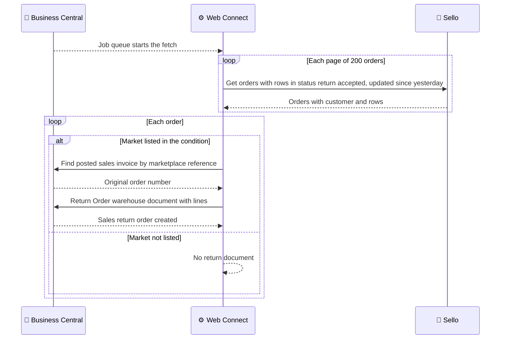

# Sello to Business Central: return orders

When a marketplace return is accepted in Sello, Web Connect fetches it on the next scheduled run and creates a return order in Business Central. The return is linked to the original order through the posted sales invoice, and each returned row gets item, variant and returned quantity from the EAN.

| | |
|---|---|
| **Direction** | Sello → Business Central |
| **Trigger** | Schedule in the Business Central job queue, within the times of day you set |
| **Result** | A warehouse document of the type Return Order and a sales return order in Business Central, with the Sello order number as document number |
| **Part of** | [Business Central and Sello integration](../overview.md) |

## Step by step

1. The job queue starts the fetch at the interval you have set (Business Central).
2. Web Connect asks the Sello API for orders with rows in the status return accepted, where the row status was updated since the day before. The newest come first, 200 orders per page, and Web Connect reads every page (Web Connect).
3. For each order, Web Connect checks the Sello market against the market condition. Orders from markets that are not listed get no return document (Web Connect).
4. Web Connect creates a warehouse document of the type Return Order, with the Sello order number as document number and the customer's name, address, country, email and mobile phone (Web Connect).
5. The marketplace order reference is looked up among the posted sales invoices in Business Central. The order number on the invoice becomes the original order on the return (Web Connect).
6. Each row becomes a return line. The EAN gives item number and variant through the bar code item references, and the returned quantity is set on the line (Web Connect).
7. The logistics setup for Sello creates the sales return order (Business Central).

## Data mapping

| Sello field | Business Central field | Note |
|---|---|---|
| `number` | Warehouse document number | The Sello order number. Only set when the market is listed in the market condition |
| Fixed value | Document type Return Order, source SELLO | Identify the document together with the Sello order number |
| `market_reference` | Original order number | Looked up as External Document No. on posted sales invoices. Also stored as external ID |
| `market_name` | Source identifier | Shows which marketplace the return came from in Entries |
| `customer_first_name` and `customer_last_name` | Customer name | Joined with a space |
| `customer_address`, `customer_address_2`, `customer_zip`, `customer_city`, `customer_country_code` | Customer address on the warehouse document | |
| `customer_email` | Email | |
| `customer_mobile` | Mobile phone | |
| `rows[].id` | Line identifier | Identifies the line together with the document |
| `rows[].identifier` | Item number and variant code | The EAN, matched through bar code item references |
| `rows[].quantity_returned` | Quantity | |

## Web Connect objects

| Object | Role |
|---|---|
| `SELLO_RETURN` | Fetches the orders with accepted returns from the Sello API on a schedule, page by page, and creates the Return Order warehouse document |
| `SELLO-URL` | Adds the start date of the time window to the request |
| `SELLO_ROWS` | The order rows, which become return lines |
| `SELLO_PAYMENT`, `SELLO_SHIPMENTS`, `SELLO_METADATA` | Parts of the Sello order that are skipped when the return is read |
| `SELLO_ERRORS`, `SELLO_TRACKING`, `SELLO_RETURNS`, `SELLO_ATTACHMENTS`, `SELLO_ICONS` | Other parts of the Sello order, kept in the message but not mapped |

## Error handling

| Situation | What happens | What to do |
|---|---|---|
| The EAN has no bar code item reference in Business Central | The return line gets no item | Add the EAN as an item reference, then process the entry again |
| The original order is not invoiced, or the invoice lacks the marketplace reference | The return gets no original order. If a reference to the original order is required, the return order is not created | Invoice the order with the marketplace reference as External Document No., or turn off the requirement in the [logistics setup](../../../general/logistics-setup.md) |
| The return comes from a Sello market that is not listed | No return document is created | Add the market to the market condition in the [Condition List](../../../general/condition-list.md) |
| The Sello credentials are wrong or expired | No returns are fetched | Update the credentials in [Secret Value Storage](../../../general/secret-value-storage.md) |

## Frequently asked questions

### Why has a return accepted in Sello not become a return order in Business Central?

Check that the return comes from a Sello market listed in the market condition, and that the job has run since the return was accepted. Then check the return in Web Connect Entries. Common reasons are an EAN without a bar code item reference, or an original order that is not invoiced yet.

### How often are returns fetched from Sello?

As often as you set on the Sello return object, within the times of day you choose. Each run fetches returns whose status was updated since the day before, so returns from the day before are fetched again on every run.

## Related

- [Business Central and Sello integration](../overview.md)
- [WMS documents](../../../general/wms-documents.md) · [Logistics Setup](../../../general/logistics-setup.md) · [Condition List](../../../general/condition-list.md) · [Objects](../../../general/objects.md) · [Entries](../../../general/entries.md)
