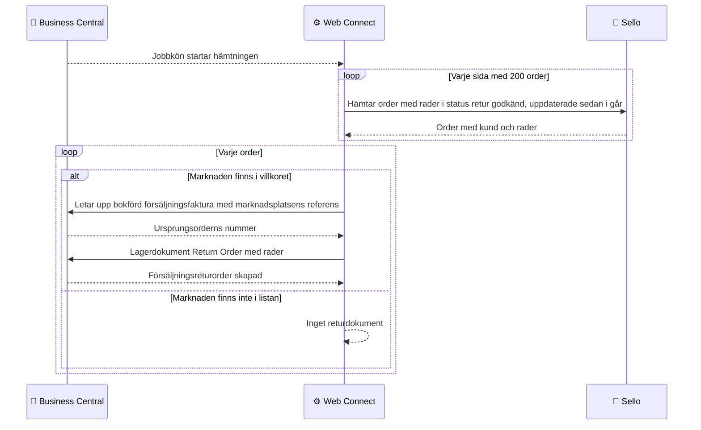

# Från Sello till Business Central: returorder

När en retur från en marknadsplats godkänns i Sello hämtar Web Connect den vid nästa schemalagda körning och skapar en returorder i Business Central. Returen kopplas till ursprungsordern via den bokförda försäljningsfakturan, och varje returnerad rad får artikel, variant och returnerat antal utifrån EAN.

| | |
|---|---|
| **Riktning** | Sello → Business Central |
| **Startas av** | Schema i jobbkön i Business Central, inom de klockslag du ställer in |
| **Resultat** | Ett lagerdokument av typen Return Order och en försäljningsreturorder i Business Central, med Sellos ordernummer som dokumentnummer |
| **Del av** | [Business Central och Sello: integration](../overview.md) |

## Steg för steg

1. Jobbkön startar hämtningen med det intervall du har ställt in (Business Central).
2. Web Connect frågar Sellos API efter order med rader i statusen retur godkänd, där radens status har uppdaterats sedan dagen innan. De senaste kommer först, 200 order per sida, och Web Connect läser alla sidor (Web Connect).
3. För varje order kontrollerar Web Connect marknaden i Sello mot marknadsvillkoret. Order från marknader som inte finns i listan får inget returdokument (Web Connect).
4. Web Connect skapar ett lagerdokument av typen Return Order, med Sellos ordernummer som dokumentnummer och kundens namn, adress, land, e-post och mobilnummer (Web Connect).
5. Marknadsplatsens orderreferens letas upp bland de bokförda försäljningsfakturorna i Business Central. Ordernumret på fakturan blir ursprungsorder på returen (Web Connect).
6. Varje rad blir en returrad. EAN ger artikelnummer och variant via streckkodsreferenserna, och det returnerade antalet anges på raden (Web Connect).
7. Logistikinställningarna för Sello skapar försäljningsreturordern (Business Central).

## Mappning av data

| Fält i Sello | Fält i Business Central | Kommentar |
|---|---|---|
| `number` | Lagerdokumentets nummer | Sellos ordernummer. Anges bara när marknaden finns i marknadsvillkoret |
| Fast värde | Dokumenttyp Return Order, källa SELLO | Identifierar dokumentet tillsammans med Sellos ordernummer |
| `market_reference` | Ursprungsorderns nummer | Letas upp som External Document No. på bokförda försäljningsfakturor. Sparas också som externt ID |
| `market_name` | Källidentifierare | Visar i Entries vilken marknadsplats returen kom från |
| `customer_first_name` och `customer_last_name` | Kundens namn | Sätts ihop med ett mellanslag |
| `customer_address`, `customer_address_2`, `customer_zip`, `customer_city`, `customer_country_code` | Kundens adress på lagerdokumentet | |
| `customer_email` | E-post | |
| `customer_mobile` | Mobilnummer | |
| `rows[].id` | Radidentifierare | Identifierar raden tillsammans med dokumentet |
| `rows[].identifier` | Artikelnummer och variantkod | EAN, som matchas via streckkodsreferenser |
| `rows[].quantity_returned` | Antal | |

## Objekt i Web Connect

| Objekt | Roll |
|---|---|
| `SELLO_RETURN` | Hämtar order med godkända returer från Sellos API enligt schema, sida för sida, och skapar lagerdokumentet Return Order |
| `SELLO-URL` | Lägger till startdatumet för tidsfönstret i anropet |
| `SELLO_ROWS` | Orderraderna, som blir returrader |
| `SELLO_PAYMENT`, `SELLO_SHIPMENTS`, `SELLO_METADATA` | Delar av ordern i Sello som hoppas över när returen läses |
| `SELLO_ERRORS`, `SELLO_TRACKING`, `SELLO_RETURNS`, `SELLO_ATTACHMENTS`, `SELLO_ICONS` | Andra delar av ordern i Sello, som finns kvar i meddelandet men inte mappas |

## Felhantering

| Situation | Vad som händer | Vad du gör |
|---|---|---|
| EAN saknar streckkodsreferens i Business Central | Returraden får ingen artikel | Lägg till EAN som artikelreferens och bearbeta sedan posten igen |
| Ursprungsordern är inte fakturerad, eller fakturan saknar marknadsplatsens referens | Returen får ingen ursprungsorder. Om en referens till ursprungsordern krävs skapas inte returordern | Fakturera ordern med marknadsplatsens referens som External Document No., eller stäng av kravet i [logistikinställningarna](../../../general/logistics-setup.md) |
| Returen kommer från en marknad i Sello som inte finns i listan | Inget returdokument skapas | Lägg till marknaden i marknadsvillkoret i [Condition List](../../../general/condition-list.md) |
| Inloggningsuppgifterna för Sello är fel eller har gått ut | Inga returer hämtas | Uppdatera uppgifterna i [Secret Value Storage](../../../general/secret-value-storage.md) |

## Vanliga frågor

### Varför har en retur som godkänts i Sello inte blivit en returorder i Business Central?

Kontrollera att returen kommer från en marknad i Sello som finns med i marknadsvillkoret, och att jobbet har körts sedan returen godkändes. Titta sedan på returen i Web Connect Entries. Vanliga orsaker är en EAN utan streckkodsreferens eller en ursprungsorder som inte har fakturerats än.

### Hur ofta hämtas returer från Sello?

Så ofta som du ställer in på returobjektet för Sello, inom de klockslag du väljer. Varje körning hämtar returer vars status har uppdaterats sedan dagen innan, så gårdagens returer hämtas igen vid varje körning.

## Relaterat

- [Business Central och Sello: integration](../overview.md)
- [WMS-dokument](../../../general/wms-documents.md) · [Logistics Setup](../../../general/logistics-setup.md) · [Condition List](../../../general/condition-list.md) · [Objects](../../../general/objects.md) · [Entries](../../../general/entries.md)
