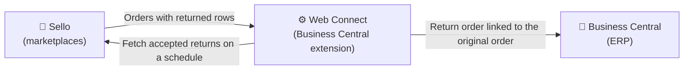
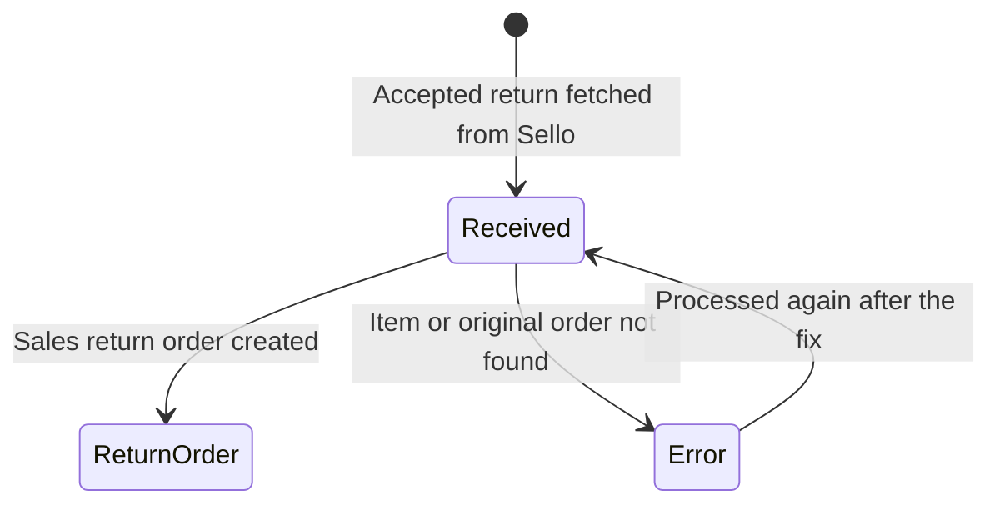
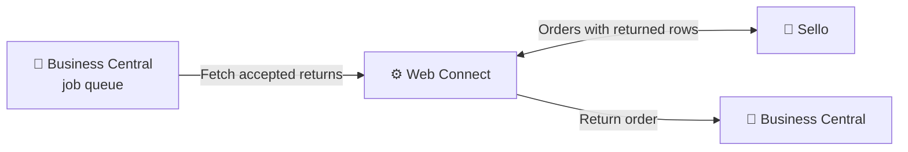

# Business Central and Sello integration

Web Connect by CombineIT connects Microsoft Dynamics 365 Business Central with Sello, the tool for selling on several marketplaces. Returns accepted in Sello are fetched on a schedule and become return orders in Business Central, linked to the original order, with the customer, the items and the returned quantities. All mappings and rules live in your own Business Central, where you can see and change them yourself.

## At a glance

| | |
|---|---|
| **System** | Sello (marketplaces) |
| **Integration product** | Web Connect for Microsoft Dynamics 365 Business Central |
| **Runs in** | Your own Business Central environment, as an extension. Web Connect fetches accepted returns from the Sello API on a schedule in the Business Central job queue. Sello does not call Business Central. All processing and configuration stays in Business Central. |
| **Configured by** | You, in Business Central: mappings, conditions, triggers and flows. You can do all of it yourself. If you want, CombineIT takes part in any step, as a sounding board or by doing the work. |
| **Connection** | Sello REST API (version 5, JSON). The API credentials are created in Sello |
| **Sello API** | [ATT FYLLA I: name and link to Sello's API documentation] |
| **Data flows** | 1: return orders |
| **Business Central editions** | All editions, Essentials and Premium, including the latest version |
| **Available from** | [Web Connect on Microsoft AppSource](https://marketplace.microsoft.com/sv-se/product/PUBID.martitab1633951001710%7CAID.webconnect%7CPAPPID.9f3a7223-19db-4ac7-832f-cf8e4699186f?tab=Overview). [ATT FYLLA I: whether the Sello integration is part of the Web Connect Ready Integrations app] |

## What can be synchronized

Web Connect has one data flow between Business Central and Sello.

| Data | Direction | What happens |
|---|---|---|
| [Return orders](flows/return-orders.md) | Sello → Business Central | A marketplace return accepted in Sello becomes a return order in Business Central, linked to the original order, with the customer, the items and the returned quantities |

Return orders are the flow in every Sello integration. Orders, stock, prices and products are not part of it. See [Limitations](#limitations).

## How it works

Web Connect uses the [WMS documents](../../general/wms-documents.md) in Business Central, the same layer that handles warehouse, POS and returns systems. At the times you set, the Business Central job queue asks the Sello API for orders with rows in the status return accepted, updated since the day before. Each order becomes a warehouse document of the type Return Order, and the [logistics setup](../../general/logistics-setup.md) for Sello then creates the sales return order. Every message is logged in Web Connect [Entries](../../general/entries.md), where it can be inspected and processed again.

### Return document status in Business Central

## Choose your setup

Each flow has to fit how your business works: which system owns the data, where people do their work, and what the accounting needs. That is why the flows are decided together when a new integration is set up. The options below are the ones Web Connect customers use today. **Common setup** marks the option most Web Connect customers with Sello use. **Recommended** marks CombineIT's best practice, where there is one.

### Return orders

| Option | How it works | When it fits |
|---|---|---|
| **Accepted returns fetched from Sello on a schedule** (common setup) | The Business Central job queue asks the Sello API for orders with rows in the status return accepted, and creates a return order for each order from the Sello markets you have chosen | Returns from the marketplaces are handled and accepted in Sello, and Business Central needs the return order for the credit and the stock |

The one Sello integration in Web Connect today uses this option.

#### Return orders fetched from Sello on a schedule

The listings, the marketplace connections and the handling of the return with the marketplace are always maintained in Sello.

## What you need

- Microsoft Dynamics 365 Business Central, any edition (Essentials or Premium), including the latest version
- Web Connect installed from Microsoft AppSource, with an activated Web Connect license
- Your approval for Web Connect to be installed and to act in your Business Central environment
- API credentials for Web Connect, created in Sello
- A logistics setup for Sello in Business Central with sales return orders switched on
- Bar code item references in Business Central with the EAN used in Sello, so returned rows can be matched to item and variant
- Original orders invoiced in Business Central with the marketplace order reference as External Document No., if returns are to be linked to the original order

## Setting it up

1. Decide which Sello markets to take returns from, see [Choose your setup](#choose-your-setup).
2. Install Web Connect in Business Central, activate the license and give your approval.
3. Import the Sello configuration with the integration turned off, then set the logistics setup for Sello.
4. Store the Sello API credentials in [Secret Value Storage](../../general/secret-value-storage.md).
5. List the Sello markets to include in the market condition in the [Condition List](../../general/condition-list.md).
6. Set how often accepted returns are fetched, and between which times of day.
7. Test a return of an item with an EAN, a return of an item without an item reference and a return whose original order is not invoiced, before going live.

## Configure it yourself in Business Central

All configuration and logic in the integration is visible and editable in Business Central. There is no external integration platform where the logic is hidden.

| What you can change | Where in Web Connect | Example |
|---|---|---|
| What happens with a return | [Logistics Setup](../../general/logistics-setup.md) | Release the created return order automatically, or require a reference to the original order |
| Which marketplaces are included | [Condition List](../../general/condition-list.md) | Add a Sello market to the list when you start selling on a new marketplace |
| Which returns are fetched and how often | [Objects](../../general/objects.md) | Change the Sello status that is fetched, how often the job runs and between which times |
| How far back returns are fetched | Integration variables | Fetch returns updated in the last two days instead of one |
| Field mapping | [Incoming data mapping](../../general/incoming-data/mapping.md) | Map another Sello field, for example the return reason, to the return document |
| Item matching | Item references in Business Central | Add the EAN of a new variant as a bar code item reference |
| Monitoring | [Entries](../../general/entries.md) | See every fetch and return, and process a return again after a fix |

## Configuration choices

- **Marketplaces:** which Sello markets returns are taken from. The condition lists the Sello market ids, and returns from other markets are left out.
- **Schedule:** how often accepted returns are fetched, and between which times of day, set to your needs.
- **Time window:** how far back the fetch looks, counted from today, based on when the return status was last updated in Sello.
- **Return order number:** whether the return order in Business Central gets the Sello order number or a number from your number series.
- **Original order:** whether every return must refer to the original sales order.
- **Item matching:** the EAN on the Sello row is matched to item number and variant through bar code item references.
- **Error handling:** who receives the error summary email, and how failed returns are processed again.

## Limitations

- **Only returns are integrated.** Orders, stock, prices and products are not sent or fetched by this integration. Marketplace orders reach Business Central another way, for example through your e-commerce platform.
- **Returns arrive on a schedule.** A return is in Business Central first after the next run. Sello does not send returns to Business Central as webhooks.
- **Return reasons are not transferred.** The reason given in Sello is not mapped to a return reason code in the standard configuration. It can be added in the mapping.
- **Prices and refunds are not taken from Sello.** The return lines get no price from Sello, and the refund is not part of the integration. The credit memo is handled in Business Central.
- **Nothing is sent back to Sello.** Business Central does not update the return status in Sello.
- **The item needs a bar code item reference.** A returned row is matched on EAN only. Without an item reference for the EAN, the line gets no item.
- **The link to the original order needs a posted sales invoice.** The original order is found through the External Document No. on posted sales invoices. Orders that are not invoiced yet are not found.

## Frequently asked questions

### Can Business Central be integrated with Sello?

Yes. Web Connect connects Business Central with Sello. Returns accepted in Sello are fetched on a schedule and become return orders in Business Central, linked to the original order, with the customer, the items and the returned quantities.

### Which marketplace returns are fetched from Sello?

Web Connect fetches Sello orders that have rows with the status return accepted. A condition in Web Connect lists the Sello markets to include, so you decide which marketplaces your returns are taken from by editing that list.

### How does Web Connect find the item on a Sello return?

Web Connect reads the EAN on each returned row and finds the item number and variant through the bar code item references in Business Central. The item needs an item reference with the EAN for the return line to get the right item.

### How is the return linked to the original order?

Web Connect takes the marketplace order reference from Sello and looks up the posted sales invoice in Business Central that has that reference as External Document No. The order number on that invoice is set as the original order on the return.

## Related

- Flows: [Return orders](flows/return-orders.md)
- How-to: [Integrations not running](../../../../how-to/web-connect/integration-not-running.md)
- Web Connect: [Logistics Setup](../../general/logistics-setup.md) · [WMS documents](../../general/wms-documents.md) · [Condition List](../../general/condition-list.md) · [Objects](../../general/objects.md) · [Secret Value Storage](../../general/secret-value-storage.md)
- [Web Connect general documentation](../../general/README.md)
- [Sello](https://sello.io/)

## About Web Connect

Web Connect is an integration platform for Microsoft Dynamics 365 Business Central, developed by CombineIT. It is installed in your own Business Central and connects it with e-commerce platforms, warehouse systems, POS, returns, marketplaces and EDI. Every flow, mapping and rule is configured in Business Central, where you can see and change it yourself, without custom code for each integration. [Web Connect on Microsoft AppSource](https://marketplace.microsoft.com/sv-se/product/PUBID.martitab1633951001710%7CAID.webconnect%7CPAPPID.9f3a7223-19db-4ac7-832f-cf8e4699186f?tab=Overview) · [Contact CombineIT](https://www.combineit.se/contact/)
