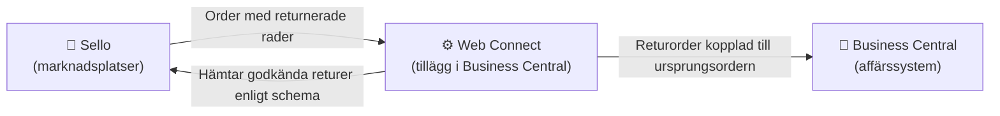
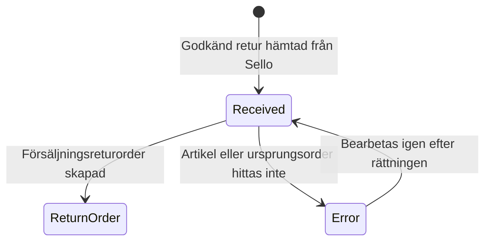
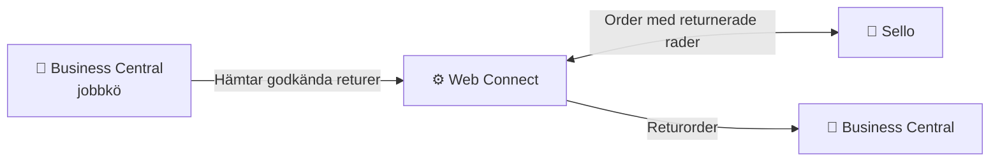

# Business Central och Sello: integration

Web Connect från CombineIT kopplar Microsoft Dynamics 365 Business Central till Sello, verktyget för att sälja på flera marknadsplatser. Returer som godkänts i Sello hämtas enligt schema och blir returorder i Business Central, kopplade till ursprungsordern, med kunden, artiklarna och de returnerade antalen. Alla mappningar och regler finns i ditt eget Business Central, där du kan se och ändra dem själv.

## I korthet

| | |
|---|---|
| **System** | Sello (marknadsplatser) |
| **Integrationsprodukt** | Web Connect för Microsoft Dynamics 365 Business Central |
| **Körs i** | Din egen Business Central-miljö, som ett tillägg. Web Connect hämtar godkända returer från Sellos API enligt schema i jobbkön i Business Central. Sello anropar inte Business Central. All bearbetning och konfiguration stannar i Business Central. |
| **Konfigureras av** | Dig, i Business Central: mappningar, villkor, triggers och flöden. Du kan göra allt själv. Om du vill är CombineIT med i vilket steg som helst, som bollplank eller genom att göra jobbet. |
| **Koppling** | Sellos REST API (version 5, JSON). API-uppgifterna skapas i Sello |
| **Sellos API** | [Sellos API-dokumentation](https://docs.sello.io/) |
| **Dataflöden** | 1: returorder |
| **Business Central-utgåvor** | Alla utgåvor, Essentials och Premium, även den senaste versionen |
| **Finns på** | [Web Connect på Microsoft AppSource](https://marketplace.microsoft.com/sv-se/product/PUBID.martitab1633951001710%7CAID.webconnect%7CPAPPID.9f3a7223-19db-4ac7-832f-cf8e4699186f?tab=Overview). Integrationen med Sello ingår inte i appen Web Connect Ready Integrations. Den sätts upp som en konfiguration i Web Connect |

## Det här kan synkas

Web Connect har ett dataflöde mellan Business Central och Sello.

| Data | Riktning | Vad som händer |
|---|---|---|
| [Returorder](flows/return-orders.md) | Sello → Business Central | En retur från en marknadsplats som godkänts i Sello blir en returorder i Business Central, kopplad till ursprungsordern, med kunden, artiklarna och de returnerade antalen |

Returorder är flödet i varje integration med Sello. Order, lagersaldo, priser och produkter ingår inte. Se [Begränsningar](#limitations).

## Så fungerar det

Web Connect använder [WMS-dokumenten](../../general/wms-documents.md) i Business Central, samma lager som hanterar lagersystem, kassasystem och retursystem. Vid de tider du ställer in frågar jobbkön i Business Central Sellos API efter order med rader i statusen retur godkänd, uppdaterade sedan dagen innan. Varje order blir ett lagerdokument av typen Return Order, och [logistikinställningarna](../../general/logistics-setup.md) för Sello skapar sedan försäljningsreturordern. Varje meddelande loggas i Web Connect [Entries](../../general/entries.md), där det kan granskas och bearbetas igen.

### Status för returdokumentet i Business Central

## Välj upplägg

Varje flöde måste passa hur ditt företag arbetar: vilket system som äger datan, var personalen gör sitt arbete och vad bokföringen behöver. Därför bestäms flödena tillsammans när en ny integration sätts upp. Alternativen nedan är de som kunder med Web Connect använder i dag. **Vanligt upplägg** markerar det alternativ som flest kunder med Web Connect och Sello använder. **Rekommenderas** markerar CombineIT:s bästa praxis, där det finns en.

### Returorder

| Alternativ | Så fungerar det | När det passar |
|---|---|---|
| **Godkända returer hämtas från Sello enligt schema** (vanligt upplägg) | Jobbkön i Business Central frågar Sellos API efter order med rader i statusen retur godkänd och skapar en returorder för varje order från de marknader i Sello som du har valt | Returer från marknadsplatserna hanteras och godkänns i Sello, och Business Central behöver returordern för krediteringen och lagersaldot |

Den enda integrationen med Sello i Web Connect i dag använder det här alternativet.

#### Returorder som hämtas från Sello enligt schema

Annonserna, kopplingarna till marknadsplatserna och hanteringen av returen mot marknadsplatsen sköts alltid i Sello.

## Det här behöver du

- Microsoft Dynamics 365 Business Central, valfri utgåva (Essentials eller Premium), även den senaste versionen
- Web Connect installerat från Microsoft AppSource, med en aktiverad licens för Web Connect
- Ditt godkännande av att Web Connect installeras och agerar i din Business Central-miljö
- API-uppgifter för Web Connect, skapade i Sello
- Logistikinställningar för Sello i Business Central med försäljningsreturorder påslagna
- Streckkodsreferenser (item references) i Business Central med den EAN som används i Sello, så att returnerade rader kan matchas mot artikel och variant
- Ursprungsorder fakturerade i Business Central med marknadsplatsens orderreferens som External Document No., om returerna ska kopplas till ursprungsordern

## Så kommer du igång

1. Bestäm vilka marknader i Sello som returerna ska hämtas från, se [Välj upplägg](#choose-your-setup).
2. Installera Web Connect i Business Central, aktivera licensen och ge ditt godkännande.
3. Importera konfigurationen för Sello med integrationen avstängd och ställ sedan in logistikinställningarna för Sello.
4. Spara API-uppgifterna för Sello i [Secret Value Storage](../../general/secret-value-storage.md).
5. Lista de marknader i Sello som ska vara med i marknadsvillkoret i [Condition List](../../general/condition-list.md).
6. Ställ in hur ofta godkända returer hämtas och mellan vilka klockslag.
7. Testa en retur av en artikel med EAN, en retur av en artikel utan artikelreferens och en retur vars ursprungsorder inte är fakturerad innan ni går live.

## Konfigurera själv i Business Central

All konfiguration och logik i integrationen går att se och ändra i Business Central. Det finns ingen extern integrationsplattform där logiken är dold.

| Det här kan du ändra | Var i Web Connect | Exempel |
|---|---|---|
| Vad som händer med en retur | [Logistics Setup](../../general/logistics-setup.md) | Släpp den skapade returordern automatiskt, eller kräv en referens till ursprungsordern |
| Vilka marknadsplatser som är med | [Condition List](../../general/condition-list.md) | Lägg till en marknad från Sello i listan när du börjar sälja på en ny marknadsplats |
| Vilka returer som hämtas och hur ofta | [Objects](../../general/objects.md) | Ändra vilken status i Sello som hämtas, hur ofta jobbet körs och mellan vilka klockslag |
| Hur långt bakåt returer hämtas | Integrationsvariabler | Hämta returer som uppdaterats de senaste två dagarna i stället för en |
| Fältmappning | [Incoming data mapping](../../general/incoming-data/mapping.md) | Mappa ett annat fält i Sello, till exempel returorsaken, till returdokumentet |
| Matchning av artiklar | Artikelreferenser i Business Central | Lägg till EAN för en ny variant som streckkodsreferens |
| Övervakning | [Entries](../../general/entries.md) | Se varje hämtning och retur, och bearbeta en retur igen efter en rättning |

## Val i konfigurationen

- **Marknadsplatser:** vilka marknader i Sello som returerna hämtas från. Villkoret listar Sellos marknads-id:n, och returer från andra marknader tas inte med.
- **Schema:** hur ofta godkända returer hämtas och mellan vilka klockslag, efter dina behov.
- **Tidsfönster:** hur långt bakåt hämtningen tittar, räknat från i dag, utifrån när returstatusen senast uppdaterades i Sello.
- **Returordernummer:** om returordern i Business Central får Sellos ordernummer eller ett nummer från din nummerserie.
- **Ursprungsorder:** om varje retur måste hänvisa till den ursprungliga försäljningsordern.
- **Matchning av artiklar:** EAN på raden i Sello matchas mot artikelnummer och variant via streckkodsreferenser.
- **Felhantering:** vem som får mejlet med sammanställningen av fel, och hur misslyckade returer bearbetas igen.

## Begränsningar

- **Bara returer integreras.** Order, lagersaldo, priser och produkter skickas inte och hämtas inte av den här integrationen. Order från marknadsplatserna når Business Central på annat sätt, till exempel via din e-handelsplattform.
- **Returerna kommer enligt schema.** En retur finns i Business Central först efter nästa körning. Sello skickar inte returer till Business Central som webhooks.
- **Returorsaker förs inte över.** Orsaken som anges i Sello mappas inte till en returorsakskod i standardkonfigurationen. Det kan läggas till i mappningen.
- **Priser och återbetalningar hämtas inte från Sello.** Returraderna får inget pris från Sello, och återbetalningen ingår inte i integrationen. Kreditnotan hanteras i Business Central.
- **Ingenting skickas tillbaka till Sello.** Business Central uppdaterar inte returstatusen i Sello.
- **Artikeln behöver en streckkodsreferens.** En returnerad rad matchas bara på EAN. Utan en artikelreferens för EAN får raden ingen artikel.
- **Kopplingen till ursprungsordern kräver en bokförd försäljningsfaktura.** Ursprungsordern hittas via External Document No. på bokförda försäljningsfakturor. Order som inte har fakturerats än hittas inte.

## Vanliga frågor

### Går det att integrera Business Central med Sello?

Ja. Web Connect kopplar Business Central till Sello. Returer som godkänts i Sello hämtas enligt schema och blir returorder i Business Central, kopplade till ursprungsordern, med kunden, artiklarna och de returnerade antalen.

### Vilka returer från marknadsplatserna hämtas från Sello?

Web Connect hämtar order i Sello som har rader med statusen retur godkänd. Ett villkor i Web Connect listar vilka marknader i Sello som ska vara med, så du bestämmer vilka marknadsplatser returerna hämtas från genom att ändra den listan.

### Hur hittar Web Connect artikeln på en retur från Sello?

Web Connect läser EAN på varje returnerad rad och hittar artikelnummer och variant via streckkodsreferenserna (item references) i Business Central. Artikeln behöver en artikelreferens med EAN för att returraden ska få rätt artikel.

### Hur kopplas returen till ursprungsordern?

Web Connect tar marknadsplatsens orderreferens från Sello och letar upp den bokförda försäljningsfakturan i Business Central som har den referensen som External Document No. Ordernumret på den fakturan anges som ursprungsorder på returen.

## Relaterat

- Flöden: [Returorder](flows/return-orders.md)
- Instruktioner: [Integrationer som inte körs](../../../../how-to/web-connect/integration-not-running.md)
- Web Connect: [Logistics Setup](../../general/logistics-setup.md) · [WMS-dokument](../../general/wms-documents.md) · [Condition List](../../general/condition-list.md) · [Objects](../../general/objects.md) · [Secret Value Storage](../../general/secret-value-storage.md)
- [Allmän dokumentation om Web Connect](../../general/README.md)
- [Sello](https://sello.io/)

## Om Web Connect

Web Connect är en integrationsplattform för Microsoft Dynamics 365 Business Central, utvecklad av CombineIT. Den installeras i ditt eget Business Central och kopplar det till e-handelsplattformar, lagersystem, kassasystem, returer, marknadsplatser och EDI. Varje flöde, mappning och regel konfigureras i Business Central, där du kan se och ändra dem själv, utan specialkod för varje integration. [Web Connect på Microsoft AppSource](https://marketplace.microsoft.com/sv-se/product/PUBID.martitab1633951001710%7CAID.webconnect%7CPAPPID.9f3a7223-19db-4ac7-832f-cf8e4699186f?tab=Overview) · [Kontakta CombineIT](https://www.combineit.se/contact/)
