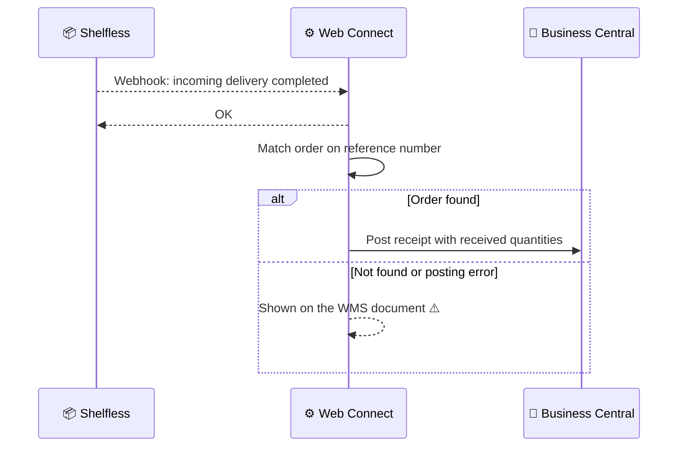

# Shelfless to Business Central: goods receipts

When Shelfless has finished receiving an incoming delivery, Shelfless sends a webhook to Web Connect. Web Connect finds the purchase order or transfer order through the reference number and posts the receipt with the quantity actually received.

| | |
|---|---|
| **Direction** | Shelfless → Business Central |
| **Trigger** | Webhook from Shelfless when an incoming delivery is completed. Completed incoming deliveries can also be fetched from the API |
| **Result** | A posted receipt on the purchase order or transfer order |
| **Part of** | [Business Central and Shelfless integration](../overview.md) |

## Step by step

1. Shelfless completes the incoming delivery and sends a webhook, received by an Azure endpoint that passes it on to Web Connect.
2. Web Connect creates a WMS document of the type receipt notice with one row per received product.
3. The order is matched on the reference number, and the rows on their line number.
4. Web Connect posts the receipt with the received quantity.

## Data mapping

| Shelfless field | Business Central field | Note |
|---|---|---|
| `ReferenceNumber` | Document number | Used to find the order |
| `IncomingDeliveryId` | WMS document number | |
| `CompletedDate` | Date on the WMS document | |
| `IncomingDeliveryRows.ExternalId` | Line number | |
| `IncomingDeliveryRows.ProductNumber` | Item number | |
| `IncomingDeliveryRows.Quantity` | Expected quantity | |
| `IncomingDeliveryRows.ReceivedQuantity` | Quantity to receive | |

## Web Connect objects

| Object | Role |
|---|---|
| `DL_WEBHOOK_RECEIVAL` | Receives the webhook and creates the WMS document |
| `DL_INC_DELIVERY_ROW` | Received rows |
| `DL_GET_INC_DELIVERIES` | Fetches completed incoming deliveries from the API (`completedAfter`), for example to catch up |

## Error handling

| Situation | What happens | What to do |
|---|---|---|
| The webhook arrives but nothing is created | The webhook object must have *Service Type for Download* set to Get, otherwise the webhook is never processed | Check the setting on `DL_WEBHOOK_RECEIVAL`, then ask Shelfless to send the webhook again |
| More is received than ordered | Accepted only if over receipt is allowed in Logistics Setup | Adjust the tolerance or the order |

## Frequently asked questions

### Can Shelfless receive more than was ordered?

Yes, if over receipt is allowed in Logistics Setup. The tolerance is set there.

## Related

- [Business Central and Shelfless integration](../overview.md)
- [Inbound deliveries](inbound-delivery.md)
- [Webhooks](../../../general/webhooks.md) · [Nothing downloads to Business Central](../../../../../how-to/web-connect/nothing-downloads-to-business-central.md)
