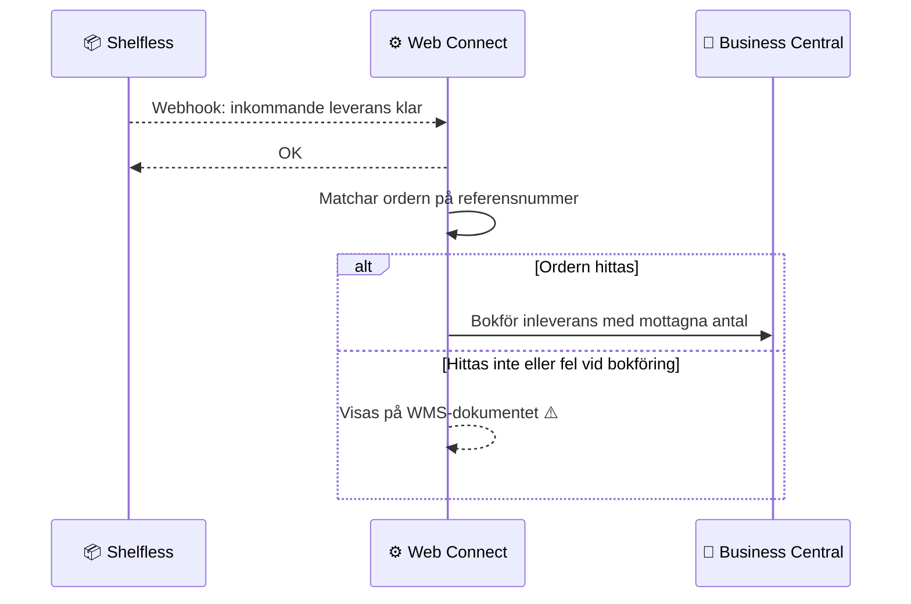

# Från Shelfless till Business Central: inleveranser

När Shelfless har tagit emot en inkommande leverans skickar Shelfless en webhook till Web Connect. Web Connect hittar inköpsordern eller flyttordern via referensnumret och bokför inleveransen med det antal som faktiskt tagits emot.

| | |
|---|---|
| **Riktning** | Shelfless → Business Central |
| **Startas av** | En webhook från Shelfless när en inkommande leverans är klar. Klara inkommande leveranser kan också hämtas från API:t |
| **Resultat** | En bokförd inleverans på inköpsordern eller flyttordern |
| **Del av** | [Business Central och Shelfless: integration](../overview.md) |

## Steg för steg

1. Shelfless slutför den inkommande leveransen och skickar en webhook, som tas emot av en Azure-endpoint som skickar den vidare till Web Connect.
2. Web Connect skapar ett WMS-dokument av typen receipt notice med en rad per mottagen produkt.
3. Ordern matchas på referensnumret, och raderna på sitt radnummer.
4. Web Connect bokför inleveransen med mottaget antal.

## Mappning av data

| Fält i Shelfless | Fält i Business Central | Kommentar |
|---|---|---|
| `ReferenceNumber` | Dokumentnummer | Används för att hitta ordern |
| `IncomingDeliveryId` | WMS-dokumentets nummer | |
| `CompletedDate` | Datum på WMS-dokumentet | |
| `IncomingDeliveryRows.ExternalId` | Radnummer | |
| `IncomingDeliveryRows.ProductNumber` | Artikelnummer | |
| `IncomingDeliveryRows.Quantity` | Förväntat antal | |
| `IncomingDeliveryRows.ReceivedQuantity` | Antal att ta emot | |

## Objekt i Web Connect

| Objekt | Roll |
|---|---|
| `DL_WEBHOOK_RECEIVAL` | Tar emot webhooken och skapar WMS-dokumentet |
| `DL_INC_DELIVERY_ROW` | Mottagna rader |
| `DL_GET_INC_DELIVERIES` | Hämtar klara inkommande leveranser från API:t (`completedAfter`), till exempel för att komma ikapp |

## Felhantering

| Situation | Vad som händer | Vad du gör |
|---|---|---|
| Webhooken kommer fram men inget skapas | Webhook-objektet måste ha *Service Type for Download* satt till Get, annars behandlas webhooken aldrig | Kontrollera inställningen på `DL_WEBHOOK_RECEIVAL` och be sedan Shelfless skicka webhooken igen |
| Mer tas emot än vad som beställts | Godkänns bara om överleverans är tillåten i Logistics Setup | Justera toleransen eller ordern |

## Vanliga frågor

### Kan Shelfless ta emot mer än vad som beställts?

Ja, om överleverans är tillåten i Logistics Setup. Där ställs också toleransen in.

## Relaterat

- [Business Central och Shelfless: integration](../overview.md)
- [Inkommande leveranser](inbound-delivery.md)
- [Webhooks](../../../general/webhooks.md) · [Inget hämtas till Business Central](../../../../../how-to/web-connect/nothing-downloads-to-business-central.md)
