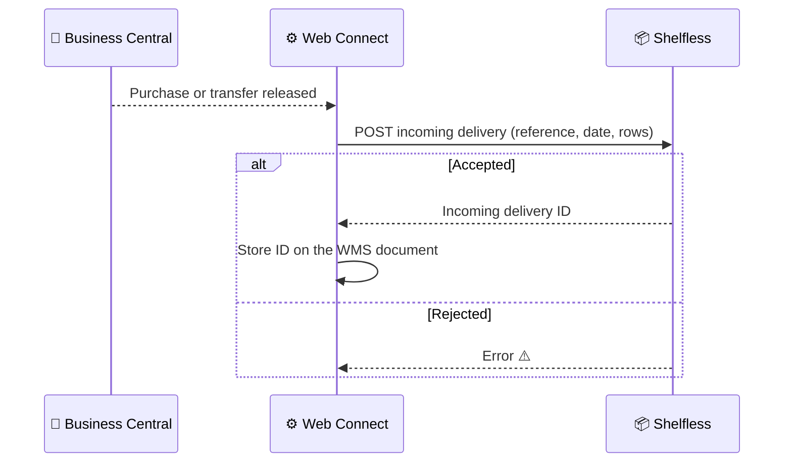

# Business Central to Shelfless: inbound deliveries

When a purchase order or an incoming transfer order is released in Business Central, Web Connect announces it to Shelfless as an incoming delivery. Shelfless then knows what to expect, and the receipt can be matched back to the order.

| | |
|---|---|
| **Direction** | Business Central → Shelfless |
| **Trigger** | Purchase order or incoming transfer order released in Business Central |
| **Result** | An incoming delivery in Shelfless. The Shelfless ID is stored in Business Central |
| **Part of** | [Business Central and Shelfless integration](../overview.md) |

## Step by step

1. A purchase order or incoming transfer order to the Shelfless location is released.
2. Web Connect creates a WMS document and sends the incoming delivery to Shelfless (`POST api/v1/incoming-deliveries`).
3. Shelfless answers with its incoming delivery ID, which Web Connect stores on the WMS document.

## Data mapping

| Shelfless field | Business Central field | Note |
|---|---|---|
| `referenceNumber`, `externalId` | Document number | Used to match the receipt |
| `expectedDeliveryDate` | Expected receipt date | |
| `stockLocation`, `type`, `channel` | Set in the mapping | The same for every incoming delivery |
| `incomingDeliveryRows.externalId` | Line number | |
| `incomingDeliveryRows.productNumber` | Item number | |
| `incomingDeliveryRows.quantity` | Quantity | |

## Web Connect objects

| Object | Role |
|---|---|
| `DL_INCOMING_DELIVERY` | Creates the incoming delivery and stores the Shelfless ID |
| `DL_INCOMINGDELIVERYROWS` | Rows |
| `DL_INCOMINGDELIVERYDATA` | Extra data fields on the incoming delivery |

## Error handling

| Situation | What happens | What to do |
|---|---|---|
| Shelfless rejects the incoming delivery | The error is shown on the WMS document and in Entries | Correct the order and [resend the message](../../../../../how-to/web-connect/resend-outgoing-message.md) |

## Frequently asked questions

### Which documents are announced to Shelfless?

Purchase orders and incoming transfer orders for the Shelfless location, when they are released.

## Related

- [Business Central and Shelfless integration](../overview.md)
- [Goods receipts](goods-receipt.md)
