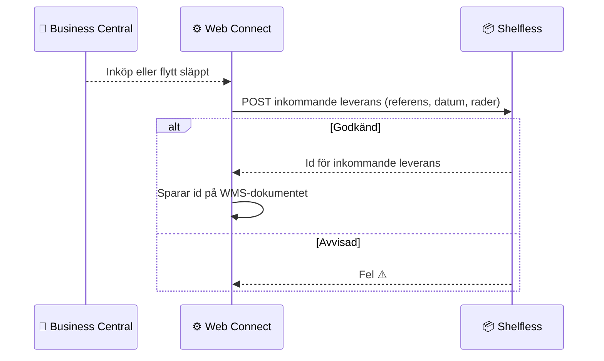

# Från Business Central till Shelfless: inkommande leveranser

När en inköpsorder eller en inkommande flyttorder släpps i Business Central aviserar Web Connect den till Shelfless som en inkommande leverans. Shelfless vet då vad som väntas, och inleveransen kan matchas tillbaka mot ordern.

| | |
|---|---|
| **Riktning** | Business Central → Shelfless |
| **Startas av** | En inköpsorder eller inkommande flyttorder släpps i Business Central |
| **Resultat** | En inkommande leverans i Shelfless. Shelfless-id:t sparas i Business Central |
| **Del av** | [Business Central och Shelfless: integration](../overview.md) |

## Steg för steg

1. En inköpsorder eller inkommande flyttorder till Shelfless-lagerstället släpps.
2. Web Connect skapar ett WMS-dokument och skickar den inkommande leveransen till Shelfless (`POST api/v1/incoming-deliveries`).
3. Shelfless svarar med id:t för den inkommande leveransen, som Web Connect sparar på WMS-dokumentet.

## Mappning av data

| Fält i Shelfless | Fält i Business Central | Kommentar |
|---|---|---|
| `referenceNumber`, `externalId` | Dokumentnummer | Används för att matcha inleveransen |
| `expectedDeliveryDate` | Förväntat inleveransdatum | |
| `stockLocation`, `type`, `channel` | Sätts i mappningen | Samma för varje inkommande leverans |
| `incomingDeliveryRows.externalId` | Radnummer | |
| `incomingDeliveryRows.productNumber` | Artikelnummer | |
| `incomingDeliveryRows.quantity` | Antal | |

## Objekt i Web Connect

| Objekt | Roll |
|---|---|
| `DL_INCOMING_DELIVERY` | Skapar den inkommande leveransen och sparar Shelfless-id:t |
| `DL_INCOMINGDELIVERYROWS` | Rader |
| `DL_INCOMINGDELIVERYDATA` | Extra datafält på den inkommande leveransen |

## Felhantering

| Situation | Vad som händer | Vad du gör |
|---|---|---|
| Shelfless avvisar den inkommande leveransen | Felet visas på WMS-dokumentet och i Entries | Rätta ordern och [skicka om meddelandet](../../../../../how-to/web-connect/resend-outgoing-message.md) |

## Vanliga frågor

### Vilka dokument aviseras till Shelfless?

Inköpsorder och inkommande flyttorder för Shelfless-lagerstället, när de släpps.

## Relaterat

- [Business Central och Shelfless: integration](../overview.md)
- [Inleveranser](goods-receipt.md)
