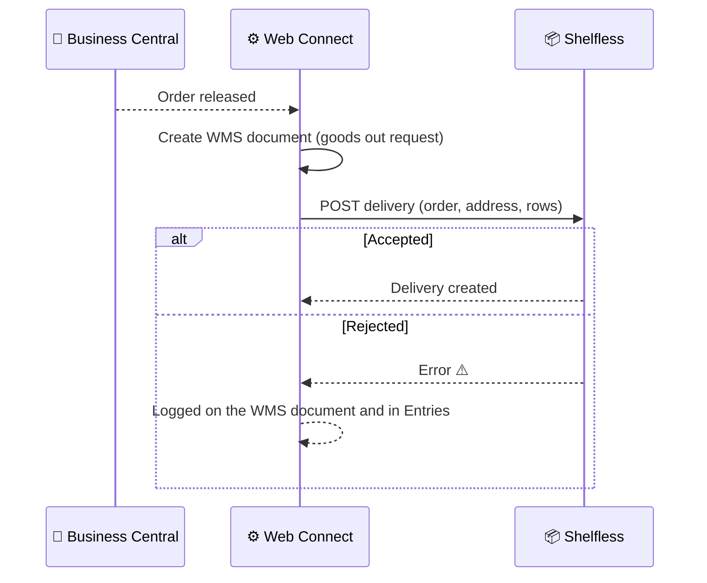

# Business Central to Shelfless: outbound deliveries

When a sales order or an outgoing transfer order is released in Business Central, Web Connect sends it to Shelfless and a delivery is created in the warehouse. The Business Central document number is sent as external ID, so the shipment can be matched back when Shelfless has shipped.

| | |
|---|---|
| **Direction** | Business Central → Shelfless |
| **Trigger** | Sales order or outgoing transfer order released in Business Central |
| **Result** | A delivery in Shelfless, and a WMS document in Business Central that tracks it |
| **Part of** | [Business Central and Shelfless integration](../overview.md) |

## Step by step

1. A sales order or outgoing transfer order for the Shelfless location is released in Business Central.
2. Web Connect creates a WMS document of the type goods out request and fills it from the order, following the document mapping in Logistics Setup.
3. Web Connect sends the delivery to Shelfless (`POST api/v1/deliveries`) with address, contact details for delivery notifications, freight service, pickup point and rows.
4. Shelfless creates the delivery and starts picking.

## Data mapping

| Shelfless field | Business Central field | Note |
|---|---|---|
| `orderNumber`, `externalId` | Document number | Used to match the shipment back |
| `deliveryAddress` | Ship-to name, address, post code, city, county and country | |
| `deliveryNotificationDetails` | Ship-to e-mail and phone number | Used by Shelfless for delivery notifications |
| `freightServiceCode` | Shipping agent service code | |
| `pickupPointId` | Pickup point on the order | Only when the order has one |
| `incoterms` | Shipment method code | |
| `orderType` | A field on the order | Mapped per implementation |
| `currencyCode` | Currency code of the order | Blank is sent as the local currency |
| `languageCode` | Language code of the order | |
| `senderProfileId` | Configurable | Can be left empty so Shelfless chooses the profile |
| `deliveryRows.externalId` | Line number | Used to match shipped rows |
| `deliveryRows.productNumber` | Item number, with variant code after a delimiter | |
| `deliveryRows.productName` | Description | |
| `deliveryRows.quantity` | Quantity | |
| `deliveryRows.itemPrice` | Configurable | For example unit cost, or line amount excluding VAT divided by quantity |

## Web Connect objects

| Object | Role |
|---|---|
| `DL_DELIVERY` | Creates the delivery in Shelfless |
| `DL_DELIVERYADDRESS` | Delivery address |
| `DL_DELIVERYNOTIFICATIONDETAILS` | E-mail and mobile number for notifications |
| `DL_PACKINGSLIPDETAILS` | Order references on the packing slip |
| `DL_DELIVERYROWS` | Order rows |
| `DL_SALESHEADER` | Reads currency and language from the sales header |

## Error handling

| Situation | What happens | What to do |
|---|---|---|
| Shelfless rejects the delivery | The error is shown on the WMS document and in Entries | Correct the order and [resend the message](../../../../../how-to/web-connect/resend-outgoing-message.md) |
| The delivery already exists in Shelfless | Shelfless rejects a new create with the same order number | See [WMS document shows "Request not sent"](../../../../../how-to/web-connect/wms-request-not-sent-error.md) |

## Frequently asked questions

### When is an order sent to Shelfless?

When the sales order or outgoing transfer order is released in Business Central. Orders that are not released are not sent.

### Which price is sent on the order rows?

That is a configuration choice. It can be the unit cost or the net sales price per unit excluding VAT, which Shelfless can use for customs.

## Related

- [Business Central and Shelfless integration](../overview.md)
- [Shipment confirmations](shipment-confirmation.md)
- [Logistics Setup](../../../general/logistics-setup.md) · [WMS Documents](../../../general/wms-documents.md)
