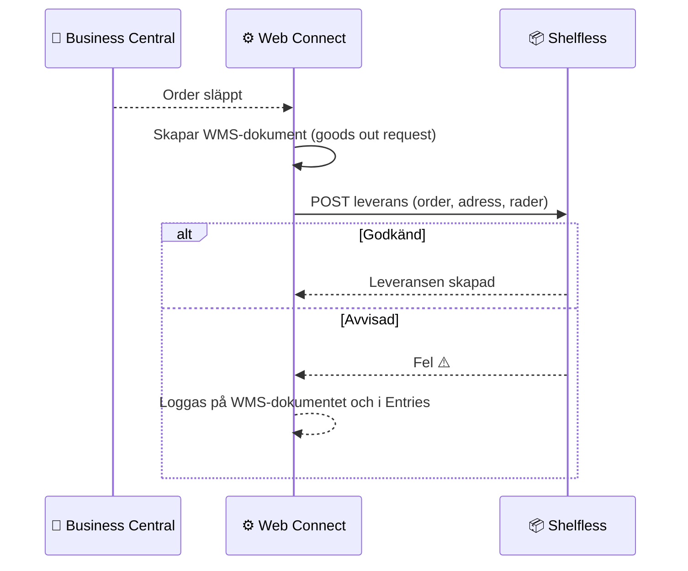

# Från Business Central till Shelfless: utgående leveranser

När en försäljningsorder eller en utgående flyttorder släpps i Business Central skickar Web Connect den till Shelfless, och en leverans skapas i lagret. Dokumentnumret i Business Central skickas som externt id, så att leveransen kan matchas tillbaka när Shelfless har skickat.

| | |
|---|---|
| **Riktning** | Business Central → Shelfless |
| **Startas av** | En försäljningsorder eller utgående flyttorder släpps i Business Central |
| **Resultat** | En leverans i Shelfless, och ett WMS-dokument i Business Central som följer den |
| **Del av** | [Business Central och Shelfless: integration](../overview.md) |

## Steg för steg

1. En försäljningsorder eller utgående flyttorder för Shelfless-lagerstället släpps i Business Central.
2. Web Connect skapar ett WMS-dokument av typen goods out request och fyller det från ordern, enligt dokumentmappningen i Logistics Setup.
3. Web Connect skickar leveransen till Shelfless (`POST api/v1/deliveries`) med adress, kontaktuppgifter för leveransaviseringar, fraktservice, utlämningsställe och rader.
4. Shelfless skapar leveransen och börjar plocka.

## Mappning av data

| Fält i Shelfless | Fält i Business Central | Kommentar |
|---|---|---|
| `orderNumber`, `externalId` | Dokumentnummer | Används för att matcha leveransen tillbaka |
| `deliveryAddress` | Leveransadressens namn, adress, postnummer, ort, län och land | |
| `deliveryNotificationDetails` | E-post och telefonnummer för leveransadressen | Används av Shelfless för leveransaviseringar |
| `freightServiceCode` | Speditörstjänstkod | |
| `pickupPointId` | Utlämningsställe på ordern | Bara när ordern har ett |
| `incoterms` | Leveransvillkorskod | |
| `orderType` | Ett fält på ordern | Mappas per införande |
| `currencyCode` | Orderns valutakod | Tomt skickas som lokal valuta |
| `languageCode` | Orderns språkkod | |
| `senderProfileId` | Konfigurerbart | Kan lämnas tomt så att Shelfless väljer profil |
| `deliveryRows.externalId` | Radnummer | Används för att matcha skickade rader |
| `deliveryRows.productNumber` | Artikelnummer, med variantkod efter ett skiljetecken | |
| `deliveryRows.productName` | Beskrivning | |
| `deliveryRows.quantity` | Antal | |
| `deliveryRows.itemPrice` | Konfigurerbart | Till exempel styckkostnad, eller radbelopp exklusive moms delat med antal |

## Objekt i Web Connect

| Objekt | Roll |
|---|---|
| `DL_DELIVERY` | Skapar leveransen i Shelfless |
| `DL_DELIVERYADDRESS` | Leveransadress |
| `DL_DELIVERYNOTIFICATIONDETAILS` | E-post och mobilnummer för aviseringar |
| `DL_PACKINGSLIPDETAILS` | Orderreferenser på följesedeln |
| `DL_DELIVERYROWS` | Orderrader |
| `DL_SALESHEADER` | Läser valuta och språk från försäljningshuvudet |

## Felhantering

| Situation | Vad som händer | Vad du gör |
|---|---|---|
| Shelfless avvisar leveransen | Felet visas på WMS-dokumentet och i Entries | Rätta ordern och [skicka om meddelandet](../../../../../how-to/web-connect/resend-outgoing-message.md) |
| Leveransen finns redan i Shelfless | Shelfless avvisar ett nytt försök att skapa den med samma ordernummer | Se [WMS-dokumentet visar "Request not sent"](../../../../../how-to/web-connect/wms-request-not-sent-error.md) |

## Vanliga frågor

### När skickas en order till Shelfless?

När försäljningsordern eller den utgående flyttordern släpps i Business Central. Order som inte släppts skickas inte.

### Vilket pris skickas på orderraderna?

Det är ett val i konfigurationen. Det kan vara styckkostnaden eller nettoförsäljningspriset per enhet exklusive moms, som Shelfless kan använda för tull.

## Relaterat

- [Business Central och Shelfless: integration](../overview.md)
- [Leveransbekräftelser](shipment-confirmation.md)
- [Logistics Setup](../../../general/logistics-setup.md) · [WMS Documents](../../../general/wms-documents.md)
