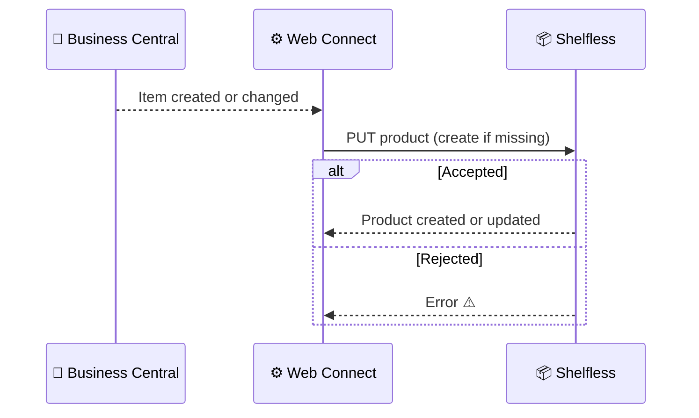

# Business Central to Shelfless: product data

When an item is created in Business Central, or its description, tariff number, country of origin or GTIN changes, Web Connect creates or updates the product in Shelfless. Barcode and customs data follow, so the warehouse can receive, pick and ship the item.

| | |
|---|---|
| **Direction** | Business Central → Shelfless |
| **Trigger** | Item created, or a tracked field changed, in Business Central |
| **Result** | The product exists in Shelfless with the item number as external ID |
| **Part of** | [Business Central and Shelfless integration](../overview.md) |

## Step by step

1. An item is created, or a tracked field changes.
2. An outgoing sync trigger in Web Connect picks up the change.
3. Web Connect sends the product to Shelfless (`PUT api/v1/products/{productNumber}`). The call creates the product if it does not exist.

## Data mapping

| Shelfless field | Business Central field | Note |
|---|---|---|
| `productNumber`, `externalId` | Item number | |
| `productName` | Description | |
| `category` | Item category code | |
| `barcodes` | GTIN | |
| `notPhysical` | Item type | Mapped with a value mapping |
| `customsInfo.description` | Description | |
| `customsInfo.price` | Unit price | |
| `customsInfo.countryOfOriginCode` | Country/region of origin code | |
| `customsInfo.harmonizedCodes` | Tariff number | The country the code applies to is set in the mapping |
| `customsInfo.currencyCode` | Local currency from General Ledger Setup | |
| `active` | Always true | |

## Web Connect objects

| Object | Role |
|---|---|
| `DL_PRODUCT` | Creates or updates the product |
| `DL_CUSTOMSINFO` | Customs data |
| `DL_HARMONIZEDCODES` | Tariff numbers |
| `DL_GENLEDGSETUP` | Reads the local currency |

## Error handling

| Situation | What happens | What to do |
|---|---|---|
| Shelfless rejects the product | The error is shown in Entries | Correct the item and [resend the message](../../../../../how-to/web-connect/resend-outgoing-message.md) |
| A change does not reach Shelfless | The changed field is not a trigger field | Add the field in [Outgoing Sync Triggers](../../../general/outgoing-mapping/outgoing-sync-triggers.md) |

## Frequently asked questions

### Which changes send the item to Shelfless again?

A new item, and changes to the description, tariff number, country of origin or GTIN. The fields that trigger an update are set in Outgoing Sync Triggers and can be changed.

## Related

- [Business Central and Shelfless integration](../overview.md)
- [Outgoing Sync Triggers](../../../general/outgoing-mapping/outgoing-sync-triggers.md)
