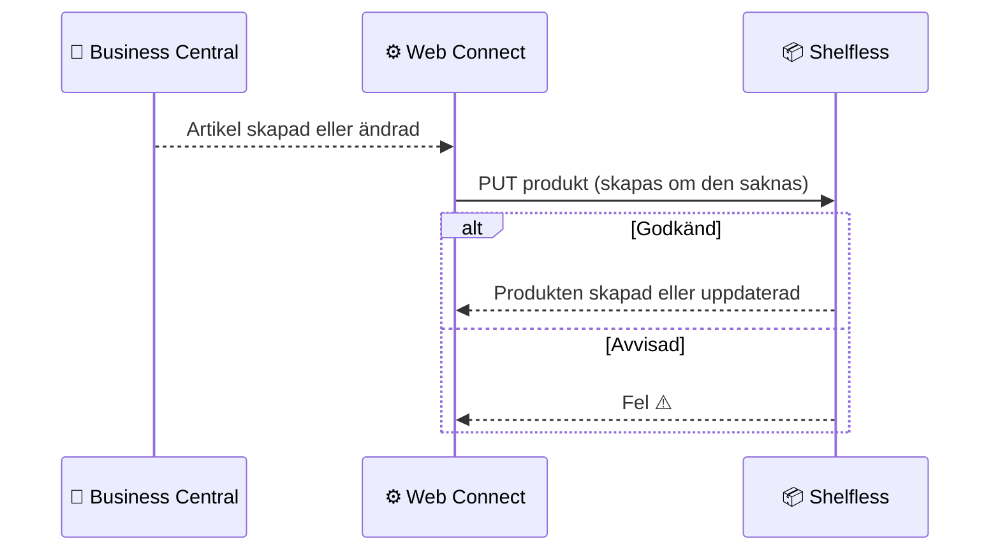

# Från Business Central till Shelfless: produktdata

När en artikel skapas i Business Central, eller när dess beskrivning, statistiska nummer, ursprungsland eller GTIN ändras, skapar eller uppdaterar Web Connect produkten i Shelfless. Streckkod och tulldata följer med, så att lagret kan ta emot, plocka och skicka artikeln.

| | |
|---|---|
| **Riktning** | Business Central → Shelfless |
| **Startas av** | En artikel skapas, eller ett bevakat fält ändras, i Business Central |
| **Resultat** | Produkten finns i Shelfless med artikelnumret som externt id |
| **Del av** | [Business Central och Shelfless: integration](../overview.md) |

## Steg för steg

1. En artikel skapas, eller ett bevakat fält ändras.
2. En utgående synktrigger i Web Connect fångar upp ändringen.
3. Web Connect skickar produkten till Shelfless (`PUT api/v1/products/{productNumber}`). Anropet skapar produkten om den inte finns.

## Mappning av data

| Fält i Shelfless | Fält i Business Central | Kommentar |
|---|---|---|
| `productNumber`, `externalId` | Artikelnummer | Med artikelvarianter blir varje variant en egen produkt, med variantkoden tillagd efter ett skiljetecken |
| `productName` | Beskrivning | |
| `category` | Artikelkategorikod | |
| `barcodes` | GTIN | |
| `notPhysical` | Artikeltyp | Mappas med en värdemappning |
| `customsInfo.description` | Beskrivning | |
| `customsInfo.price` | Enhetspris | |
| `customsInfo.countryOfOriginCode` | Kod för ursprungsland/region | |
| `customsInfo.harmonizedCodes` | Statistiskt nummer | Vilket land koden gäller ställs in i mappningen |
| `customsInfo.currencyCode` | Lokal valuta från General Ledger Setup | |
| `active` | Alltid true | |

## Objekt i Web Connect

| Objekt | Roll |
|---|---|
| `DL_PRODUCT` | Skapar eller uppdaterar produkten |
| `DL_CUSTOMSINFO` | Tulldata |
| `DL_HARMONIZEDCODES` | Statistiska nummer |
| `DL_GENLEDGSETUP` | Läser den lokala valutan |

## Felhantering

| Situation | Vad som händer | Vad du gör |
|---|---|---|
| Shelfless avvisar produkten | Felet visas i Entries | Rätta artikeln och [skicka om meddelandet](../../../../../how-to/web-connect/resend-outgoing-message.md) |
| En ändring når inte Shelfless | Det ändrade fältet är inget triggerfält | Lägg till fältet i [Outgoing Sync Triggers](../../../general/outgoing-mapping/outgoing-sync-triggers.md) |

## Vanliga frågor

### Vilka ändringar gör att artikeln skickas till Shelfless igen?

En ny artikel, och ändringar av beskrivning, statistiskt nummer, ursprungsland eller GTIN. Vilka fält som startar en uppdatering ställs in i Outgoing Sync Triggers och går att ändra.

## Relaterat

- [Business Central och Shelfless: integration](../overview.md)
- [Outgoing Sync Triggers](../../../general/outgoing-mapping/outgoing-sync-triggers.md)
