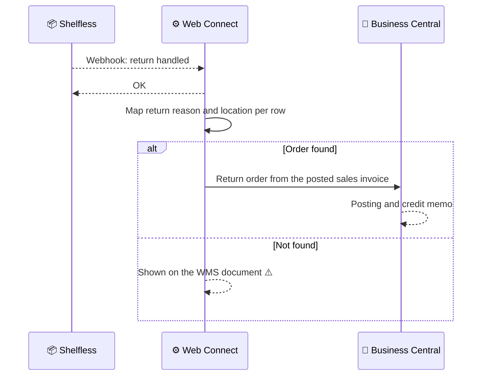

# Shelfless to Business Central: returns

When Shelfless has received and assessed a customer return, Shelfless sends a webhook to Web Connect. Web Connect creates a return order in Business Central from the posted sales invoice, with return reason and location per row, ready for posting and credit memo.

| | |
|---|---|
| **Direction** | Shelfless → Business Central |
| **Trigger** | Webhook from Shelfless when a return has been handled |
| **Result** | A return order in Business Central with reason and location per row |
| **Part of** | [Business Central and Shelfless integration](../overview.md) |

## Step by step

1. The customer registers the return, and Shelfless receives and assesses the goods.
2. Shelfless sends a webhook, received by an Azure endpoint that passes it on to Web Connect.
3. Web Connect creates a WMS document of the type return order. The Shelfless return reference is the key, so each partial return becomes its own return order.
4. Rows delivered back to the customer are left out.
5. Each Shelfless return reason is mapped to a Business Central return reason code, and each row status to a location, for example stock or scrap.
6. The return order is created in Business Central from the posted sales invoice, so prices come from Business Central.
7. Posting the return receipt, the credit memo and the refund are done in Business Central.

## Data mapping

| Shelfless field | Business Central field | Note |
|---|---|---|
| `RegistrationReferenceNumber` | WMS document number | One return order per registration |
| `DeliveryOrderNumber` | Original order number | |
| `DeliveryExternalId` | Document number of the original order | |
| `CreatedDate` | Date on the WMS document | |
| `Status` | Status on the WMS document | |
| `DeliveryReturnRows.ProductNumber` | Item number | |
| `DeliveryReturnRows.Quantity` | Quantity | |
| `DeliveryReturnRows.ReturnRowDeviationId` | Return reason code | Through WMS/Return Reason Codes |
| `DeliveryReturnRows.Status` | Location code | Through a value mapping |
| `DeliveryReturnRows.DeviationComment` | Text on the return order line | |

## Web Connect objects

| Object | Role |
|---|---|
| `DL_WEBHOOK_RETURN` | Receives the webhook and creates the WMS document |
| `DL_DELIVERYRETURNROWS` | Returned rows, except rows delivered back to the customer |

## Error handling

| Situation | What happens | What to do |
|---|---|---|
| A return reason is not mapped | The row cannot be given a return reason code | Add the reason in [WMS/Return Reason Codes](../../../general/wms-return-reason-codes.md) |
| The webhook cannot be delivered | Shelfless sends it again when the answer is not HTTP 200 | Check Entries when the connection is back |

## Frequently asked questions

### Where do the prices on the return order come from?

From the posted sales invoice in Business Central. Shelfless sends no prices.

### Can one order be returned several times?

Yes. Each return registration in Shelfless becomes its own return order in Business Central.

## Related

- [Business Central and Shelfless integration](../overview.md)
- [WMS/Return Reason Codes](../../../general/wms-return-reason-codes.md)
