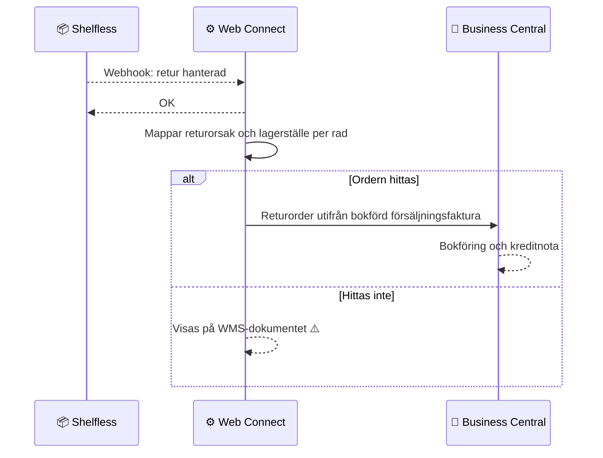

# Från Shelfless till Business Central: returer

När Shelfless har tagit emot och bedömt en kundretur skickar Shelfless en webhook till Web Connect. Web Connect skapar en returorder i Business Central utifrån den bokförda försäljningsfakturan, med returorsak och lagerställe per rad, klar för bokföring och kreditnota.

| | |
|---|---|
| **Riktning** | Shelfless → Business Central |
| **Startas av** | En webhook från Shelfless när en retur har hanterats |
| **Resultat** | En returorder i Business Central med orsak och lagerställe per rad |
| **Del av** | [Business Central och Shelfless: integration](../overview.md) |

## Steg för steg

1. Kunden registrerar returen, och Shelfless tar emot och bedömer varorna.
2. Shelfless skickar en webhook, som tas emot av en Azure-endpoint som skickar den vidare till Web Connect.
3. Web Connect skapar ett WMS-dokument av typen return order. Returreferensen från Shelfless är nyckeln, så varje delretur blir en egen returorder.
4. Rader som levererats tillbaka till kunden tas inte med.
5. Varje returorsak i Shelfless mappas till en returorsakskod i Business Central, och varje radstatus till ett lagerställe, till exempel lager eller kassation.
6. Returordern skapas i Business Central utifrån den bokförda försäljningsfakturan, så priserna kommer från Business Central.
7. Bokföring av returinleveransen, kreditnotan och återbetalningen görs i Business Central.

## Mappning av data

| Fält i Shelfless | Fält i Business Central | Kommentar |
|---|---|---|
| `RegistrationReferenceNumber` | WMS-dokumentets nummer | En returorder per registrering |
| `DeliveryOrderNumber` | Ursprungligt ordernummer | |
| `DeliveryExternalId` | Dokumentnummer på den ursprungliga ordern | |
| `CreatedDate` | Datum på WMS-dokumentet | |
| `Status` | Status på WMS-dokumentet | |
| `DeliveryReturnRows.ProductNumber` | Artikelnummer | |
| `DeliveryReturnRows.Quantity` | Antal | |
| `DeliveryReturnRows.ReturnRowDeviationId` | Returorsakskod | Via WMS/Return Reason Codes |
| `DeliveryReturnRows.Status` | Lagerställekod | Via en värdemappning |
| `DeliveryReturnRows.DeviationComment` | Text på returorderraden | |

## Objekt i Web Connect

| Objekt | Roll |
|---|---|
| `DL_WEBHOOK_RETURN` | Tar emot webhooken och skapar WMS-dokumentet |
| `DL_DELIVERYRETURNROWS` | Returnerade rader, utom rader som levererats tillbaka till kunden |

## Felhantering

| Situation | Vad som händer | Vad du gör |
|---|---|---|
| En returorsak är inte mappad | Raden kan inte få någon returorsakskod | Lägg till orsaken i [WMS/Return Reason Codes](../../../general/wms-return-reason-codes.md) |
| Webhooken kan inte levereras | Shelfless skickar den igen när svaret inte är HTTP 200 | Kontrollera Entries när kopplingen är tillbaka |

## Vanliga frågor

### Var kommer priserna på returordern ifrån?

Från den bokförda försäljningsfakturan i Business Central. Shelfless skickar inga priser.

### Kan samma order returneras flera gånger?

Ja. Varje returregistrering i Shelfless blir en egen returorder i Business Central.

## Relaterat

- [Business Central och Shelfless: integration](../overview.md)
- [WMS/Return Reason Codes](../../../general/wms-return-reason-codes.md)
