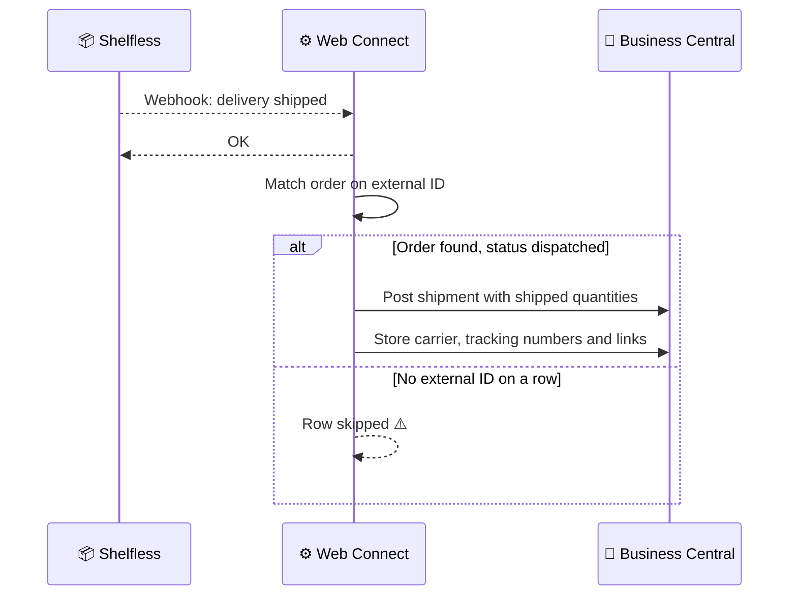

# Shelfless to Business Central: shipment confirmations

When Shelfless has shipped a delivery, Shelfless sends a webhook to Web Connect. Web Connect finds the order in Business Central through the external ID, posts the shipped quantities and stores the carrier, tracking numbers and tracking links.

| | |
|---|---|
| **Direction** | Shelfless → Business Central |
| **Trigger** | Webhook from Shelfless when a delivery is shipped. Shipped deliveries can also be fetched from the API |
| **Result** | A posted sales shipment or transfer shipment in Business Central, with tracking |
| **Part of** | [Business Central and Shelfless integration](../overview.md) |

## Step by step

1. Shelfless ships the delivery and sends a webhook. An Azure endpoint receives it and passes it on to Web Connect, which answers OK.
2. Web Connect creates incoming data from the webhook: a WMS document of the type shipping notice, its rows and its parcels.
3. The order is matched on the external ID that was sent with the order. If the delivery has no external ID, the order reference on the packing slip is used.
4. Rows without an external ID are skipped.
5. When the Shelfless status is dispatched, Web Connect posts the shipment with the shipped quantity per row.
6. Carrier, freight service, tracking number and tracking link are stored, and each parcel's tracking number is stored as a package line. Return labels are left out.

## Data mapping

| Shelfless field | Business Central field | Note |
|---|---|---|
| `ExternalId` | Document number | Used to find the order |
| `PackingSlipDetails.YourOrderNumber` | Document number | Used only when `ExternalId` is empty |
| `DeliveryId` | WMS document number | |
| `ShippedDate` | Shipped date on the WMS document | The posting date can be set to the work date |
| `Status` | Status on the WMS document | Posted when dispatched |
| `FreightServiceCode`, `CourierName` | Freight service and carrier | |
| `PickupPointId` | Pickup point | |
| `Shipments[].TrackingNumbers[].TrackingNumber` | Tracking number | The first on the shipment, all as package lines |
| `Shipments[].TrackingNumbers[].TrackingLink` | Tracking link | |
| `DeliveryRows.ExternalId` | Line number | Rows without it are skipped |
| `DeliveryRows.ProductNumber` | Item number | |
| `DeliveryRows.Quantity` | Quantity to ship | |

## Web Connect objects

| Object | Role |
|---|---|
| `DL_WEBHOOK_SHIPMENT` | Receives the webhook and creates the WMS document |
| `DL_SHPTM_DELROW` | Shipped rows |
| `DL_DLSHIPMENTS` | Parcels with carrier and freight service |
| `DL_SHPMNT_TRACKNBRS` | Tracking numbers per parcel, return labels excluded |
| `DL_GET_DELIVERIES` | Fetches shipped deliveries from the API (`shippedAfter`), for example to catch up |

## Error handling

| Situation | What happens | What to do |
|---|---|---|
| The delivery was created or copied in Shelfless | No external ID. The packing slip reference is used, and rows without an external ID are skipped | Create orders in Business Central. Check the WMS document |
| The webhook cannot be delivered | Shelfless sends it again when the answer is not HTTP 200 | Check Entries when the connection is back |
| The posting fails in Business Central | The error is shown on the WMS document | Correct the cause and process the document again |

## Frequently asked questions

### What happens with deliveries that have several parcels?

The tracking number and link of the first parcel are stored on the shipment, and every parcel's tracking number is stored as a package line. Return labels are not stored.

### Why was a shipment not posted?

Web Connect matches the webhook to the order through the external ID. A delivery created or copied in Shelfless has no external ID. Web Connect then uses the order reference on the packing slip, but rows without an external ID are skipped.

## Related

- [Business Central and Shelfless integration](../overview.md)
- [Outbound deliveries](outbound-delivery.md)
- [Webhooks](../../../general/webhooks.md) · [WMS Documents](../../../general/wms-documents.md)
