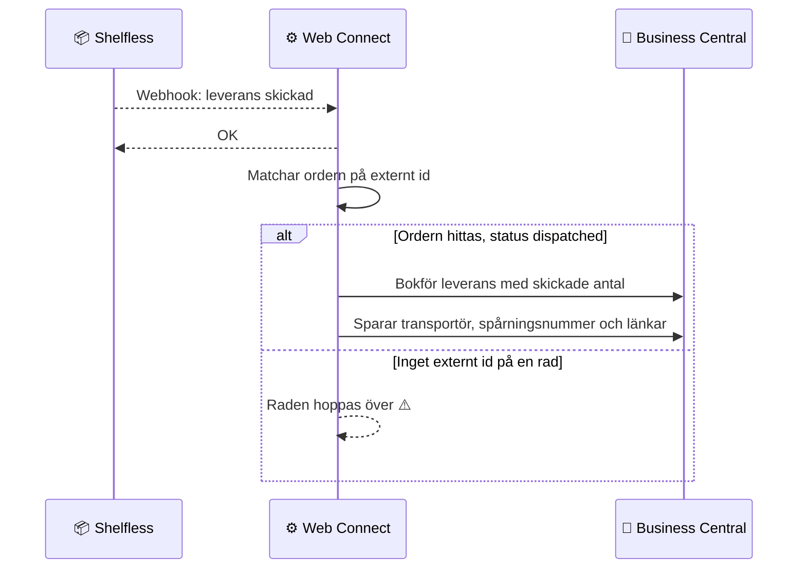

# Från Shelfless till Business Central: leveransbekräftelser

När Shelfless har skickat en leverans skickar Shelfless en webhook till Web Connect. Web Connect hittar ordern i Business Central via det externa id:t, bokför de skickade antalen och sparar transportör, spårningsnummer och spårningslänkar.

| | |
|---|---|
| **Riktning** | Shelfless → Business Central |
| **Startas av** | En webhook från Shelfless när en leverans skickas. Skickade leveranser kan också hämtas från API:t |
| **Resultat** | En bokförd försäljningsleverans eller flyttleverans i Business Central, med spårning |
| **Del av** | [Business Central och Shelfless: integration](../overview.md) |

## Steg för steg

1. Shelfless skickar leveransen och skickar en webhook. En Azure-endpoint tar emot den och skickar den vidare till Web Connect, som svarar OK.
2. Web Connect skapar inkommande data från webhooken: ett WMS-dokument av typen shipping notice, dess rader och dess kolli.
3. Ordern matchas på det externa id som skickades med ordern. Saknar leveransen externt id används orderreferensen på följesedeln.
4. Rader utan externt id hoppas över.
5. När statusen i Shelfless är dispatched bokför Web Connect leveransen med skickat antal per rad.
6. Transportör, fraktservice, spårningsnummer och spårningslänk sparas, och varje kollis spårningsnummer sparas som en paketrad. Returetiketter tas inte med.

## Mappning av data

| Fält i Shelfless | Fält i Business Central | Kommentar |
|---|---|---|
| `ExternalId` | Dokumentnummer | Används för att hitta ordern |
| `PackingSlipDetails.YourOrderNumber` | Dokumentnummer | Används bara när `ExternalId` är tomt |
| `DeliveryId` | WMS-dokumentets nummer | |
| `ShippedDate` | Skickat datum på WMS-dokumentet | Bokföringsdatumet kan sättas till arbetsdatumet |
| `Status` | Status på WMS-dokumentet | Bokförs vid dispatched |
| `FreightServiceCode`, `CourierName` | Fraktservice och transportör | |
| `PickupPointId` | Utlämningsställe | |
| `Shipments[].TrackingNumbers[].TrackingNumber` | Spårningsnummer | Det första på leveransen, alla som paketrader |
| `Shipments[].TrackingNumbers[].TrackingLink` | Spårningslänk | |
| `DeliveryRows.ExternalId` | Radnummer | Rader utan det hoppas över |
| `DeliveryRows.ProductNumber` | Artikelnummer | |
| `DeliveryRows.Quantity` | Antal att leverera | |

## Objekt i Web Connect

| Objekt | Roll |
|---|---|
| `DL_WEBHOOK_SHIPMENT` | Tar emot webhooken och skapar WMS-dokumentet |
| `DL_SHPTM_DELROW` | Skickade rader |
| `DL_DLSHIPMENTS` | Kolli med transportör och fraktservice |
| `DL_SHPMNT_TRACKNBRS` | Spårningsnummer per kolli, utan returetiketter |
| `DL_GET_DELIVERIES` | Hämtar skickade leveranser från API:t (`shippedAfter`), till exempel för att komma ikapp |

## Felhantering

| Situation | Vad som händer | Vad du gör |
|---|---|---|
| Leveransen skapades eller kopierades i Shelfless | Inget externt id. Referensen på följesedeln används, och rader utan externt id hoppas över | Skapa order i Business Central. Kontrollera WMS-dokumentet |
| Webhooken kan inte levereras | Shelfless skickar den igen när svaret inte är HTTP 200 | Kontrollera Entries när kopplingen är tillbaka |
| Bokföringen misslyckas i Business Central | Felet visas på WMS-dokumentet | Rätta orsaken och behandla dokumentet igen |

## Vanliga frågor

### Hur hanteras leveranser med flera kolli?

Spårningsnumret och länken för det första kollit sparas på leveransen, och varje kollis spårningsnummer sparas som en paketrad. Returetiketter sparas inte.

### Varför bokfördes inte en leverans?

Web Connect matchar webhooken mot ordern via det externa id:t. En leverans som skapats eller kopierats i Shelfless har inget externt id. Web Connect använder då orderreferensen på följesedeln, men rader utan externt id hoppas över.

## Relaterat

- [Business Central och Shelfless: integration](../overview.md)
- [Utgående leveranser](outbound-delivery.md)
- [Webhooks](../../../general/webhooks.md) · [WMS Documents](../../../general/wms-documents.md)
