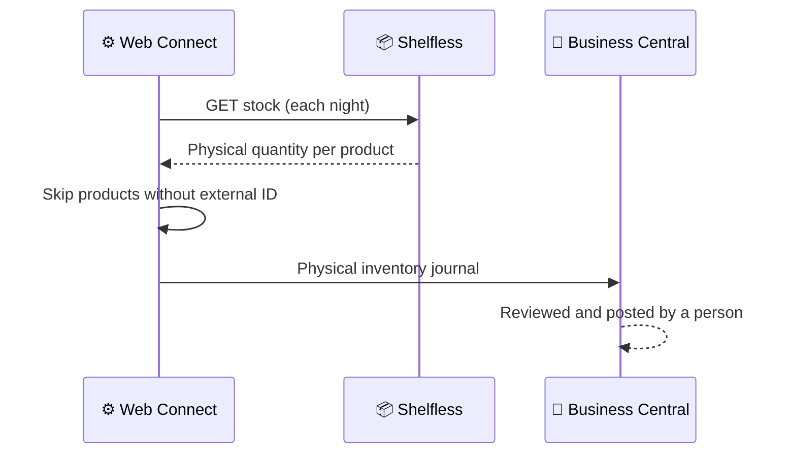

# Shelfless to Business Central: stock count

Once a night Web Connect fetches the physical stock of every product in Shelfless and writes it into a physical inventory journal in Business Central. The journal is not posted automatically, so differences are reviewed before they reach the books.

| | |
|---|---|
| **Direction** | Shelfless → Business Central |
| **Trigger** | Schedule in the Business Central job queue, once a night |
| **Result** | A physical inventory journal with the Shelfless stock per item |
| **Part of** | [Business Central and Shelfless integration](../overview.md) |

## Step by step

1. Shortly after midnight the job queue runs the download, and Web Connect fetches the stock from Shelfless (`GET api/v1/stock`).
2. Web Connect creates a WMS document of the type item balance with one row per product.
3. Products without an external ID, which were not created from Business Central, are left out.
4. The physical quantity per item is written into the physical inventory journal. Rows where both quantities are zero, or where there is no difference, can be removed.
5. A person reviews the differences and posts the journal.

## Data mapping

| Shelfless field | Business Central field | Note |
|---|---|---|
| `products.productNumber` | Item number | |
| `products.physicalQuantity` | Physical quantity in the journal | |
| `products.externalId` | Used as a filter | Products without it are left out |

## Web Connect objects

| Object | Role |
|---|---|
| `DL_STOCK` | Fetches the stock on a schedule |
| `DL_STOCK_PRODUCTS` | One row per product |

## Error handling

| Situation | What happens | What to do |
|---|---|---|
| The job queue has stopped | No journal is created | See [Integrations not running](../../../../../how-to/web-connect/integration-not-running.md) |
| A bundle or component created in Shelfless is missing | It has no external ID and is left out | Create the item in Business Central so it gets an external ID |

## Frequently asked questions

### Is the stock count posted automatically?

No. The physical inventory journal is created automatically, and a person reviews and posts it.

## Related

- [Business Central and Shelfless integration](../overview.md)
- [Logistics Setup](../../../general/logistics-setup.md)
