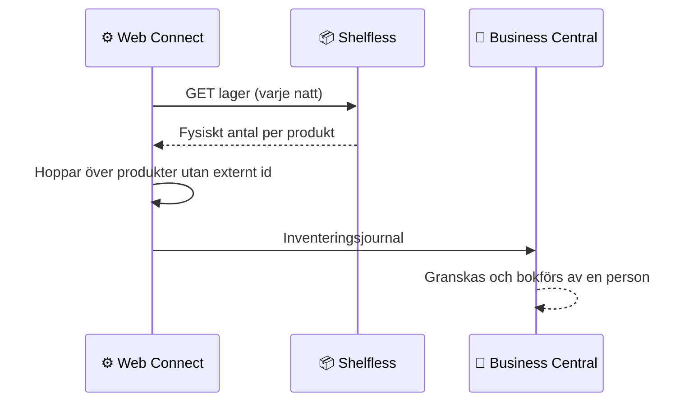

# Från Shelfless till Business Central: inventering

En gång per natt hämtar Web Connect det fysiska lagret för varje produkt i Shelfless och skriver in det i en inventeringsjournal i Business Central. Journalen bokförs inte automatiskt, så differenser granskas innan de når bokföringen.

| | |
|---|---|
| **Riktning** | Shelfless → Business Central |
| **Startas av** | Schema i jobbkön i Business Central, en gång per natt |
| **Resultat** | En inventeringsjournal med lagret i Shelfless per artikel |
| **Del av** | [Business Central och Shelfless: integration](../overview.md) |

## Steg för steg

1. Strax efter midnatt kör jobbkön hämtningen, och Web Connect hämtar lagret från Shelfless (`GET api/v1/stock`).
2. Web Connect skapar ett WMS-dokument av typen item balance med en rad per produkt.
3. Produkter utan externt id, som inte skapats från Business Central, tas inte med.
4. Det fysiska antalet per artikel skrivs in i inventeringsjournalen. Rader där båda antalen är noll, eller där det inte finns någon differens, kan tas bort.
5. En person granskar differenserna och bokför journalen.

## Mappning av data

| Fält i Shelfless | Fält i Business Central | Kommentar |
|---|---|---|
| `products.productNumber` | Artikelnummer | |
| `products.physicalQuantity` | Inventerat antal i journalen | |
| `products.externalId` | Används som filter | Produkter utan det tas inte med |

## Objekt i Web Connect

| Objekt | Roll |
|---|---|
| `DL_STOCK` | Hämtar lagret enligt schema |
| `DL_STOCK_PRODUCTS` | En rad per produkt |

## Felhantering

| Situation | Vad som händer | Vad du gör |
|---|---|---|
| Jobbkön har stannat | Ingen journal skapas | Se [Integrationerna körs inte](../../../../../how-to/web-connect/integration-not-running.md) |
| En paketartikel eller komponent som skapats i Shelfless saknas | Den har inget externt id och tas inte med | Skapa artikeln i Business Central så att den får ett externt id |

## Vanliga frågor

### Bokförs inventeringen automatiskt?

Nej. Inventeringsjournalen skapas automatiskt, och en person granskar och bokför den.

## Relaterat

- [Business Central och Shelfless: integration](../overview.md)
- [Logistics Setup](../../../general/logistics-setup.md)
