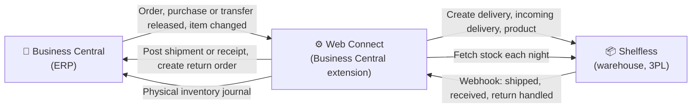
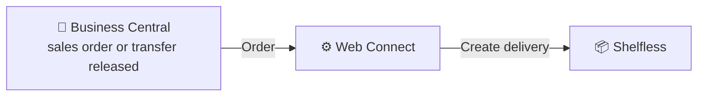
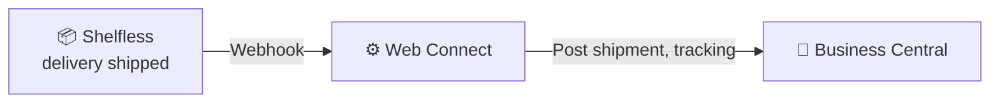
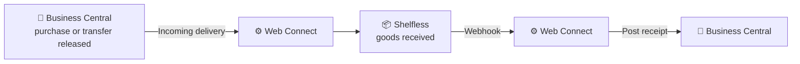
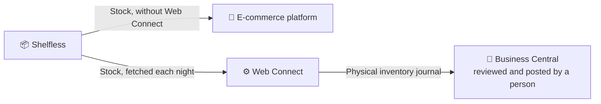
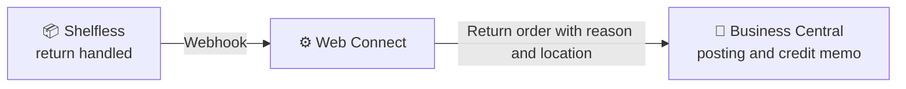
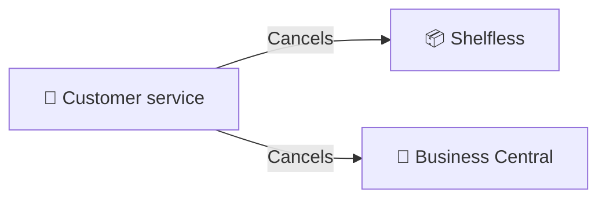

# Business Central and Shelfless integration

Web Connect by CombineIT connects Microsoft Dynamics 365 Business Central with Shelfless, the third party logistics (3PL) warehouse. Sales orders, purchase orders, transfers and products are sent to Shelfless, and shipments, goods receipts, returns and a nightly stock count come back to Business Central. All mappings and rules live in your own Business Central, where you can see and change them yourself.

## At a glance

| | |
|---|---|
| **System** | Shelfless (warehouse, 3PL) |
| **Integration product** | Web Connect for Microsoft Dynamics 365 Business Central |
| **Runs in** | Your own Business Central environment, as an extension. Orders, purchases and products are sent to Shelfless when they are released or changed. Shipments, receipts and returns are pushed by Shelfless as webhooks, received by an Azure endpoint that passes them on to Web Connect. The stock count is fetched on a schedule in the Business Central job queue. All processing and configuration stays in Business Central. |
| **Configured by** | You, in Business Central: mappings, conditions, triggers and flows. You can do all of it yourself. If you want, CombineIT takes part in any step, as a sounding board or by doing the work. |
| **Connection** | REST API with HTTP Basic Authentication, and webhooks from Shelfless |
| **Shelfless API** | [Shelfless DreamREST API](https://rest.dreamlogistics.se/swagger/index.html) |
| **Data flows** | 7: outbound deliveries, shipment confirmations, inbound deliveries, goods receipts, products, returns and stock count |
| **Business Central editions** | All editions, Essentials and Premium, including the latest version |
| **Available from** | [Web Connect on Microsoft AppSource](https://marketplace.microsoft.com/sv-se/product/PUBID.martitab1633951001710%7CAID.webconnect%7CPAPPID.9f3a7223-19db-4ac7-832f-cf8e4699186f?tab=Overview). The Shelfless integration is not part of the Web Connect Ready Integrations app. It is set up as a configuration in Web Connect |

## What can be synchronized

Web Connect has seven data flows between Business Central and Shelfless.

| Data | Direction | What happens |
|---|---|---|
| [Outbound deliveries](flows/outbound-delivery.md) | Business Central → Shelfless | A released sales order or outgoing transfer order is created as a delivery in Shelfless |
| [Shipment confirmations](flows/shipment-confirmation.md) | Shelfless → Business Central | When Shelfless has shipped, the shipment is posted in Business Central with tracking numbers |
| [Inbound deliveries](flows/inbound-delivery.md) | Business Central → Shelfless | A released purchase order or incoming transfer order is announced to Shelfless as an incoming delivery |
| [Goods receipts](flows/goods-receipt.md) | Shelfless → Business Central | When Shelfless has received the goods, the receipt is posted in Business Central with the received quantity |
| [Products](flows/product-data.md) | Business Central → Shelfless | New and changed items are created or updated in Shelfless, with barcode and customs data. Each item variant becomes its own product |
| [Returns](flows/returns.md) | Shelfless → Business Central | When Shelfless has handled a customer return, a return order is created in Business Central |
| [Stock count](flows/stock-reconciliation.md) | Shelfless → Business Central | Each night the stock in Shelfless is fetched into a physical inventory journal for review |

Outbound deliveries and shipment confirmations are the core of the integration. The other flows are chosen when the integration is set up. See [Choose your setup](#choose-your-setup).

## How it works

Web Connect sends a sales order, purchase order or transfer order to Shelfless when it is released in Business Central, and products when an item is created or a tracked field changes. Shelfless calls back with a webhook when a delivery has been shipped, an incoming delivery has been received or a return has been handled. Web Connect matches the webhook to the Business Central document through the external ID it sent, and posts the shipment or receipt or creates the return order. Once a night Web Connect fetches the stock from Shelfless and creates a physical inventory journal. Every message is logged in Web Connect Entries and as a [WMS document](../../general/wms-documents.md), where it can be inspected and resent.

## Choose your setup

Each flow has to fit how your business works: which system owns the data, where people do their work, and what the accounting needs. That is why the flows are decided together when a new integration is set up. The options below are the ones Web Connect customers use today.

Shelfless is used by one Web Connect customer today. No option is therefore marked **common setup**, because there is nothing to compare with. The options describe how that integration works.

### Outbound deliveries

| Option | How it works | When it fits |
|---|---|---|
| **Sent when the order is released** | Sales orders and outgoing transfer orders are sent to Shelfless when they are released in Business Central | Orders are handled in Business Central, for example after they are imported from the e-commerce platform |

#### Outbound deliveries sent when the order is released

### Shipments

| Option | How it works | When it fits |
|---|---|---|
| **Webhook from Shelfless** | Shelfless pushes each shipped delivery. Web Connect posts the shipment and stores the tracking numbers. Shipped deliveries can also be fetched from the API, for example to catch up after an interruption | Always, when outbound deliveries are used |

#### Shipments by webhook from Shelfless

### Purchases and receipts

| Option | How it works | When it fits |
|---|---|---|
| **Announced from Business Central, received by webhook** | Purchase orders and incoming transfer orders are announced when released. Shelfless pushes the receipt when the goods are received, and Web Connect posts it | Purchasing is done in Business Central |

#### Purchases announced from Business Central and received by webhook

### Stock

| Option | How it works | When it fits |
|---|---|---|
| **Directly between Shelfless and the e-commerce platform, counted into Business Central each night** | Shelfless sends stock to the e-commerce platform without Business Central. Web Connect fetches the stock from Shelfless each night and creates a physical inventory journal that someone reviews and posts | Shelfless already has a connection to the e-commerce platform, and stock differences must be checked before they are posted |

#### Stock directly between Shelfless and the e-commerce platform, counted into Business Central each night

### Returns

| Option | How it works | When it fits |
|---|---|---|
| **Return order created from the webhook** | When Shelfless has handled a return, Web Connect creates a return order in Business Central from the posted sales invoice, with return reason and location per row. Posting, credit memo and refund are done in Business Central | Customer returns are received by Shelfless |

#### Returns created from the webhook

### Cancellations

| Option | How it works | When it fits |
|---|---|---|
| **Manually in each system** | An order that has been sent to Shelfless is cancelled in Shelfless and in Business Central by hand. Web Connect sends no cancellation to Shelfless | This is the only option in use today |

#### Cancellation manually in each system

Picking, packing, carrier booking and the stock locations inside the warehouse are always handled in Shelfless.

## What you need

- Microsoft Dynamics 365 Business Central, any edition (Essentials or Premium), including the latest version
- Web Connect installed from Microsoft AppSource, with an activated Web Connect license
- Your approval for Web Connect to be installed and to act in your Business Central environment
- An API user (username and password) for the Shelfless DreamREST API. Shelfless decides how the API user is issued, so ask Shelfless for one
- Webhooks set up in Shelfless for shipped deliveries, received incoming deliveries and handled returns, pointing to the Web Connect endpoint. Shelfless registers the webhooks
- A location in Business Central for the stock at Shelfless

## Setting it up

1. Decide which flows to use and which option to choose for each, see [Choose your setup](#choose-your-setup).
2. Install Web Connect in Business Central, activate the license and give your approval. The Shelfless integration is not part of the Ready Integrations app, so it is set up as a configuration in Web Connect.
3. Store the Shelfless API user in Web Connect [Secret Value Storage](../../general/secret-value-storage.md) and set up a test site and a production site.
4. Set up [Logistics Setup](../../general/logistics-setup.md) for Shelfless: location, which documents to integrate, posting and journals.
5. Set up the configuration choices below.
6. Test orders, purchases, returns and the stock count against Shelfless before going live.

## Configure it yourself in Business Central

All configuration and logic in the integration is visible and editable in Business Central. There is no external integration platform where the logic is hidden. The Azure endpoint that receives webhooks only passes the call on to Web Connect.

| What you can change | Where in Web Connect | Example |
|---|---|---|
| Which documents go to Shelfless | [Logistics Setup](../../general/logistics-setup.md) | Send sales orders, purchase orders and transfer orders when they are released |
| Posting of shipments and receipts | [Logistics Setup](../../general/logistics-setup.md) | Post the shipment when Shelfless reports the delivery as dispatched, with the work date as posting date |
| Field mapping on outgoing documents | [Outgoing Mapping](../../general/outgoing-mapping/README.md) and [Dynamic Flow Fields](../../general/dynamic-flow-fields.md) | Send the net price per unit excluding VAT as item price on the order rows |
| Field mapping on incoming webhooks | [Incoming Data mapping](../../general/incoming-data/mapping.md) | Store the tracking number and tracking link on the shipment |
| What triggers product updates | [Outgoing Sync Triggers](../../general/outgoing-mapping/outgoing-sync-triggers.md) | Send the item when the description, tariff number, country of origin or GTIN changes |
| Which rows are processed | [Condition List](../../general/condition-list.md) | Skip rows without an external ID, or return rows delivered back to the customer |
| Return reasons and locations | [WMS/Return Reason Codes](../../general/wms-return-reason-codes.md) | Map each Shelfless return reason to a Business Central return reason code |
| Monitoring and resending | [Entries](../../general/entries.md) and [WMS Documents](../../general/wms-documents.md) | See every order and webhook, and [resend a message](../../../../how-to/web-connect/resend-outgoing-message.md) |

## Configuration choices

- **Documents to integrate:** sales orders, outgoing and incoming transfer orders and purchase orders can each be turned on or off.
- **When to send:** documents are sent to Shelfless when they are released.
- **Posting:** whether shipments and receipts are posted automatically, which Shelfless status counts as shipped, and whether the posting date is the work date.
- **Over receipt:** whether Shelfless may report more than ordered on a purchase, and with which tolerance.
- **Item price on order rows:** which value is sent as item price, for example unit cost or the net sales price per unit excluding VAT, which Shelfless can use for customs.
- **Product number:** the item number, with the variant code added after a delimiter when variants are used. Each item variant becomes its own product in Shelfless.
- **Sender profile and freight service:** which freight service code and sender profile are sent. The sender profile can be left empty so Shelfless chooses it from the country and the type of customer.
- **Return reasons and locations:** which Business Central return reason code and location each Shelfless return reason and row status maps to.
- **Stock count:** which journal the count is written to, and whether rows without a difference are removed.
- **Error e-mail:** a daily summary of errors can be sent to a list of recipients.

## Limitations

- **Cancellations are not sent to Shelfless.** An order that has been sent has to be cancelled in Shelfless by hand.
- **Orders created or copied in Shelfless have no external ID.** Web Connect can fall back to the order reference on the packing slip, but rows without an external ID are skipped. Create orders in Business Central, not in Shelfless.
- **Products created only in Shelfless are not counted.** The stock count only includes products that came from Business Central.
- **The stock count is not posted automatically.** The physical inventory journal must be reviewed and posted by a person.
- **Return orders are not sent to Shelfless.** Returns are registered in Shelfless, and the return order is created in Business Central afterwards.

## Frequently asked questions

### Can Business Central be integrated with Shelfless?

Yes. Web Connect connects Business Central with Shelfless through the Shelfless DreamREST API. Sales orders, outgoing transfers, purchase orders, incoming transfers and products are sent to Shelfless, and shipments, goods receipts, returns and a nightly stock count come back to Business Central.

### Why was a shipment from Shelfless not posted in Business Central?

Web Connect finds the Business Central order through the external ID that was sent with the order. A delivery created or copied in Shelfless has no such ID. Web Connect can then fall back to the order reference on the packing slip, but rows without an external ID are skipped. Check the shipment in Web Connect Entries and the WMS document.

### Are stock differences from Shelfless posted automatically?

No. Each night Web Connect fetches the stock in Shelfless and creates a physical inventory journal in Business Central. Someone reviews and posts the journal, so differences are never posted without a check.

### Can we cancel an order in Business Central after it has been sent to Shelfless?

Not through the integration today. The cancellation has to be made in Shelfless as well. A cancellation request from Business Central to Shelfless is not part of the standard setup.

### Does stock go through Business Central to the web shop?

It does not have to. Shelfless can send stock directly to the e-commerce platform. Business Central then gets the nightly stock count from Shelfless, so its own stock stays correct.

## Related

- Flows: [Outbound deliveries](flows/outbound-delivery.md) · [Shipment confirmations](flows/shipment-confirmation.md) · [Inbound deliveries](flows/inbound-delivery.md) · [Goods receipts](flows/goods-receipt.md) · [Product data](flows/product-data.md) · [Returns](flows/returns.md) · [Stock count](flows/stock-reconciliation.md)
- How-to: [Resend an outgoing message](../../../../how-to/web-connect/resend-outgoing-message.md) · [WMS document shows "Request not sent"](../../../../how-to/web-connect/wms-request-not-sent-error.md) · [Nothing downloads to Business Central](../../../../how-to/web-connect/nothing-downloads-to-business-central.md)
- [Web Connect general documentation](../../general/README.md)
- [Shelfless DreamREST API documentation](https://rest.dreamlogistics.se/swagger/index.html)

## About Web Connect

Web Connect is an integration platform for Microsoft Dynamics 365 Business Central, developed by CombineIT. It is installed in your own Business Central and connects it with e-commerce platforms, warehouse systems, POS, returns, marketplaces and EDI. Every flow, mapping and rule is configured in Business Central, where you can see and change it yourself, without custom code for each integration. [Web Connect on Microsoft AppSource](https://marketplace.microsoft.com/sv-se/product/PUBID.martitab1633951001710%7CAID.webconnect%7CPAPPID.9f3a7223-19db-4ac7-832f-cf8e4699186f?tab=Overview) · [Contact CombineIT](https://www.combineit.se/contact/)
